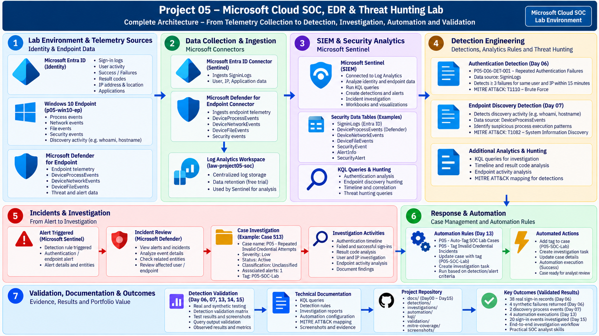

# Project 05 — Microsoft Cloud SOC, EDR & Threat Hunting Lab

**A hands-on Security Operations Center (SOC) project using Microsoft Sentinel, Microsoft Defender for Endpoint, Microsoft Entra ID, KQL, detection engineering, threat hunting, and security automation.**


## Project Overview

This project demonstrates the practical workflow of a cloud-focused Security Operations Center, from security telemetry analysis and detection development to incident investigation, automation, and validation.

The laboratory uses Microsoft's security ecosystem to investigate identity authentication events, analyze endpoint activity, develop Kusto Query Language (KQL) queries, validate detection logic, investigate security cases, and document investigation findings.

The project follows an evidence-driven SOC workflow, with technical documentation, KQL queries, investigation reports, validation records, automation evidence, and screenshots maintained in the repository.

**Project focus:** Cloud Security Operations | SIEM | EDR | Identity Security | Detection Engineering | Threat Hunting | Incident Investigation

**Target roles:** SOC Analyst L1 | Junior Security Analyst | Cybersecurity Analyst | Blue Team Analyst

---

## Complete Project Architecture



The architecture illustrates the major components of the laboratory, including identity and endpoint telemetry, data collection, security analytics, detection engineering, investigation, automation, and validation.

### Architecture Documentation

| Diagram                                                                                                 | Purpose                                                   |
| ------------------------------------------------------------------------------------------------------- | --------------------------------------------------------- |
| [Day 01 — Initial SOC Architecture](architecture/Project05-SOC-Architecture-Day01.png)                  | Initial laboratory architecture and environment           |
| [Day 15 — Investigation and Automation Architecture](architecture/Project05-SOC-Architecture-Day15.png) | Authentication investigation and case-management workflow |
| [Complete Project Architecture](architecture/Project05-SOC-Complete-Architecture.png)                   | Project-wide view of the SOC workflow                     |

---

## Technology Stack

| Technology                      | Application in the Project                                        |
| ------------------------------- | ----------------------------------------------------------------- |
| Microsoft Sentinel              | SIEM investigation and security analytics                         |
| Microsoft Defender for Endpoint | Endpoint security telemetry and investigation                     |
| Microsoft Entra ID              | Identity and authentication analysis                              |
| Azure Log Analytics             | Security data storage and KQL analysis                            |
| Kusto Query Language (KQL)      | Event filtering, aggregation, investigation, and hunting          |
| Windows 10                      | Laboratory endpoint and process activity                          |
| PowerShell and Windows commands | Controlled endpoint activity                                      |
| MITRE ATT&CK                    | Mapping security use cases to adversary techniques                |
| Git and GitHub                  | Version control, evidence management, and technical documentation |
| Visual Studio Code              | KQL development and project documentation                         |
| VMware Workstation              | Local laboratory virtualization                                   |

---

## Key Project Outcomes

The following results are drawn from documented laboratory tests and investigations.

| Activity                                | Quantitative Outcome                                                               | Security Operations Value                                         |
| --------------------------------------- | ---------------------------------------------------------------------------------- | ----------------------------------------------------------------- |
| Authentication baseline analysis        | **38 sign-in records** reviewed                                                    | Established an observed authentication baseline                   |
| Authentication baseline breakdown       | **35 successful and 3 failed sign-ins**                                            | Examined authentication outcomes                                  |
| Synthetic authentication detection test | **4 controlled failures** grouped into one query result                            | Validated the repeated-failure query logic                        |
| Endpoint discovery investigation        | **2 matching process events** returned                                             | Examined telemetry generated by controlled discovery activity     |
| Day 13 automation validation            | Successful execution records documented for case-tagging rules                     | Verified recorded automation executions                           |
| Day 15 authentication investigation     | **20 sign-in events** analyzed                                                     | Investigated authentication activity across a defined time window |
| Day 15 event breakdown                  | **6 failures, 11 successes, and 3 other outcomes**                                 | Analyzed authentication results and event chronology              |
| Case-management workflow                | Case details, tagging, and investigation-task creation checked                     | Practiced SOC case-management procedures                          |
| Technical documentation                 | Daily notes, KQL files, investigation reports, validation records, and screenshots | Created reproducible technical evidence for portfolio review      |

### What These Results Demonstrate

* Practical investigation of identity and authentication telemetry.
* Query-based validation of repeated authentication-failure logic.
* Analysis of Windows endpoint process events.
* Examination of authentication timelines and result codes.
* Validation of recorded security automation executions.
* Documentation of investigation evidence and case-management activities.

The synthetic authentication test validates query behavior against controlled test data; it is not evidence of a real-world attack. Authentication failures are treated as investigation signals rather than automatic proof of compromise.

---

## Project Implementation and Deliverables

### 1. Cloud SOC Environment

Established the Microsoft security laboratory and documented the core environment, including the Log Analytics workspace, Microsoft Sentinel, identity telemetry, and Windows endpoint.

**Key deliverables:**

* Laboratory configuration documentation.
* Initial architecture diagram.
* Environment preparation records.
* Endpoint onboarding and telemetry documentation.

Documentation: [`docs/`](docs/)

### 2. Identity and Authentication Investigation

Investigated Microsoft Entra ID sign-in activity using authentication fields, timestamps, account information, application context, source IP addresses, and authentication outcomes.

**Investigation activities:**

* Reviewing successful and failed sign-ins.
* Filtering events by user and source IP.
* Analyzing authentication result codes.
* Examining event chronology.
* Identifying patterns that warrant additional investigation.
* Documenting findings using KQL and screenshots.

Key query: [`kql/authentication/day15-end-to-end-investigation.kql`](kql/authentication/day15-end-to-end-investigation.kql)

Investigation report: [`investigations/day15-authentication-incident-investigation.md`](investigations/day15-authentication-incident-investigation.md)

### 3. Detection Engineering

Developed and validated query logic for repeated authentication failures and examined endpoint discovery activity.

#### Authentication Detection

**Detection ID:** `P05-D06-DET-001`

**Detection name:** Repeated Authentication Failures

The query groups failed authentication events by user and source IP within a 15-minute time bucket, using a threshold of three or more failures.

The validation process included:

* Reviewing observed authentication data.
* Testing query behavior against controlled synthetic events.
* Examining the grouped output.
* Recording the validation result.

Detection documentation: [`detections/day06-repeated-authentication-failures.md`](detections/day06-repeated-authentication-failures.md)

Validation evidence: [`validation/day06-repeated-authentication-failures-validation.md`](validation/day06-repeated-authentication-failures-validation.md)

#### Endpoint Discovery Investigation

Investigated process activity associated with controlled discovery commands, including `whoami` and `hostname`.

The investigation examined matching process events and documented the results.

Validation evidence: [`validation/day07-repeated-discovery-validation.md`](validation/day07-repeated-discovery-validation.md)

### 4. KQL-Based Threat Hunting and Investigation

Used KQL to filter, aggregate, and examine security telemetry for authentication and endpoint investigations.

Investigation techniques included:

* Time-based filtering.
* User and IP-based grouping.
* Authentication outcome analysis.
* Process event filtering.
* Process command-line examination.
* Timeline analysis.
* Investigation of repeated activity.
* Review of query output against the investigation hypothesis.

Query directories:

* [`kql/authentication/`](kql/authentication/)
* [`kql/endpoint/`](kql/endpoint/)
* [`kql/correlation/`](kql/correlation/)
* [`kql/hunting/`](kql/hunting/)

### 5. Incident Investigation and Case Management

Performed an end-to-end authentication investigation using available sign-in telemetry and case-management evidence.

The Day 15 workflow included:

1. Establishing the authentication event baseline.
2. Reviewing failed and successful sign-ins.
3. Examining source IP and authentication result codes.
4. Reviewing event chronology.
5. Inspecting the relevant security case and associated alert details.
6. Verifying case tags and investigation-task creation.
7. Recording findings and supporting evidence.

The documented investigation included a Defender case named **`P05 - Repeated Invalid Credential Attempts`**, with the associated case details recorded in the investigation artifacts.

The analysis focused on evidence-based investigation rather than assuming that authentication failures represented a confirmed attack.

**Key artifacts:**

* [Authentication investigation detection](detections/day15-authentication-investigation.md)
* [Authentication incident investigation report](investigations/day15-authentication-incident-investigation.md)
* [End-to-end investigation validation](validation/day15-end-to-end-investigation-validation.md)

### 6. Security Automation

Configured and validated case-management automation rules for laboratory security cases.

Documented activities included:

* Reviewing automation rule configuration.
* Examining recorded execution results.
* Applying the `P05-SOC-Lab` case tag.
* Creating an investigation task.
* Verifying case details after automation execution.

**Key artifacts:**

* [Day 13 automation rules](automation/day13-automation-rules.md)
* [Day 13 automation validation](validation/day13-automation-validation.md)
* [Day 15 investigation automation validation](automation/day15-investigation-automation-validation.md)

### 7. Detection Validation and Evidence Management

Consolidated validation results across authentication investigation, endpoint discovery, automation, and end-to-end investigation activities.

The validation approach records:

* Test objectives and query logic.
* Observed results.
* Supporting screenshots.
* Detection and investigation evidence.
* Technical findings.
* Validation status.

**Key artifact:** [Day 14 Detection Validation Matrix](validation/day14-detection-validation-matrix.md)

---

## MITRE ATT&CK Mapping

MITRE ATT&CK provides a framework for organizing the adversary behaviors examined during the project.

| Technique ID                                        | Technique                    | Project Application                                      |
| --------------------------------------------------- | ---------------------------- | -------------------------------------------------------- |
| [T1110](https://attack.mitre.org/techniques/T1110/) | Brute Force                  | Authentication-failure investigation and detection logic |
| [T1082](https://attack.mitre.org/techniques/T1082/) | System Information Discovery | Controlled endpoint discovery activity                   |

These mappings describe the behaviors investigated in the laboratory and the related detection use cases.

MITRE ATT&CK documentation: [`mitre-coverage/`](mitre-coverage/)

---

## End-to-End SOC Investigation Workflow

The project brings together the following analyst workflow:

```text
Security Telemetry
        |
        v
Data Collection and Availability
        |
        v
KQL Investigation and Analysis
        |
        v
Detection Logic and Validation
        |
        v
Alert and Case Review
        |
        v
Evidence Collection and Timeline Analysis
        |
        v
Case Tagging and Investigation Tasks
        |
        v
Validation and Technical Documentation
```

This workflow demonstrates how an analyst can move from examining security events to recording findings and validating investigation procedures.

---

## Repository Structure

```text
Project-05-Microsoft-Cloud-SOC/
│
├── architecture/
│   ├── Project05-SOC-Architecture-Day01.png
│   ├── Project05-SOC-Architecture-Day15.png
│   └── Project05-SOC-Complete-Architecture.png
│
├── attacks/
│
├── automation/
│   ├── day13-automation-rules.md
│   └── day15-investigation-automation-validation.md
│
├── detections/
│   ├── day06-repeated-authentication-failures.md
│   └── day15-authentication-investigation.md
│
├── docs/
│   ├── Day00.md
│   ├── Day01.md
│   ├── ...
│   ├── Day13.md
│   └── Day15.md
│
├── hunting/
│
├── investigations/
│   ├── day11-endpoint-incident-investigation.md
│   └── day15-authentication-incident-investigation.md
│
├── kql/
│   ├── authentication/
│   ├── endpoint/
│   ├── correlation/
│   └── hunting/
│
├── mitre-coverage/
│
├── screenshots/
│   └── Day15/
│
├── validation/
│   ├── day06-repeated-authentication-failures-validation.md
│   ├── day07-repeated-discovery-validation.md
│   ├── day13-automation-validation.md
│   ├── day14-detection-validation-matrix.md
│   └── day15-end-to-end-investigation-validation.md
│
└── README.md
```

Browse the folders for the complete set of daily documentation, query files, screenshots, validation records, and supporting evidence.

---

## Skills Demonstrated

### Security Operations

* Security event investigation.
* Authentication and identity analysis.
* Endpoint telemetry review.
* Incident and case investigation.
* Evidence collection and reporting.

### SIEM and KQL

* KQL filtering and aggregation.
* Time-based event analysis.
* Authentication investigation.
* Process-event analysis.
* Query-based hunting and validation.

### Detection Engineering

* Detection hypothesis development.
* Repeated authentication-failure logic.
* Controlled query testing.
* Detection validation documentation.
* MITRE ATT&CK mapping.

### Microsoft Security

* Microsoft Sentinel concepts and investigation workflows.
* Microsoft Defender for Endpoint telemetry.
* Microsoft Entra ID sign-in analysis.
* Log Analytics and security data investigation.
* Security case-management automation.

### Professional SOC Practices

* Evidence-driven analysis.
* Timeline construction.
* Investigation documentation.
* Validation record maintenance.
* Technical reporting and GitHub portfolio management.

---

## Project Documentation and Evidence

| Resource                                 | Description                                                |
| ---------------------------------------- | ---------------------------------------------------------- |
| [Daily Documentation](docs/)             | Implementation notes and project activities                |
| [KQL Queries](kql/)                      | Authentication, endpoint, correlation, and hunting queries |
| [Detection Content](detections/)         | Documented detection use cases                             |
| [Investigation Reports](investigations/) | Case investigation findings                                |
| [Automation Artifacts](automation/)      | Automation rules and validation records                    |
| [Validation Records](validation/)        | Test results and validation matrix                         |
| [Architecture Diagrams](architecture/)   | Initial, Day 15, and complete project architecture         |
| [Screenshots](screenshots/)              | Visual evidence of laboratory activities                   |
| [MITRE ATT&CK Mapping](mitre-coverage/)  | Technique mapping documentation                            |

---

## About the Author

**Ananthan D**

Aspiring SOC Analyst | Cybersecurity | Blue Team

**Core areas of focus:** Microsoft Sentinel · Microsoft Defender for Endpoint · Microsoft Entra ID · KQL · SIEM · EDR · Threat Hunting · Detection Engineering · Incident Investigation

GitHub: [@ananthancyber](https://github.com/ananthancyber)

---

## Disclaimer

This repository documents a personal cybersecurity laboratory created for defensive security learning, investigation practice, detection engineering, and professional portfolio development. Activities are intended for authorized laboratory environments.
