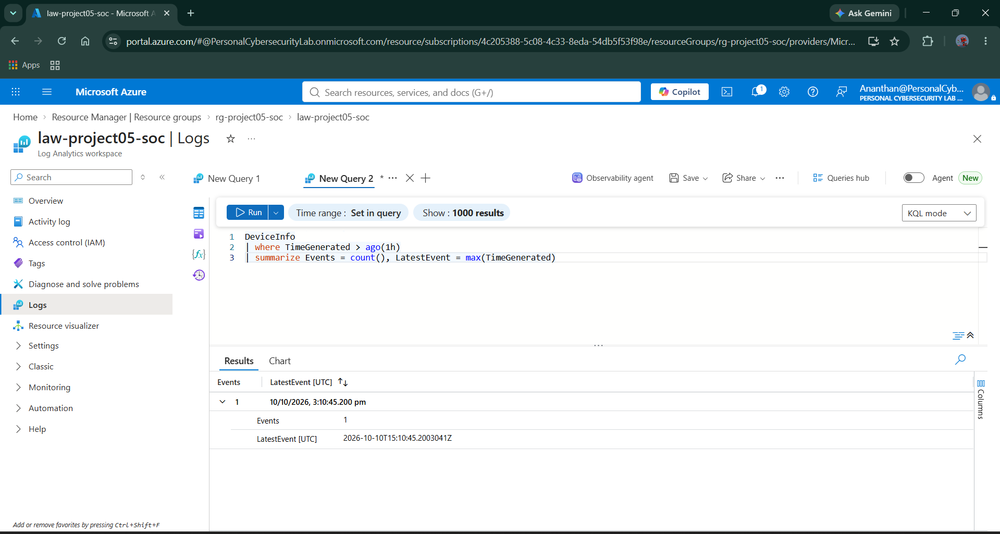
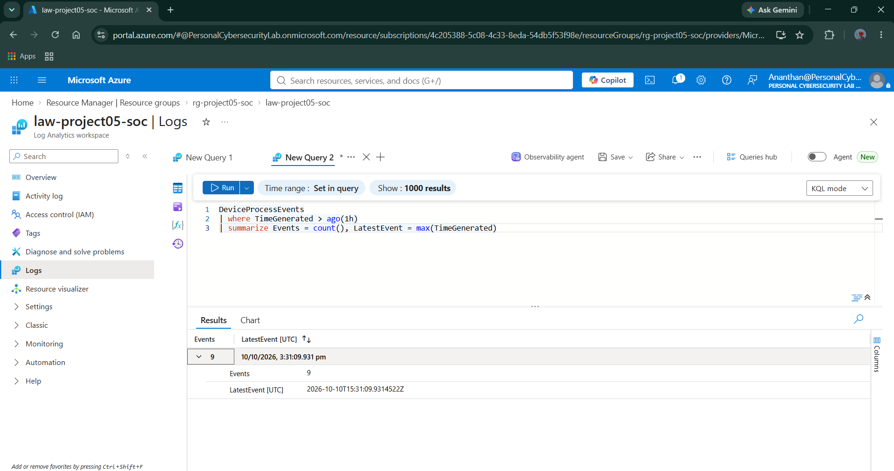
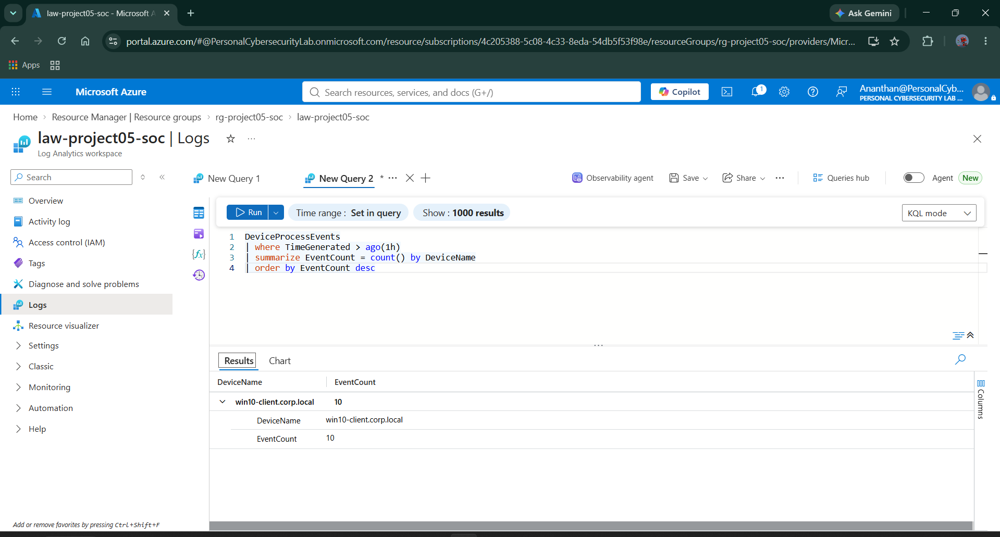
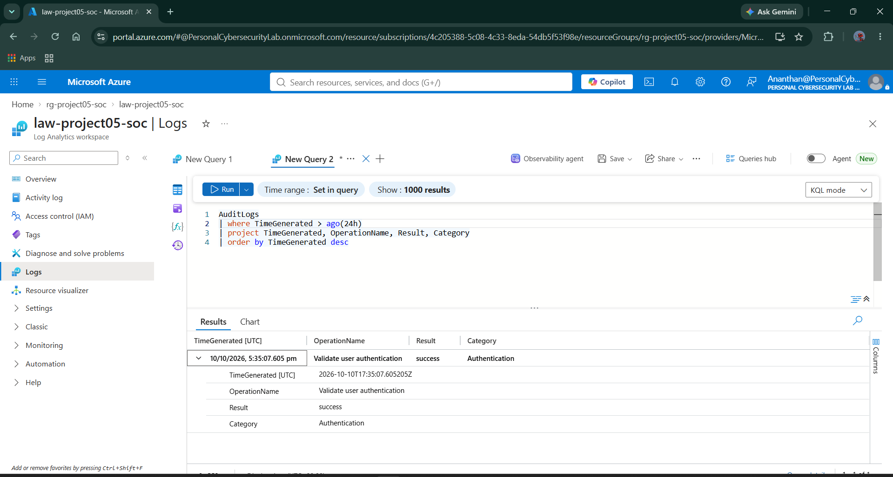
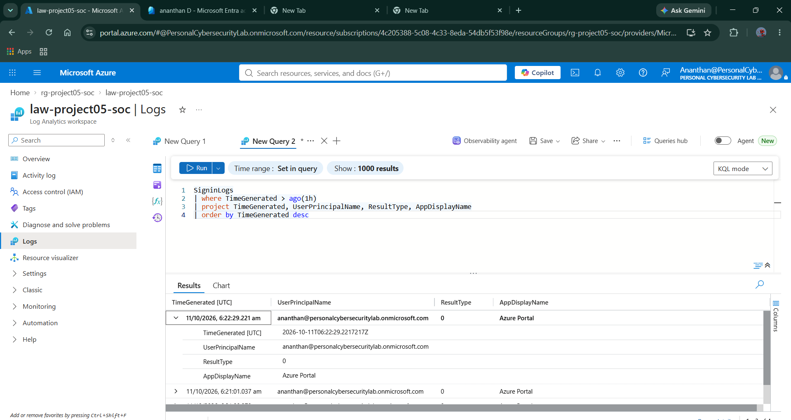
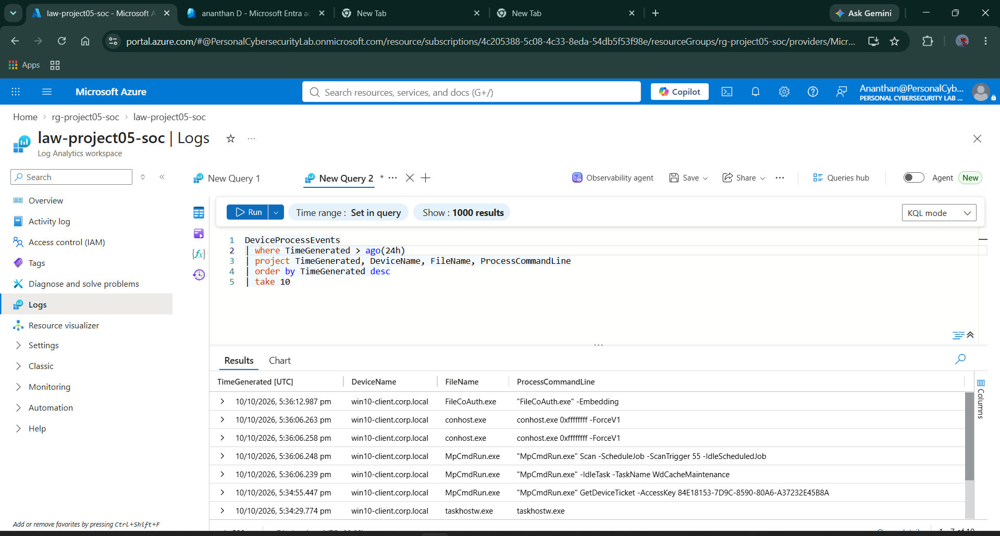
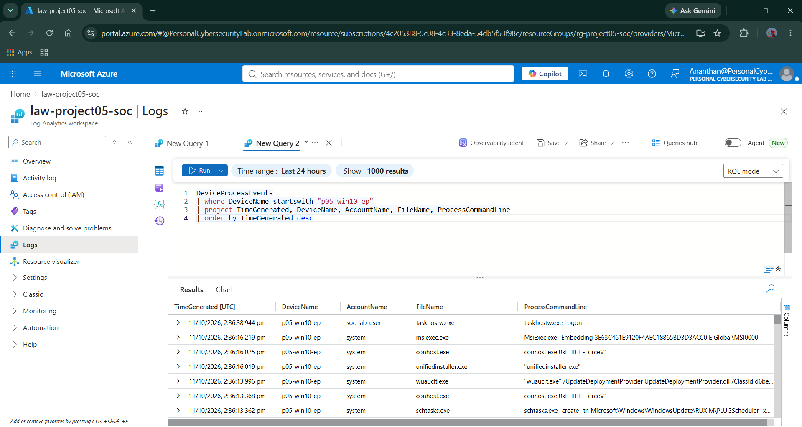

# Day 04 — Microsoft Defender XDR & Sentinel Telemetry Integration

**Project:** Project 05 — Microsoft Cloud SOC, EDR & Threat Hunting Lab  
**Day:** 04 of 18  
**Phase:** Telemetry Integration and Validation  
**Status:** Core telemetry validation completed
**Azure Resource Group:** `rg-project05-soc`  
**Log Analytics Workspace:** `law-project05-soc`  
**Endpoint:** `p05-win10-ep`  
**Region:** Central India

---

## 1. Objective

The objective of Day 04 was to validate the availability of endpoint and identity telemetry in the Microsoft Sentinel Log Analytics workspace.

The work focused on:

- Verifying the Microsoft Defender XDR workspace connection.
- Validating endpoint inventory telemetry.
- Validating endpoint process events.
- Verifying Microsoft Entra ID sign-in and audit logs.
- Checking Defender alert and Sentinel incident tables.
- Recording integration limitations and preserving supporting evidence.

These validations establish the telemetry baseline required for subsequent KQL exercises, detection engineering, threat hunting, and incident investigation.

## 2. Lab Architecture

The following diagram represents the intended logical telemetry flow.

```text
Windows Endpoint
       |
       v
Microsoft Defender for Endpoint
       |
       v
Microsoft Defender XDR
       |
       v
Microsoft Sentinel / Log Analytics
       |
       v
KQL Queries and Threat Hunting


Microsoft Entra ID
       |
       v
Diagnostic Settings
       |
       v
Log Analytics Workspace
       |
       v
Microsoft Sentinel
```

**Validation note:** Endpoint and identity telemetry were verified in the workspace. The complete Defender alert and incident ingestion path has not yet been verified.

## 3. Environment Configuration

| Component | Configuration |
|---|---|
| Azure subscription | Azure subscription 1 |
| Resource group | `rg-project05-soc` |
| Log Analytics workspace | `law-project05-soc` |
| Workspace region | Central India |
| Microsoft Sentinel | Enabled |
| Microsoft Defender XDR solution | Installed |
| Defender XDR workspace status | Connected |
| Endpoint | `p05-win10-ep` |
| Endpoint operating system | Windows 10 |
| Entra ID diagnostic setting | `EntraID-to-LogAnalytics` |
| Identity log categories | `SignInLogs`, `AuditLogs` |

## 4. Evidence Directory

All Day 04 evidence screenshots are stored in:

`screenshots/Day04/`

```text
screenshots/Day04/
├── Day04-01-DeviceInfo-Ingestion-Validation.png
├── Day04-02-DeviceProcessEvents-Ingestion-Validation.png
├── Day04-03-Process-Events-By-Device.png
├── Day04-04-Entra-Audit-Log-Ingestion-Validation.png
├── Day04-05-Entra-SignIn-Log-Ingestion-Validation.png
├── Day04-06-Endpoint-Process-Telemetry-Validation.png
└── Day04-07-P05-Endpoint-Process-Ingestion.png
```

The filenames above match the seven screenshots in the existing evidence folder.

---

## 5. Evidence 01 — Device Inventory Ingestion

**Screenshot:** `Day04-01-DeviceInfo-Ingestion-Validation.png`



**Table:** `DeviceInfo`

### Validation query

```kusto
DeviceInfo
| where DeviceName startswith "p05-win10-ep"
| project Timestamp, DeviceName, OSPlatform, OnboardingStatus
| order by Timestamp desc
```

### Observed result

The query returned a device record with the following properties:

| Field | Observed value |
|---|---|
| Device name | `p05-win10-ep` |
| Operating system | `Windows10` |
| Onboarding status | `Onboarded` |

**Assessment:** The endpoint was visible in Defender device telemetry.

**Status:** PASS

---

## 6. Evidence 02 — Endpoint Process Event Ingestion

**Screenshot:** `Day04-02-DeviceProcessEvents-Ingestion-Validation.png`



**Table:** `DeviceProcessEvents`

### Validation query

```kusto
DeviceProcessEvents
| where DeviceName startswith "p05-win10-ep"
| project Timestamp, DeviceName, AccountName, FileName, ProcessCommandLine
| order by Timestamp desc
```

### Observed result

The query returned endpoint process records containing device names, account names, executable filenames, and process command lines.

**Assessment:** Endpoint process telemetry was available for investigation and hunting.

**Status:** PASS

---

## 7. Evidence 03 — Process Events by Device

**Screenshot:** `Day04-03-Process-Events-By-Device.png`



### Purpose

This evidence supports the validation of process activity associated with the monitored endpoint.

It helps establish that the endpoint's process telemetry can be queried and inspected for later investigation activities.

### Aggregate validation query

```kusto
DeviceProcessEvents
| where DeviceName startswith "p05-win10-ep"
| summarize ProcessEvents=count(), LatestEvent=max(Timestamp)
```

### Observed result

The aggregate query returned:

| Metric | Observed value |
|---|---:|
| Process events | 192 |
| Latest event | 11 October 2026, 2:59:54 PM UTC |

The count represents the result at the time of validation and can change as additional events arrive.

**Assessment:** Process telemetry was available in the workspace.

**Status:** PASS

---

## 8. Evidence 04 — Entra ID Audit Log Ingestion

**Screenshot:** `Day04-04-Entra-Audit-Log-Ingestion-Validation.png`



**Table:** `AuditLogs`

### Validation query

```kusto
AuditLogs
| where TimeGenerated > ago(7d)
| project TimeGenerated, OperationName, Result, Category
| order by TimeGenerated desc
```

### Observed result

An earlier query returned an audit record with these characteristics:

- Operation: `Validate user authentication`
- Result: `Success`
- Category: `Authentication`

The Entra ID diagnostic setting `EntraID-to-LogAnalytics` was configured to send audit and sign-in logs to the workspace.

**Assessment:** Entra ID audit telemetry was available.

**Status:** PASS

---

## 9. Evidence 05 — Entra ID Sign-In Log Ingestion

**Screenshot:** `Day04-05-Entra-SignIn-Log-Ingestion-Validation.png`



**Table:** `SigninLogs`

### Validation query

```kusto
SigninLogs
| where TimeGenerated > ago(7d)
| project TimeGenerated, UserPrincipalName, AppDisplayName, IPAddress, ResultType
| order by TimeGenerated desc
```

### Observed result

A previously validated query returned a successful Azure Portal sign-in with `ResultType` equal to `0`.

**Assessment:** Entra ID sign-in telemetry was available in the workspace.

**Status:** PASS

---

## 10. Evidence 06 — Endpoint Process Telemetry Validation

**Screenshot:** `Day04-06-Endpoint-Process-Telemetry-Validation.png`



### Purpose

This evidence provides an additional record of endpoint process telemetry validation for `p05-win10-ep`.

The process events provide useful fields for later security investigations, including:

- Event timestamp
- Device name
- Account name
- Process filename
- Process command line

**Assessment:** Endpoint process telemetry was available for KQL-based investigation.

**Status:** PASS

---

## 11. Evidence 07 — P05 Endpoint Process Ingestion

**Screenshot:** `Day04-07-P05-Endpoint-Process-Ingestion.png`



### Purpose

This evidence records process ingestion for the dedicated Project 05 endpoint.

The endpoint was renamed to `p05-win10-ep` and its device inventory and process telemetry were subsequently visible in Defender queries.

### Aggregate validation query

```kusto
DeviceProcessEvents
| where DeviceName startswith "p05-win10-ep"
| summarize ProcessEvents=count(), LatestEvent=max(Timestamp)
```

**Assessment:** The dedicated Project 05 endpoint was producing queryable process telemetry.

**Status:** PASS

---

## 12. Defender Alert Ingestion Validation

The following Defender tables were checked:

- `AlertInfo`
- `AlertEvidence`

Both tables were selected in the Defender XDR connector's event configuration, and the portal reported that the changes were applied successfully.

### Validation query

```kusto
union isfuzzy=true withsource=SourceTable
    AlertInfo,
    AlertEvidence
| summarize RecordCount=count() by SourceTable
```

### Observed result

No records were returned from the checked tables during the last seven days.

This does not establish whether the tables are empty because no qualifying alerts were generated or because an alert integration issue exists.

**Status:** NOT VERIFIED

---

## 13. Sentinel Security Alert and Incident Validation

The following tables were checked:

- `SecurityAlert`
- `SecurityIncident`

### Validation query

```kusto
union isfuzzy=true withsource=SourceTable
    SecurityAlert,
    SecurityIncident
| summarize RecordCount=count() by SourceTable
```

### Observed result

No records were returned during the seven-day query period.

The Microsoft Defender portal also displayed zero alerts and zero incidents in the views that were checked.

These results do not prove that the workspace connection is broken. They establish that alert and incident records were not available in the checked views and tables during validation.

**Status:** NOT VERIFIED

---

## 14. Integration Limitation — Unified Security Operations Platform

During the Microsoft Defender XDR solution review, the portal displayed a warning indicating that incident and alert configuration was disabled because one or more workspaces were onboarded to the Unified Security Operations Platform.

The workspace was separately displayed as `Connected` in Microsoft Defender XDR settings.

### Assessment

The available evidence confirms the workspace connection and raw endpoint telemetry ingestion.

However, the end-to-end flow of Defender alerts and incidents into Sentinel has not been demonstrated.

The observed warning has been recorded as an outstanding integration question. It should not be treated as proof of a failed connection or as proof that alert ingestion is operational.

### Outstanding action

Verify the supported alert and incident integration path for the current workspace configuration before marking the alert pipeline as operational.

**Status:** OPEN

---

## 15. Day 04 Validation Summary

| Validation area | Result | Conclusion |
|---|---|---|
| Defender XDR workspace connection | PASS | Workspace displayed as connected |
| Device inventory telemetry | PASS | Endpoint record returned |
| Endpoint process telemetry | PASS | Process events returned |
| Entra ID audit logs | PASS | Audit record returned |
| Entra ID sign-in logs | PASS | Successful sign-in record returned |
| Defender alert tables | NOT VERIFIED | No records returned in the seven-day check |
| Sentinel security alerts | NOT VERIFIED | No records returned in the seven-day check |
| Sentinel security incidents | NOT VERIFIED | No records returned in the seven-day check |
| End-to-end alert/incident ingestion | OPEN | Further verification required |

## 16. Security and Operational Considerations

1. **Telemetry is not the same as detection.** Process events demonstrate that telemetry is available; they do not prove that a detection rule generated an alert.

2. **A connected workspace does not prove every integration is working.** Validate each data source and alert pipeline independently.

3. **Zero records must be interpreted carefully.** An empty query result can mean no qualifying events were generated or that the expected records were not ingested.

4. **Detection success requires evidence.** Do not report an alert as generated unless it is actually observed and its details are inspected.

5. **Avoid unnecessary configuration changes.** Investigate the Unified Security Operations Platform warning using the supported configuration path instead of repeatedly reinstalling the solution.

6. **Maintain cost awareness.** Continue monitoring Azure and security-service trial usage.

## 17. Day 04 Deliverables

| Deliverable | Status |
|---|---|
| Workspace connection reviewed | Completed |
| Device inventory telemetry validated | Completed |
| Process telemetry validated | Completed |
| Entra ID sign-in logs validated | Completed |
| Entra ID audit logs validated | Completed |
| Defender alert tables checked | Completed; no records returned |
| Sentinel alert and incident tables checked | Completed; no records returned |
| Seven evidence screenshots captured | Completed |
| Integration limitation documented | Completed |
| End-to-end alert/incident ingestion verified | Outstanding |
| Day 04 documentation | Completed |

## 18. Final Assessment

Day 04 established that the Microsoft Defender XDR workspace connection was present and that endpoint inventory, endpoint process, Entra ID sign-in, and Entra ID audit telemetry were available for querying.

The alert and incident checks returned no records during the selected seven-day period. Consequently, end-to-end Defender alert and incident ingestion remains unverified.

The documentation distinguishes verified telemetry ingestion from the unresolved alert and incident integration question.

The core telemetry validation work for Day 04 is complete. The alert/incident integration limitation will remain documented until it can be independently verified.

**Day 04 status:** Core telemetry validation completed; alert/incident integration remains open.

**Next phase:** Day 05 — KQL Fundamentals.

**Repository:** `Project-05-Microsoft-Cloud-SOC`