# Day 05 — KQL Fundamentals and SOC Investigation Query Library

**Project:** Project 05 — Microsoft Cloud SOC, EDR & Threat Hunting Lab  
**Day:** 05 of 18  
**Focus:** Kusto Query Language (KQL)  
**Platforms:** Microsoft Sentinel, Microsoft Defender for Endpoint, Microsoft Entra ID  
**Endpoint:** `p05-win10-ep`  
**Log Analytics Workspace:** `law-project05-soc`  
**Status:** Query development and practical investigation completed

---

## 1. Executive Summary

Day 05 focused on developing practical Kusto Query Language (KQL) skills for security investigations.

The objective was to create reusable queries for authentication analysis, endpoint process investigation, endpoint correlation, and threat hunting.

Using Microsoft Defender and Entra ID telemetry, I practised filtering events, selecting fields, classifying process activity, aggregating records, investigating authentication outcomes, parsing command lines, and correlating endpoint telemetry with device inventory.

The resulting query library is organized into four categories within the existing GitHub repository.

### Key Deliverables

- Four categorized KQL query-library files.
- Approximately 12 investigation queries developed during the practical exercises.
- Authentication investigation using Entra ID sign-in logs.
- Endpoint process investigation using Defender telemetry.
- Process-to-device inventory correlation.
- Command-line classification and parsing exercises.
- Evidence screenshots documenting query execution and results.
- Reusable KQL documentation for future detection engineering.

---

## 2. Lab Environment

| Component | Configuration |
|---|---|
| SIEM | Microsoft Sentinel |
| Log Analytics workspace | `law-project05-soc` |
| Endpoint | `p05-win10-ep` |
| Endpoint telemetry | Microsoft Defender for Endpoint |
| Identity telemetry | Microsoft Entra ID |
| Authentication table | `SigninLogs` |
| Process telemetry table | `DeviceProcessEvents` |
| Device inventory table | `DeviceInfo` |
| Query language | KQL |

## 3. Query Library Structure

```text
Project-05-Microsoft-Cloud-SOC/
├── kql/
│   ├── authentication/
│   │   └── day05-authentication-investigations.kql
│   ├── endpoint/
│   │   └── day05-endpoint-investigations.kql
│   ├── correlation/
│   │   └── day05-endpoint-correlation.kql
│   └── hunting/
│       └── day05-hunting-queries.kql
├── screenshots/
│   └── Day05/
└── docs/
    └── Day05-KQL-Fundamentals.md
```

The library separates identity investigations, endpoint investigations, correlation, and hunting so that queries can be located and reused efficiently.

---

## 4. KQL Fundamentals Practised

| Operator or Function | Purpose |
|---|---|
| `where` | Filters records by conditions |
| `project` | Selects fields relevant to an investigation |
| `extend` | Creates calculated columns |
| `summarize` | Aggregates records |
| `count()` | Counts events |
| `countif()` | Counts records meeting a condition |
| `dcount()` | Estimates distinct values |
| `order by` / `sort` | Orders query results |
| `top` | Returns the highest-ranked records |
| `take` | Limits the number of returned records |
| `distinct` | Returns unique values |
| `join` | Combines related datasets |
| `parse` | Extracts structured values from strings |
| `ago()` | Defines a relative time range |
| `bin()` | Groups timestamps into intervals |
| `arg_max()` | Selects the record with the maximum value |

---

## 5. Endpoint Investigation — Baseline Process Telemetry

### Objective

Retrieve recent process execution events from the Project 05 endpoint.

### KQL Query

```kusto
DeviceProcessEvents
| where DeviceName startswith "p05-win10-ep"
| project
    Timestamp,
    DeviceName,
    AccountName,
    FileName,
    ProcessCommandLine
| order by Timestamp desc
```

### Evidence 01 — Baseline Process Telemetry

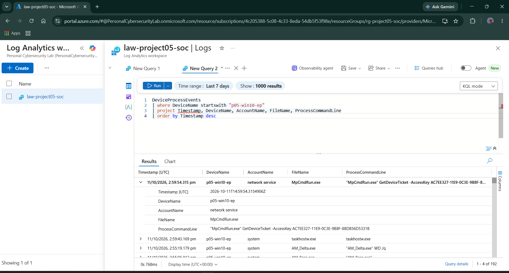

### Analysis

The query returned process telemetry for `p05-win10-ep`.

The selected fields provide an analyst with timestamps, device identity, account context, executable names, and command-line information.

These fields form the foundation for endpoint investigations and subsequent threat-hunting exercises.

---

## 6. Endpoint Investigation — PowerShell Filtering

### Objective

Filter process telemetry to identify PowerShell executions.

### KQL Query

```kusto
DeviceProcessEvents
| where DeviceName startswith "p05-win10-ep"
| where FileName =~ "powershell.exe"
| project
    Timestamp,
    DeviceName,
    AccountName,
    FileName,
    ProcessCommandLine
| order by Timestamp desc
```

### Evidence 02 — PowerShell Process Filtering

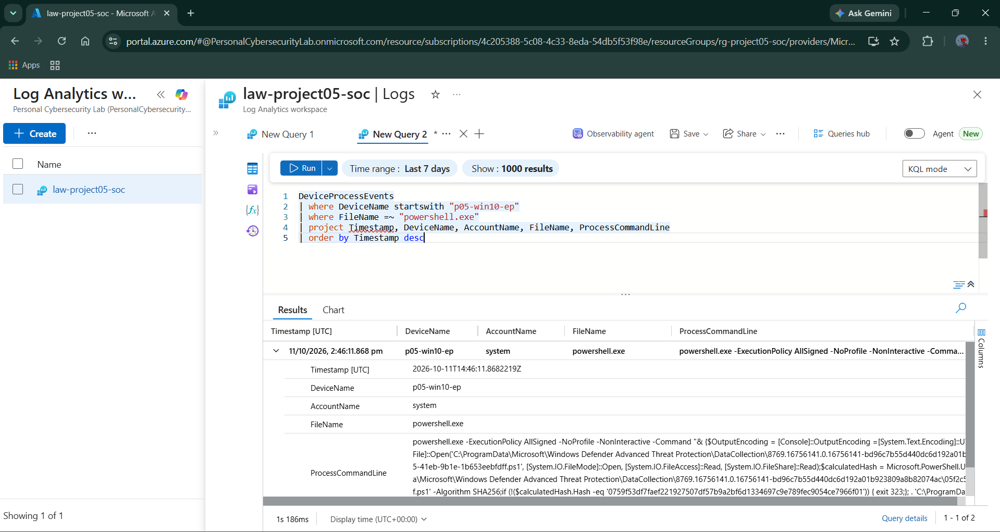

### Analysis

The query returned two PowerShell process events in the selected period.

The command line and account fields provide context for investigating why PowerShell was executed and which process initiated it.

PowerShell execution alone does not establish malicious activity.

---

## 7. Threat Hunting — Encoded PowerShell Indicators

### Objective

Search process command lines for common encoded PowerShell command indicators.

### KQL Query

```kusto
DeviceProcessEvents
| where DeviceName startswith "p05-win10-ep"
| where FileName =~ "powershell.exe"
| where ProcessCommandLine contains "-EncodedCommand"
    or ProcessCommandLine contains " -enc "
| project
    Timestamp,
    DeviceName,
    AccountName,
    ProcessCommandLine
| order by Timestamp desc
```

### Evidence 03 — Encoded PowerShell Search

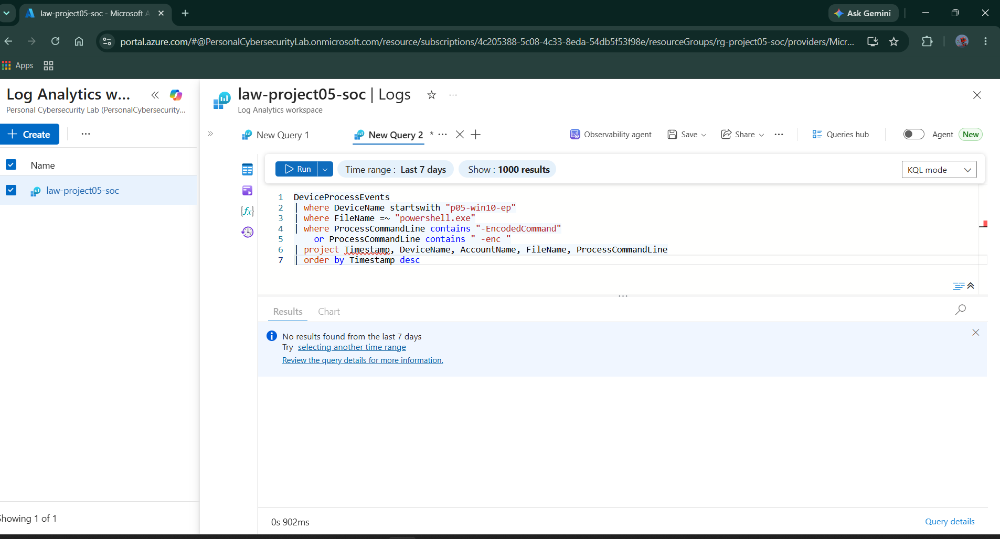

### Analysis

The query returned no matching records during the selected seven-day period.

This records the outcome of the specific query and patterns searched. It does not establish that encoded PowerShell was never executed.

---

## 8. Endpoint Investigation — Process Frequency

### Objective

Identify the most frequently recorded process filenames.

### KQL Query

```kusto
DeviceProcessEvents
| where DeviceName startswith "p05-win10-ep"
| summarize EventCount = count() by FileName
| order by EventCount desc
| take 10
```

### Evidence 04 — Process Event Counts

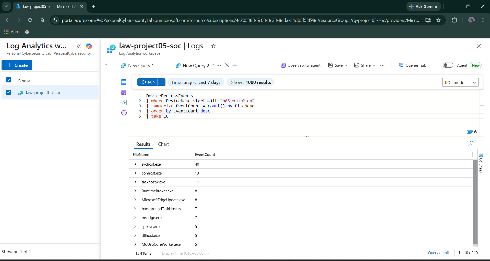

### Observed Results

| Process | Event Count |
|---|---:|
| `svchost.exe` | 40 |
| `conhost.exe` | 13 |
| `taskhostw.exe` | 11 |
| `RuntimeBroker.exe` | 8 |
| `MicrosoftEdgeUpdate.exe` | 8 |
| `backgroundTaskHost.exe` | 7 |
| `msedge.exe` | 7 |
| `sppsvc.exe` | 5 |
| `dllhost.exe` | 5 |
| `MoUsoCoreWorker.exe` | 5 |

### Analysis

The `summarize` operator aggregates process events by filename. Sorting by the resulting count provides a quick view of frequently observed executables.

Frequency is useful for establishing a baseline, but a high count does not independently indicate malicious activity.

---

## 9. Endpoint Investigation — Process Activity by Account

### Objective

Understand which accounts appear in endpoint process telemetry.

### KQL Query

```kusto
DeviceProcessEvents
| where DeviceName startswith "p05-win10-ep"
| summarize EventCount = count() by AccountName
| order by EventCount desc
```

### Evidence 05 — Process Events by Account

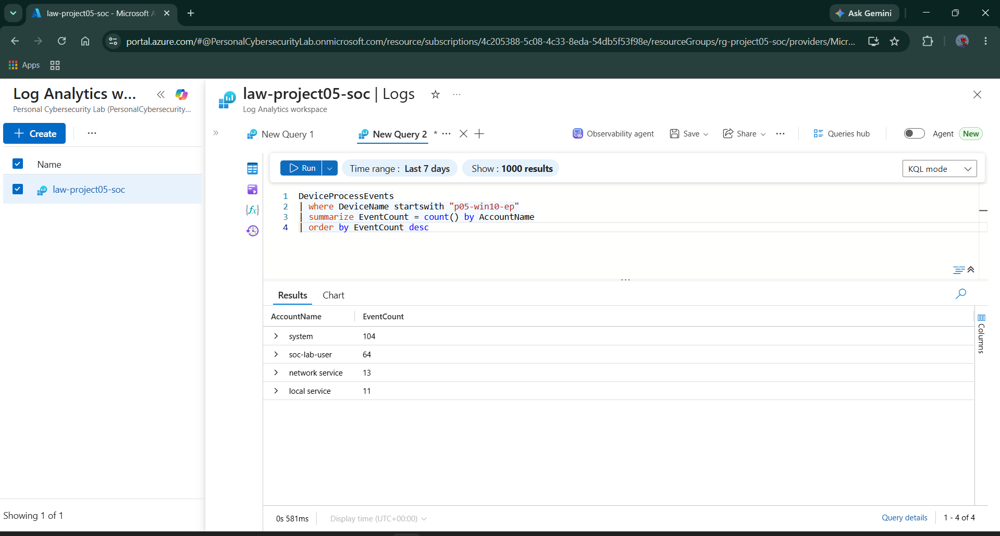

### Observed Results

| Account | Process Events |
|---|---:|
| `system` | 104 |
| `soc-lab-user` | 64 |
| `network service` | 13 |
| `local service` | 11 |

### Analysis

Account-based aggregation provides an overview of process activity associated with user and service accounts.

Unexpected account activity should be investigated using timestamps, executable names, command lines, and surrounding events.

---

## 10. Endpoint Investigation — PowerShell Command Lines

### Objective

Inspect PowerShell command lines and their initiating processes.

### KQL Query

```kusto
DeviceProcessEvents
| where DeviceName startswith "p05-win10-ep"
| where FileName =~ "powershell.exe"
| project
    Timestamp,
    DeviceName,
    AccountName,
    ProcessCommandLine,
    InitiatingProcessFileName
| order by Timestamp desc
```

### Evidence 06 — PowerShell Command-Line Investigation

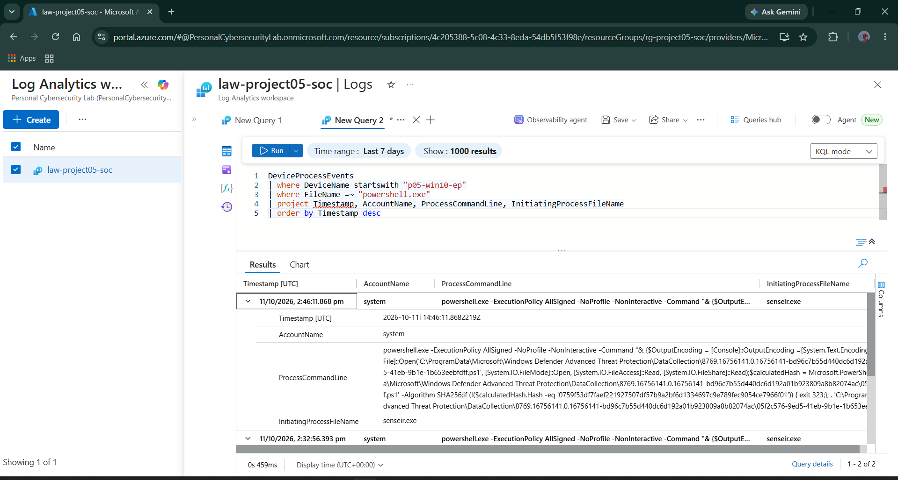

### Analysis

The query exposed PowerShell command-line information and the initiating process.

The observed events included `senseir.exe` as the initiating process and command-line options such as `-ExecutionPolicy AllSigned`, `-NoProfile`, and `-NonInteractive`.

The visible context was consistent with security-related telemetry collection. Definitive classification requires consideration of the full command line and surrounding activity.

---

## 11. Endpoint Investigation — Recent Process Events

### Objective

Retrieve a small sample of the newest process events for quick triage.

### KQL Query

```kusto
DeviceProcessEvents
| where DeviceName startswith "p05-win10-ep"
| project
    Timestamp,
    AccountName,
    FileName,
    ProcessCommandLine
| top 10 by Timestamp desc
```

### Evidence 07 — Recent Process Events

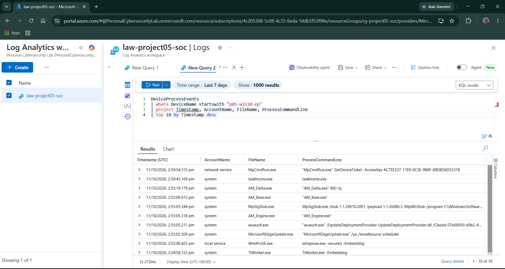

### Analysis

The query returned the ten most recent matching process events.

The observed executable names included Microsoft Defender and Windows Update-related components, alongside other Windows processes.

This query is useful for quickly reviewing recent endpoint activity before performing a more focused investigation.

---

## 12. KQL Transformation — `extend`

### Objective

Create a calculated column to classify PowerShell and other process events.

### KQL Query

```kusto
DeviceProcessEvents
| where DeviceName startswith "p05-win10-ep"
| extend ProcessType = iff(
    FileName =~ "powershell.exe",
    "PowerShell",
    "Other"
)
| project
    Timestamp,
    DeviceName,
    AccountName,
    FileName,
    ProcessType
| top 20 by Timestamp desc
```

### Evidence 08 — Process Classification Using `extend`

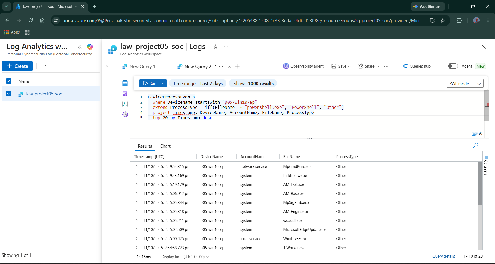

### Analysis

The `extend` operator adds a calculated `ProcessType` column.

This demonstrates how an analyst can enrich raw process records with simple classification labels to support triage.

---

## 13. KQL Transformation — `distinct`

### Objective

Identify unique executable filenames observed on the endpoint.

### KQL Query

```kusto
DeviceProcessEvents
| where DeviceName startswith "p05-win10-ep"
| distinct FileName
| sort by FileName asc
```

### Evidence 09 — Distinct Process Names

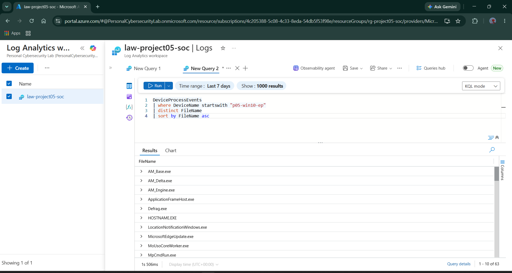

### Analysis

The query returned unique executable filenames rather than every process event.

This is useful for creating a quick inventory of observed executable names before selecting particular processes for investigation.

---

## 14. Endpoint Correlation — Process Activity and Device Inventory

### Objective

Correlate endpoint process-event counts with device inventory information.

### KQL Query

```kusto
let ProcessSummary =
    DeviceProcessEvents
    | where DeviceName startswith "p05-win10-ep"
    | summarize ProcessCount = count()
        by DeviceId, DeviceName;
let DeviceInventory =
    DeviceInfo
    | where DeviceName startswith "p05-win10-ep"
    | summarize arg_max(Timestamp, *) by DeviceId
    | project DeviceId, DeviceName, OSPlatform, OnboardingStatus;
ProcessSummary
| join kind=inner DeviceInventory on DeviceId
| project
    DeviceName,
    OSPlatform,
    OnboardingStatus,
    ProcessCount
```

### Evidence 10 — Endpoint Inventory Correlation

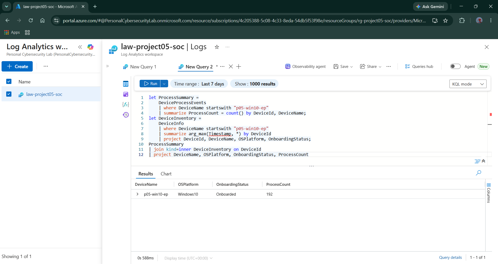

### Observed Result

| Field | Value |
|---|---|
| Device name | `p05-win10-ep` |
| Operating system | `Windows10` |
| Onboarding status | `Onboarded` |
| Process events counted | 192 |

### Analysis

The `join` operator combines process summaries with device inventory records using `DeviceId`.

The result provides endpoint context alongside process-event counts, demonstrating a practical correlation technique for SOC investigations.

---

## 15. PowerShell Command Classification

### Objective

Classify PowerShell process events based on command-line indicators.

### KQL Query

```kusto
DeviceProcessEvents
| where DeviceName startswith "p05-win10-ep"
| where FileName =~ "powershell.exe"
| extend CommandType = case(
    ProcessCommandLine contains "-EncodedCommand",
        "Encoded command",
    ProcessCommandLine contains "-File",
        "Script file",
    ProcessCommandLine contains "-Command",
        "Inline command",
    "Other"
)
| project
    Timestamp,
    DeviceName,
    AccountName,
    FileName,
    CommandType,
    ProcessCommandLine
| top 20 by Timestamp desc
```

### Evidence 11 — PowerShell Command Classification

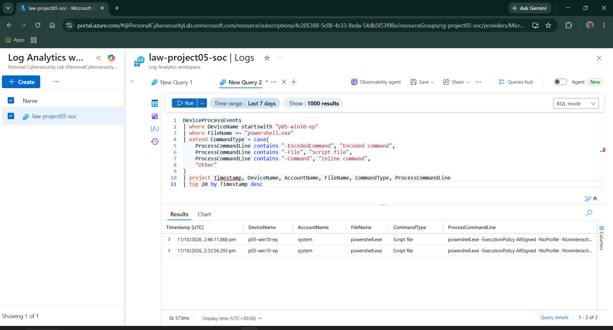

### Analysis

The query applies simple text-based classification to PowerShell command lines.

The classification can help prioritize investigation, but the labels do not determine whether the execution is malicious.

---

## 16. KQL Transformation — `parse`

### Objective

Separate a process command line into its first token and remaining arguments.

### KQL Query

```kusto
DeviceProcessEvents
| where DeviceName startswith "p05-win10-ep"
| where isnotempty(ProcessCommandLine)
| parse ProcessCommandLine with
    FileNameFromCommand " "
    CommandArguments
| project
    Timestamp,
    DeviceName,
    FileName,
    FileNameFromCommand,
    CommandArguments
| top 20 by Timestamp desc
```

### Evidence 12 — Command-Line Parsing

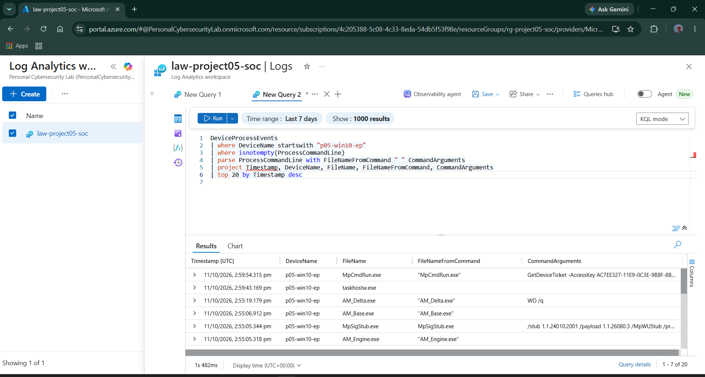

### Analysis

The `parse` operator separates command-line text into fields that can be inspected independently.

The extracted values should be compared with the original command line because quoting, whitespace, and command structure can affect parsing.

---

## 17. Authentication Investigation — Sign-In Activity

### Objective

Review recent Entra ID sign-in events and their outcomes.

### KQL Query

```kusto
SigninLogs
| where TimeGenerated > ago(7d)
| project
    TimeGenerated,
    UserPrincipalName,
    AppDisplayName,
    IPAddress,
    ResultType,
    ResultDescription,
    Location
| order by TimeGenerated desc
| take 20
```

### Evidence 13 — Authentication Sign-In Activity

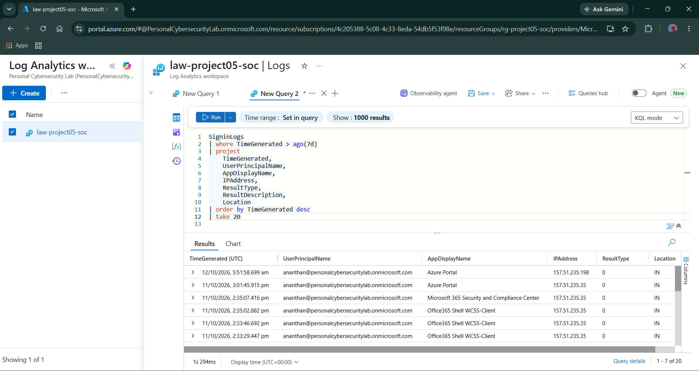

### Analysis

The query returned Entra ID sign-in events for the selected period.

The fields provide context for investigating authentication activity, including account, application, source IP address, location, and result code.

The observed successful sign-in records had `ResultType` equal to `0`.

---

## 18. Authentication Investigation — Failed Sign-Ins

### Objective

Group unsuccessful sign-in events by user, IP address, result code, and result description.

### KQL Query

```kusto
SigninLogs
| where TimeGenerated > ago(7d)
| where ResultType != "0"
| summarize
    FailedAttempts = count(),
    FirstSeen = min(TimeGenerated),
    LastSeen = max(TimeGenerated)
    by
        UserPrincipalName,
        IPAddress,
        ResultType,
        ResultDescription
| order by FailedAttempts desc
```

### Evidence 14 — Failed Sign-In Investigation

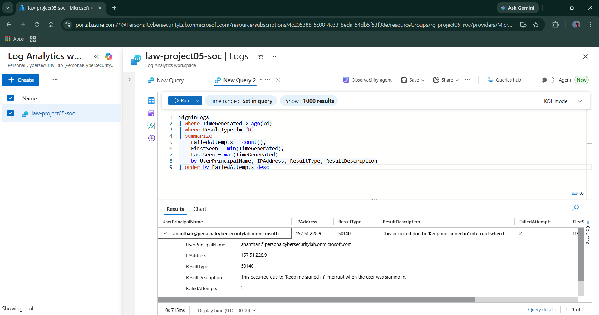

### Observed Result

The query returned a group containing two unsuccessful sign-in events with result code `50140`.

The result description indicated that the user interrupted the “Keep me signed in” prompt.

### Analysis

This result demonstrates why authentication failures must be interpreted in context. A failed sign-in does not automatically indicate brute-force activity.

---

## 19. Authentication Investigation — Outcomes by User

### Objective

Summarize successful and unsuccessful sign-ins for each user.

### KQL Query

```kusto
SigninLogs
| where TimeGenerated > ago(7d)
| summarize
    TotalSignIns = count(),
    SuccessfulSignIns = countif(ResultType == "0"),
    FailedSignIns = countif(ResultType != "0"),
    UniqueSourceIPs = dcount(IPAddress)
    by UserPrincipalName
| order by FailedSignIns desc
```

### Evidence 15 — Authentication Outcomes by User

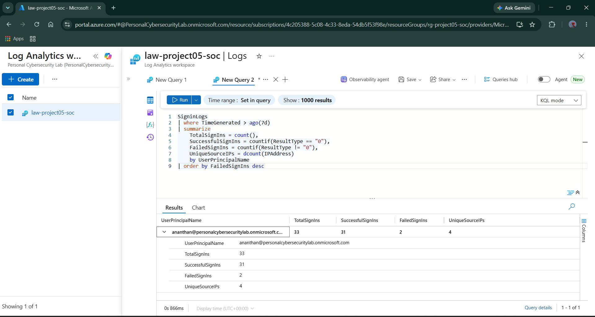

### Observed Results

| Metric | Value |
|---|---:|
| Total sign-ins | 33 |
| Successful sign-ins | 31 |
| Unsuccessful sign-ins | 2 |
| Distinct source IP addresses estimated | 4 |

### Analysis

The query summarizes authentication activity into a compact per-user view.

This helps analysts establish an initial authentication baseline and decide whether further investigation is necessary.

---

## 20. Authentication Investigation — Activity by IP

### Objective

Compare authentication outcomes across source IP addresses.

### KQL Query

```kusto
SigninLogs
| where TimeGenerated > ago(7d)
| summarize
    TotalAttempts = count(),
    Successful = countif(ResultType == "0"),
    Failed = countif(ResultType != "0"),
    Users = dcount(UserPrincipalName)
    by IPAddress
| order by Failed desc
```

### Evidence 16 — Authentication Activity by IP

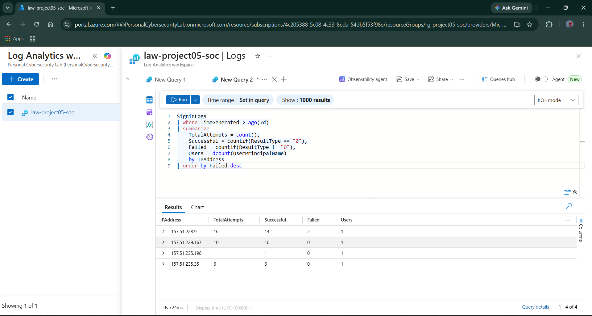

### Observed Results

| Source IP | Total Attempts | Successful | Failed |
|---|---:|---:|---:|
| `157.51.228.9` | 16 | 14 | 2 |
| `157.51.229.167` | 10 | 10 | 0 |
| `157.51.235.198` | 1 | 1 | 0 |
| `157.51.235.35` | 6 | 6 | 0 |

### Analysis

The query groups sign-in outcomes by IP address.

The two observed failures were associated with `157.51.228.9`. This is a useful pivot for further investigation, but the source IP should not be classified as malicious based on these counts alone.

---

## 21. Authentication Hunting — Repeated Failures

### Objective

Find user and IP combinations with at least three failed sign-ins in a 15-minute interval.

### KQL Query

```kusto
SigninLogs
| where TimeGenerated > ago(7d)
| where ResultType != "0"
| summarize
    FailedAttempts = count()
    by
        UserPrincipalName,
        IPAddress,
        ResultType,
        bin(TimeGenerated, 15m)
| where FailedAttempts >= 3
| order by FailedAttempts desc
```

### Evidence 17 — Repeated Failed Sign-Ins

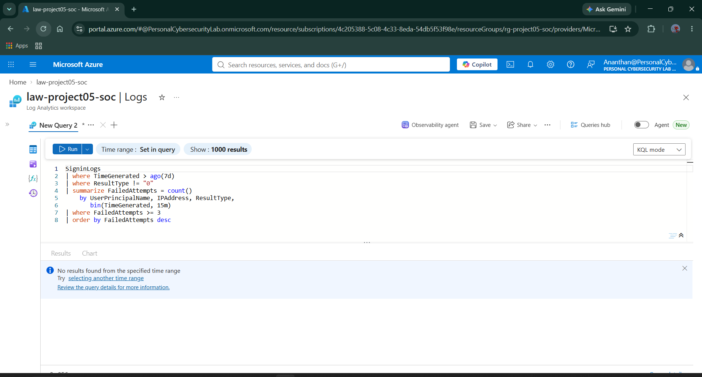

### Analysis

The query returned no matching groups for the selected period.

This is the result of applying a defined threshold to the available sign-in data. The query demonstrates time-binned authentication hunting and can be adapted for future detection engineering.

---

## 22. Endpoint Hunting — Process Activity by Hour

### Objective

Establish an hourly baseline of process-event volume on the Project 05 endpoint.

### KQL Query

```kusto
DeviceProcessEvents
| where Timestamp > ago(24h)
| where DeviceName startswith "p05-win10-ep"
| summarize ProcessEvents = count()
    by bin(Timestamp, 1h)
| order by Timestamp asc
```

### Evidence 18 — Endpoint Process Activity by Hour

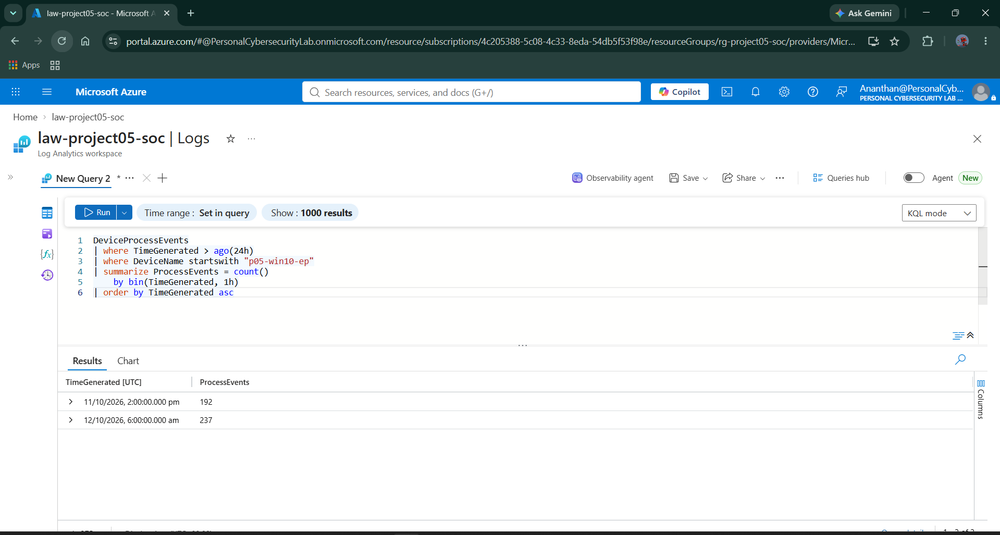

### Observed Result

The captured query returned hourly buckets containing 192 and 237 process events.

### Analysis

The `bin()` function groups event timestamps into hourly intervals. This provides a simple time-based baseline for identifying changes in endpoint activity.

---

## 23. Quantitative Outcomes

The following metrics summarize the Day 05 implementation and captured query results.

| Metric | Outcome |
|---|---:|
| Query-library categories | 4 |
| Query-library files | 4 |
| Investigation queries developed | Approximately 12 |
| Core KQL operators and functions practised | 15+ |
| Primary investigation domains | 4 |
| Sign-in events in the captured user summary | 33 |
| Successful sign-ins | 31 |
| Unsuccessful sign-ins | 2 |
| Distinct source IP addresses estimated | 4 |
| Process events in the captured correlation result | 192 |
| Events in one captured hourly bucket | 192 |
| Events in another captured hourly bucket | 237 |

These are implementation and telemetry metrics. They should not be interpreted as the number of confirmed security incidents or successful threat detections.

---

## 24. Skills Demonstrated

### Technical Skills

- Kusto Query Language (KQL)
- Microsoft Sentinel Logs
- Microsoft Defender for Endpoint telemetry
- Microsoft Entra ID sign-in investigation
- Endpoint process analysis
- PowerShell command-line investigation
- Event aggregation and time-based analysis
- Dataset correlation using `join`
- Command-line parsing
- Threat-hunting query development

### SOC Investigation Skills

- Establishing investigation scope.
- Filtering telemetry by device, user, and time.
- Identifying authentication patterns.
- Reviewing command-line evidence.
- Aggregating process activity by executable and account.
- Correlating endpoint telemetry with device inventory.
- Recording findings with supporting evidence.
- Organizing reusable investigation queries.


---

## 25. Conclusion

Day 05 established a structured KQL investigation library using Microsoft Sentinel, Microsoft Defender for Endpoint, and Microsoft Entra ID telemetry.

The exercises demonstrated how a SOC analyst can filter security events, investigate authentication activity, review PowerShell command lines, summarize endpoint process behavior, correlate telemetry with device inventory, and organize reusable threat-hunting queries.

The resulting query library provides a foundation for the next project phase: **Day 06 — Authentication Detections**.

The next phase will focus on converting investigation logic into detection queries with defined conditions, validation criteria, and evidence.