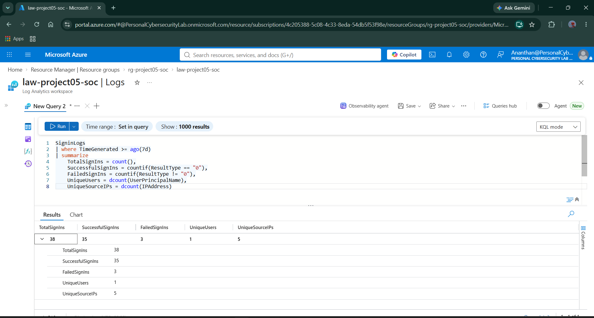
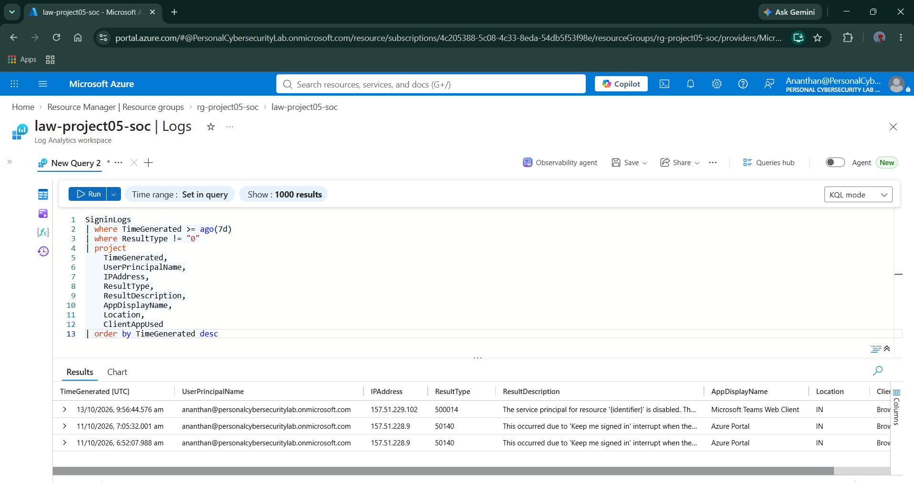
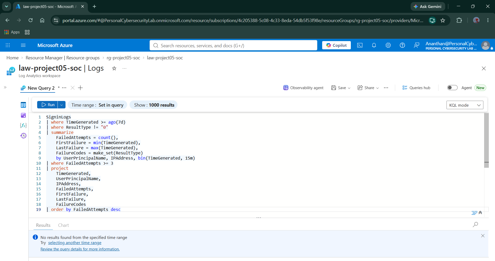
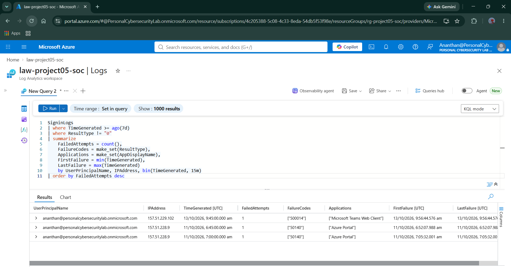
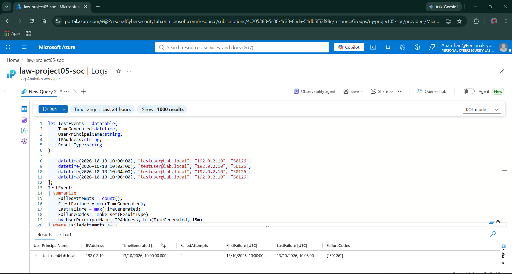
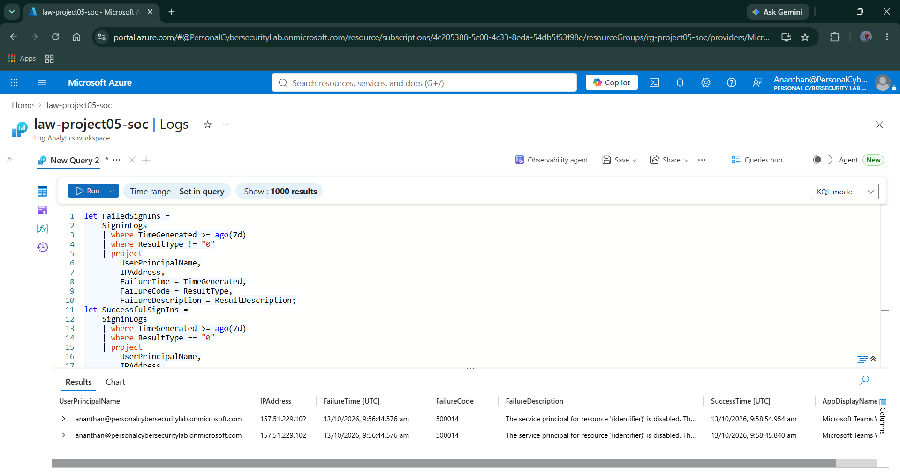
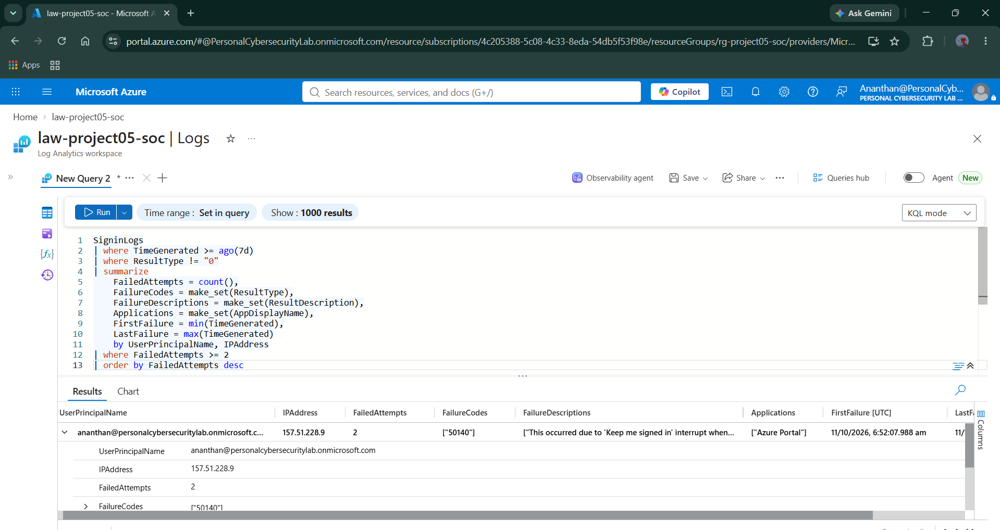

# Day 06 — Authentication Detection Engineering

## 1. Overview

**Project:** Project 05 — Microsoft Cloud SOC, EDR & Threat Hunting Lab  
**Day:** 06  
**Focus:** Authentication Detection Engineering  
**Platform:** Microsoft Sentinel and Log Analytics  
**Data Source:** Microsoft Entra ID sign-in telemetry  
**Query Language:** Kusto Query Language (KQL)

### Objective

Develop and validate KQL-based authentication detections using Microsoft Entra ID sign-in logs.

The investigation focuses on:

- Establishing an authentication baseline.
- Investigating failed sign-in events.
- Identifying repeated authentication failures.
- Correlating failed and successful sign-ins.
- Testing detection logic with synthetic events.
- Documenting findings and mapping the detection to MITRE ATT&CK.

---

## 2. Lab Environment

| Component | Details |
|---|---|
| Resource group | `rg-project05-soc` |
| Log Analytics workspace | `law-project05-soc` |
| SIEM platform | Microsoft Sentinel |
| Identity telemetry | Microsoft Entra ID |
| Authentication table | `SigninLogs` |
| Query language | KQL |
| Investigation period | Last 7 days, unless otherwise specified |

### Authentication Telemetry Flow

Microsoft Entra ID sign-in activity is recorded in Entra ID and made available in Log Analytics through the configured data integration.

The investigation queries `SigninLogs` to examine authentication outcomes, user identities, source IP addresses, applications, timestamps, and failure descriptions.

**Important distinction:** The authentication events analyzed in this document originate from Entra ID sign-in telemetry. They are not Windows endpoint process events from the P05 Windows VM.

---

## 3. Authentication Baseline

### Objective

Establish a baseline of successful and failed authentication activity before developing detection rules.

### Detection Query

```kusto
SigninLogs
| where TimeGenerated >= ago(7d)
| summarize
    TotalSignIns = count(),
    SuccessfulSignIns = countif(ResultType == "0"),
    FailedSignIns = countif(ResultType != "0"),
    UniqueUsers = dcount(UserPrincipalName),
    UniqueSourceIPs = dcount(IPAddress)
```

### Observed Results

| Metric | Observed value |
|---|---:|
| Total sign-in records | 38 |
| Successful sign-ins | 35 |
| Failed sign-ins | 3 |
| Unique users | 1 |
| Unique source IP addresses | 5 |

### Analysis

The baseline query returned 38 sign-in records, including 35 successful and 3 failed events.

Five distinct source IP addresses were observed across the sign-in records.

These values establish the starting point for the investigation. Failed authentication events require further analysis before they can be classified as suspicious.

### Evidence



---

## 4. Failed Sign-In Investigation

### Objective

Investigate failed sign-in records and identify their result codes, descriptions, source IP addresses, and associated applications.

### Detection Query

```kusto
SigninLogs
| where TimeGenerated >= ago(7d)
| where ResultType != "0"
| project
    TimeGenerated,
    UserPrincipalName,
    IPAddress,
    ResultType,
    ResultDescription,
    AppDisplayName,
    Location,
    ClientAppUsed
| order by TimeGenerated desc
```

### Observed Results

Three failed sign-in records were returned.

| Result code | Source IP | Application | Observed description |
|---|---|---|---|
| `500014` | `157.51.229.102` | Microsoft Teams Web Client | Service principal for the resource was disabled |
| `50140` | `157.51.228.9` | Azure Portal | Sign-in interrupted by the Keep me signed in prompt |
| `50140` | `157.51.228.9` | Azure Portal | Sign-in interrupted by the Keep me signed in prompt |

### Analysis

The two Azure Portal failures shared the same source IP and result code. Their descriptions indicated interruption of the Keep me signed in prompt.

The Microsoft Teams Web Client event had result code `500014`; its description indicated that the service principal for the resource was disabled.

The observed descriptions provide context for the failures. The events do not, by themselves, establish malicious activity.

### Evidence



---

## 5. Brute-Force Detection Baseline

### Objective

Identify groups of repeated failed sign-ins associated with the same user and source IP within a 15-minute window.

### Detection Query

```kusto
SigninLogs
| where TimeGenerated >= ago(7d)
| where ResultType != "0"
| summarize
    FailedAttempts = count(),
    FirstFailure = min(TimeGenerated),
    LastFailure = max(TimeGenerated),
    FailureCodes = make_set(ResultType)
    by UserPrincipalName, IPAddress, bin(TimeGenerated, 15m)
| where FailedAttempts >= 3
| project
    TimeGenerated,
    UserPrincipalName,
    IPAddress,
    FailedAttempts,
    FirstFailure,
    LastFailure,
    FailureCodes
| order by FailedAttempts desc
```

### Detection Logic

The query:

1. Retrieves failed sign-in records from the previous seven days.
2. Groups events by user, source IP, and 15-minute time window.
3. Counts the failed attempts in each group.
4. Returns groups containing at least three failures.

### Observed Result

The query returned no matching groups.

This means no group met the configured threshold in the queried telemetry.

The absence of matching results does not mean that no failed sign-ins occurred. The baseline investigation identified three failures, but they did not meet the threshold within a matching 15-minute grouping window.

### Evidence



---

## 6. Failed Sign-In Grouping

### Objective

Examine all failed sign-in groups without applying the minimum three-failure threshold.

### Detection Query

```kusto
SigninLogs
| where TimeGenerated >= ago(7d)
| where ResultType != "0"
| summarize
    FailedAttempts = count(),
    FailureCodes = make_set(ResultType),
    Applications = make_set(AppDisplayName),
    FirstFailure = min(TimeGenerated),
    LastFailure = max(TimeGenerated)
    by UserPrincipalName, IPAddress, bin(TimeGenerated, 15m)
| order by FailedAttempts desc
```

### Observed Results

| Source IP | Failed attempts in group | Result code | Application |
|---|---:|---|---|
| `157.51.229.102` | 1 | `500014` | Microsoft Teams Web Client |
| `157.51.228.9` | 1 | `50140` | Azure Portal |
| `157.51.228.9` | 1 | `50140` | Azure Portal |

The failures were grouped into separate 15-minute windows. No group contained three or more failures.

### Analysis

This query provides visibility into individual failure groups and helps explain why the initial brute-force threshold was not met.

### Evidence



---

## 7. Synthetic Brute-Force Detection Validation

### Objective

Test whether the detection logic identifies repeated authentication failures when the configured threshold is met.

This test uses synthetic data generated inside KQL. It does not generate real Entra ID sign-in events.

### Validation Query

```kusto
let TestEvents = datatable(
    TimeGenerated:datetime,
    UserPrincipalName:string,
    IPAddress:string,
    ResultType:string
)
[
    datetime(2026-10-13 10:00:00), "testuser@lab.local", "192.0.2.10", "50126",
    datetime(2026-10-13 10:02:00), "testuser@lab.local", "192.0.2.10", "50126",
    datetime(2026-10-13 10:04:00), "testuser@lab.local", "192.0.2.10", "50126",
    datetime(2026-10-13 10:06:00), "testuser@lab.local", "192.0.2.10", "50126"
];
TestEvents
| summarize
    FailedAttempts = count(),
    FirstFailure = min(TimeGenerated),
    LastFailure = max(TimeGenerated),
    FailureCodes = make_set(ResultType)
    by UserPrincipalName, IPAddress, bin(TimeGenerated, 15m)
| where FailedAttempts >= 3
```

### Validation Results

| Metric | Observed result |
|---|---|
| Synthetic failed events | 4 |
| Synthetic user | `testuser@lab.local` |
| Synthetic source IP | `192.0.2.10` |
| Failure result code | `50126` |
| First event | 10:00 UTC |
| Last event | 10:06 UTC |
| Detection threshold | At least 3 failures in 15 minutes |
| Detection output | One matching group |
| Detected failures | 4 |

### Analysis

The synthetic validation returned one group containing four failed events within a 15-minute window.

The configured threshold was three failures. The query correctly returned the group because four events exceeded the threshold.

This validates the KQL grouping and threshold logic. It does not demonstrate a real brute-force attack or confirm that Microsoft Sentinel generated an alert.

### Evidence



---

## 8. Failed and Successful Sign-In Correlation

### Objective

Identify successful sign-in records occurring after failed sign-in activity for the same user and source IP.

### Investigation Query

```kusto
let FailedSignIns =
    SigninLogs
    | where TimeGenerated >= ago(7d)
    | where ResultType != "0"
    | summarize
        FailedAttempts = count(),
        LastFailure = max(TimeGenerated)
        by UserPrincipalName, IPAddress;
let SuccessfulSignIns =
    SigninLogs
    | where TimeGenerated >= ago(7d)
    | where ResultType == "0"
    | project
        UserPrincipalName,
        IPAddress,
        SuccessTime = TimeGenerated,
        AppDisplayName;
FailedSignIns
| join kind=inner SuccessfulSignIns
    on UserPrincipalName, IPAddress
| where SuccessTime > LastFailure
| project
    UserPrincipalName,
    IPAddress,
    FailedAttempts,
    LastFailure,
    SuccessTime,
    AppDisplayName
| order by SuccessTime desc
```

### Observed Results

The query returned three matching rows in the initial correlation investigation.

| Source IP | Failed attempts in group | Application |
|---|---:|---|
| `157.51.229.102` | 1 | Microsoft Teams Web Client |
| `157.51.229.102` | 1 | Microsoft Teams Web Client |
| `157.51.228.9` | 2 | Azure Portal |

### Analysis

The results show successful sign-in records after the latest recorded failure for the same user and source IP.

This correlation is useful for investigation, but it does not establish that the failures and subsequent successes were part of a brute-force attack.

The query can return multiple successful events associated with the same failure group. Consequently, result rows should not be interpreted as distinct attacks.

### Evidence



---

## 9. Time-Bounded Failed and Successful Sign-In Correlation

### Objective

Narrow the correlation to successful sign-in records occurring within 15 minutes after an individual failed sign-in.

### Investigation Query

```kusto
let FailedSignIns =
    SigninLogs
    | where TimeGenerated >= ago(7d)
    | where ResultType != "0"
    | project
        UserPrincipalName,
        IPAddress,
        FailureTime = TimeGenerated,
        FailureCode = ResultType,
        FailureDescription = ResultDescription;
let SuccessfulSignIns =
    SigninLogs
    | where TimeGenerated >= ago(7d)
    | where ResultType == "0"
    | project
        UserPrincipalName,
        IPAddress,
        SuccessTime = TimeGenerated,
        AppDisplayName;
FailedSignIns
| join kind=inner SuccessfulSignIns
    on UserPrincipalName, IPAddress
| where SuccessTime > FailureTime
| where SuccessTime <= FailureTime + 15m
| project
    UserPrincipalName,
    IPAddress,
    FailureTime,
    FailureCode,
    FailureDescription,
    SuccessTime,
    AppDisplayName
| order by SuccessTime desc
```

### Observed Results

The query returned two matching records.

| Field | Observed value |
|---|---|
| Source IP | `157.51.229.102` |
| Failure code | `500014` |
| Application | Microsoft Teams Web Client |
| Failed sign-in time | 09:56:44 UTC, 13 October 2026 |
| Subsequent successful records | 09:58:45 and 09:58:54 UTC, 13 October 2026 |
| Matching records | 2 |

### Analysis

Two successful sign-in records occurred within 15 minutes after the failed sign-in record from the same user and IP address.

The failure description indicated that the service principal for the resource was disabled.

The correlation identifies an authentication sequence for further investigation. It does not prove account compromise or a brute-force attack.

### Evidence


---

## 10. Repeated Failed Sign-In Summary

### Objective

Identify users and source IP addresses associated with two or more failed sign-in records over the previous seven days.

### Investigation Query

```kusto
SigninLogs
| where TimeGenerated >= ago(7d)
| where ResultType != "0"
| summarize
    FailedAttempts = count(),
    FailureCodes = make_set(ResultType),
    FailureDescriptions = make_set(ResultDescription),
    Applications = make_set(AppDisplayName),
    FirstFailure = min(TimeGenerated),
    LastFailure = max(TimeGenerated)
    by UserPrincipalName, IPAddress
| where FailedAttempts >= 2
| order by FailedAttempts desc
```

### Observed Results

| Field | Observed value |
|---|---|
| User | Lab Entra ID account |
| Source IP | `157.51.228.9` |
| Failed attempts | 2 |
| Failure code | `50140` |
| Application | Azure Portal |
| Failure description | Sign-in interrupted by the Keep me signed in prompt |

### Analysis

Two failed sign-in records were associated with the same user and IP address.

The observed failure description indicated interruption of the Keep me signed in prompt. The events did not meet the configured threshold of three failures within a 15-minute window.

### Evidence



---

## 11. Detection Logic Summary

### Detection Name

Repeated Authentication Failures

### Detection Logic

| Attribute | Configuration |
|---|---|
| Data source | Microsoft Entra ID |
| Table | `SigninLogs` |
| Query language | KQL |
| Grouping fields | User, source IP, 15-minute time window |
| Initial threshold | 3 or more failed sign-ins |
| Lookback period | 7 days |
| Detection purpose | Identify repeated authentication failures |
| MITRE ATT&CK technique | T1110 — Brute Force |

The threshold is an initial lab configuration and should be tuned against expected authentication behavior before production deployment.

### MITRE ATT&CK Mapping

**T1110 — Brute Force**

This technique is relevant to repeated authentication failures when the activity is consistent with an attempt to guess or repeatedly test credentials.

The mapping identifies the behavior the detection is intended to investigate. It does not mean the observed lab failures were confirmed brute-force activity.

---

## 12. Quantitative Outcomes

The following results are directly supported by the recorded queries and screenshots.

| Metric | Result |
|---|---:|
| Real Entra ID sign-in records observed | 38 |
| Successful sign-in records | 35 |
| Failed sign-in records | 3 |
| Distinct users observed | 1 |
| Distinct source IP addresses observed | 5 |
| Failed sign-in records with result code `50140` | 2 |
| Failed sign-in records with result code `500014` | 1 |
| Synthetic failed events generated in KQL | 4 |
| Synthetic events returned by the threshold detection | 4 |
| Matching synthetic detection groups | 1 |
| Real-telemetry groups meeting the 3-failure/15-minute threshold | 0 |
| Records returned by the 15-minute failure-success correlation | 2 |

**Interpretation:** The KQL detection logic successfully identified the synthetic group of four failures. No group met the same threshold in the observed real Entra ID telemetry.

These outcomes demonstrate query development, baseline analysis, correlation, and synthetic detection validation. They do not represent a confirmed real-world attack or a measured production alert detection rate.

---

## 13. Skills Demonstrated

- Microsoft Sentinel and Log Analytics investigation.
- KQL filtering, aggregation, summarization, and joins.
- Entra ID authentication log analysis.
- Failed sign-in investigation.
- Time-window-based detection logic.
- Failed and successful authentication correlation.
- Synthetic detection validation.
- MITRE ATT&CK mapping.
- Evidence capture and technical documentation.

---

## 14. Day 06 Conclusion

Day 06 established an authentication baseline and developed KQL queries to investigate failed sign-ins, identify repeated failures, and correlate failures with subsequent successful sign-ins.

The initial brute-force detection threshold returned no matching groups in the observed real Entra ID telemetry. A separate synthetic-data test returned one group containing four failures within a 15-minute window, validating the query's threshold logic.

The investigation provides a foundation for more advanced authentication detections and incident investigation in the following project stages.

**Day 06 status:** Authentication baseline, investigation queries, and synthetic detection validation completed.

**Next roadmap stage:** Day 07 — Endpoint Detection Engineering.