# Day 07 — Endpoint Detection & Hunting with Microsoft Defender

## 1. Overview

**Project:** Project 05 — Microsoft Cloud SOC, EDR & Threat Hunting Lab  
**Day:** 07 of 18  
**Focus:** Endpoint process investigation, command execution analysis, file activity monitoring, and detection validation  
**Platform:** Microsoft Defender XDR — Advanced Hunting  
**Endpoint:** `p05-win10-ep`  
**Query Language:** Kusto Query Language (KQL)

### Objective

Investigate endpoint telemetry collected by Microsoft Defender for Endpoint, establish process activity baselines, execute controlled discovery commands, and validate the visibility of endpoint activities through KQL.

The objective was to understand how a SOC analyst can investigate process execution, examine parent-child process relationships, and correlate endpoint activities with the initiating account and command line.

---

## 2. Lab Environment

| Component | Configuration |
|---|---|
| Endpoint | `p05-win10-ep` |
| Operating system | Windows 10 |
| Endpoint security | Microsoft Defender for Endpoint |
| Investigation interface | Microsoft Defender XDR Advanced Hunting |
| Process telemetry | `DeviceProcessEvents` |
| File telemetry | `DeviceFileEvents` |
| Query language | KQL |
| Test account | `soc-lab-user` |
| Test activity | Controlled process execution, command discovery, and temporary file operations |

---

## 3. Endpoint Process Baseline

The investigation began by reviewing process execution events generated by the Windows endpoint.

The baseline query used `DeviceProcessEvents` to identify process activity on `p05-win10-ep` and summarize execution frequency.

### Evidence 01 — Endpoint Process Baseline

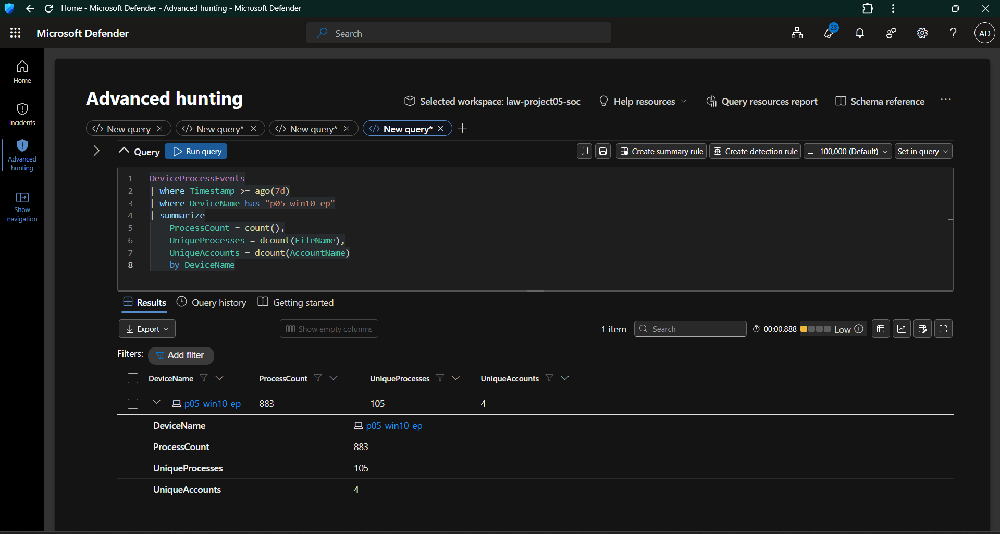

**Investigation:** Establish a baseline of observed endpoint process activity.

**SOC relevance:**
- Identify frequently executed processes.
- Understand normal endpoint activity before investigating suspicious behavior.
- Establish a reference point for future detection engineering and threat hunting.

### Evidence 02 — Top Process Frequency

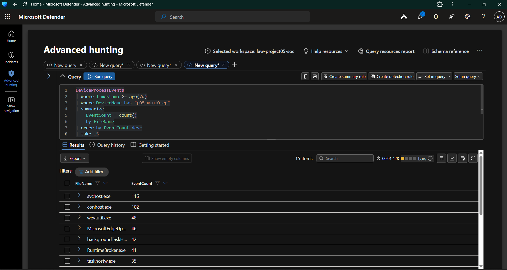

**Investigation:** Aggregate process events by filename and rank processes by event count.

**Observed result:** The investigation returned a ranked list of frequently observed processes, including Windows service and console-related processes.

**SOC relevance:** Process frequency provides context for investigating unusual execution patterns. Frequency alone does not establish whether a process is malicious.

---

## 4. Windows Event Utility Investigation

The investigation examined `wevtutil.exe`, a legitimate Windows utility that can interact with Windows event logs.

### Evidence 03 — Wevtutil Investigation

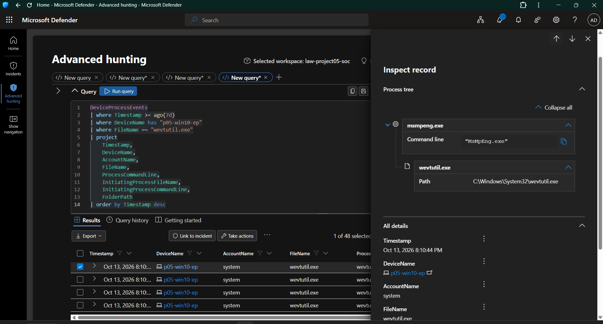

**Investigation:** Review `wevtutil.exe` process events, associated accounts, command lines, and initiating processes.

**SOC relevance:** Event-log utilities can be used for legitimate administration and may also appear during attacker activity. Their use should be investigated in context.

### Evidence 04 — Wevtutil Command-Line Analysis

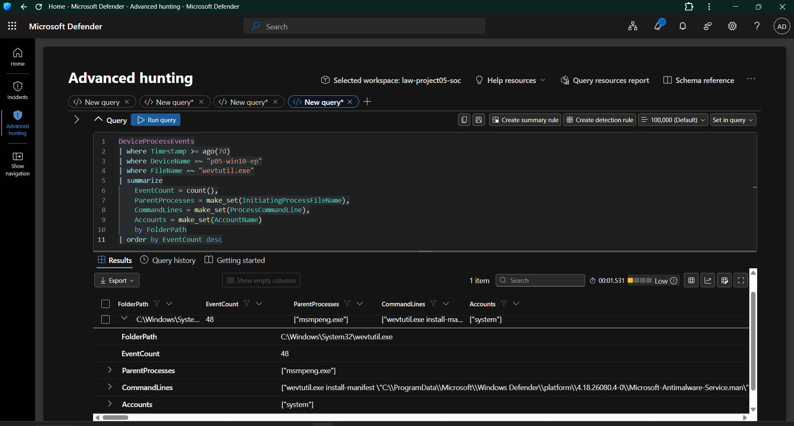

**Investigation:** Examine the command-line and parent-process context associated with `wevtutil.exe`.

**Observed result:** The process investigation identified `msmpeng.exe` as the parent process and showed a command line associated with the Microsoft Defender platform.

**Assessment:** The observed command and parent-process context are consistent with Defender-related activity. The result demonstrates why analysts should inspect the process tree and command line instead of classifying a process as malicious based only on its filename.

---

## 5. Controlled PowerShell Activity

PowerShell process telemetry was reviewed to understand how command execution appears in Defender Advanced Hunting.

### Evidence 05 — PowerShell Harmless Test Execution

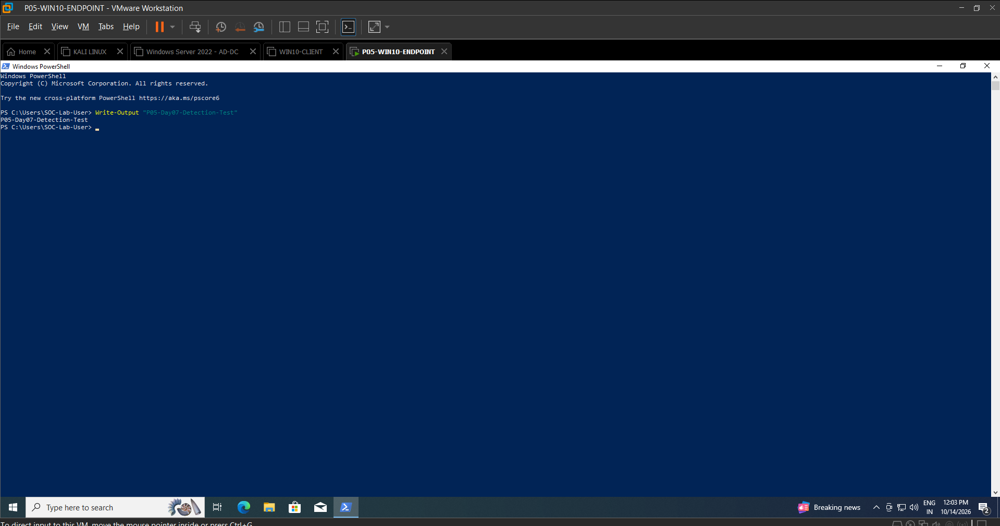

A controlled PowerShell command was executed in the Windows test environment.

**Purpose:**
- Generate a known process-execution event.
- Establish a timestamp for telemetry validation.
- Compare the action performed on the endpoint with the event recorded by Defender.

### Evidence 06 — PowerShell Process Telemetry

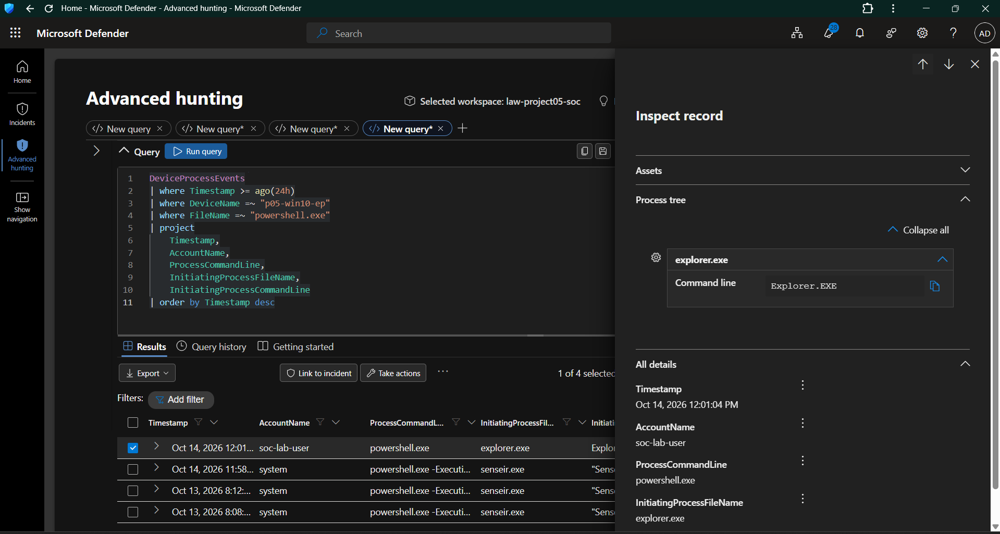

The resulting process events were queried from `DeviceProcessEvents`.

The investigation examined:

- `Timestamp`
- `DeviceName`
- `AccountName`
- `ProcessCommandLine`
- `InitiatingProcessFileName`
- `FolderPath`

**Observed result:** PowerShell activity associated with `p05-win10-ep` was visible in Advanced Hunting. Events included activity initiated by `explorer.exe` and PowerShell activity associated with `senseir.exe`.

**SOC relevance:** The initiating process and execution context help distinguish user-initiated activity from background security-tool activity.

---

## 6. Controlled File Creation and Telemetry Validation

A temporary test directory and text file were created on the Windows endpoint.

The test used the following location:

`%TEMP%\P05-Day07-Test\endpoint-test.txt`

The file contained a simple project test message. This activity was performed to validate endpoint visibility, not to simulate malware.

### Evidence 07 — Windows Test File Creation

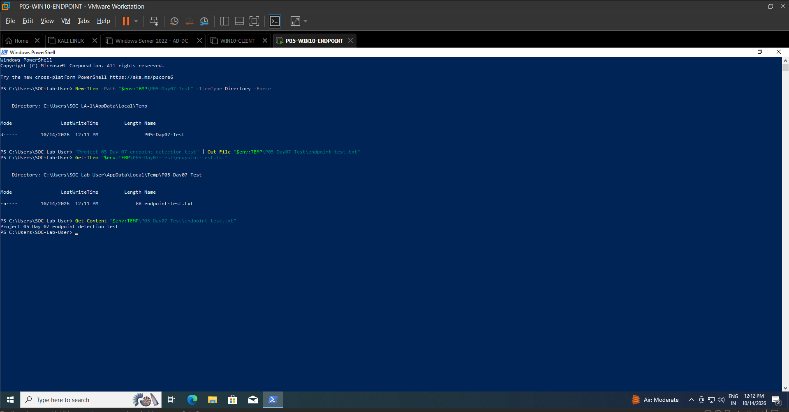

**Endpoint action:** Create a temporary directory and write a text file using PowerShell.

**Validation objective:** Confirm that the test artifacts existed on the Windows endpoint.

### Evidence 08 — PowerShell Process Telemetry After the Test

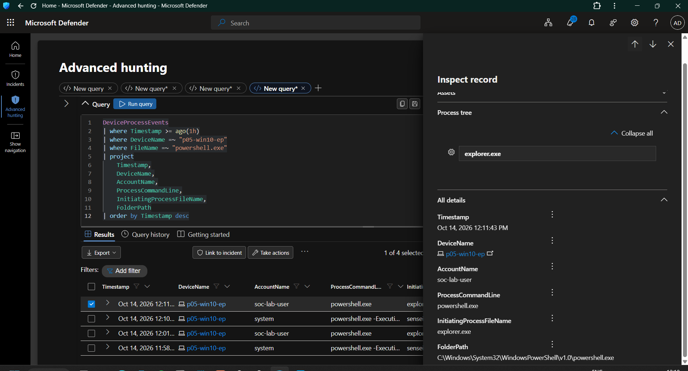

The process telemetry was reviewed after the controlled test.

**SOC relevance:** A known test action provides a useful reference for checking process events, timestamps, initiating processes, and execution accounts.

### Evidence 09 — CMD Process Execution

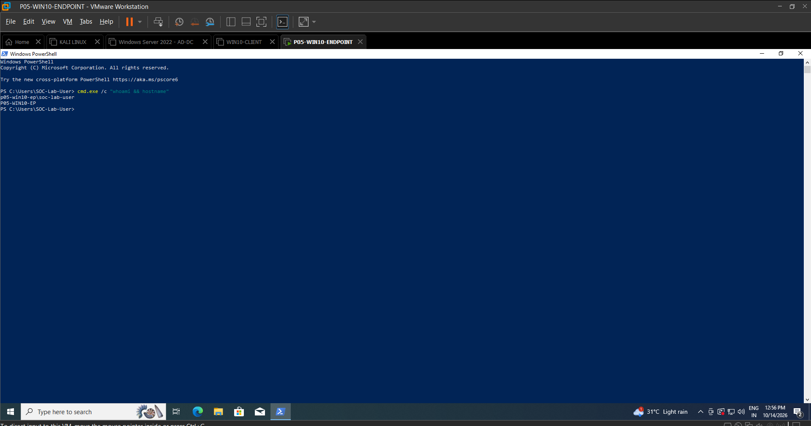

A controlled command was executed:

`cmd.exe /c "whoami && hostname"`

The command returned the current account and hostname.

**Observed result:** Defender recorded the `cmd.exe` process event and exposed its command line and initiating PowerShell process.

**SOC relevance:** Discovery commands such as `whoami` and `hostname` can appear during routine administration, troubleshooting, and attacker reconnaissance. Their presence should be assessed using surrounding process and account context.

### Evidence 10 — CMD Process Telemetry Validation

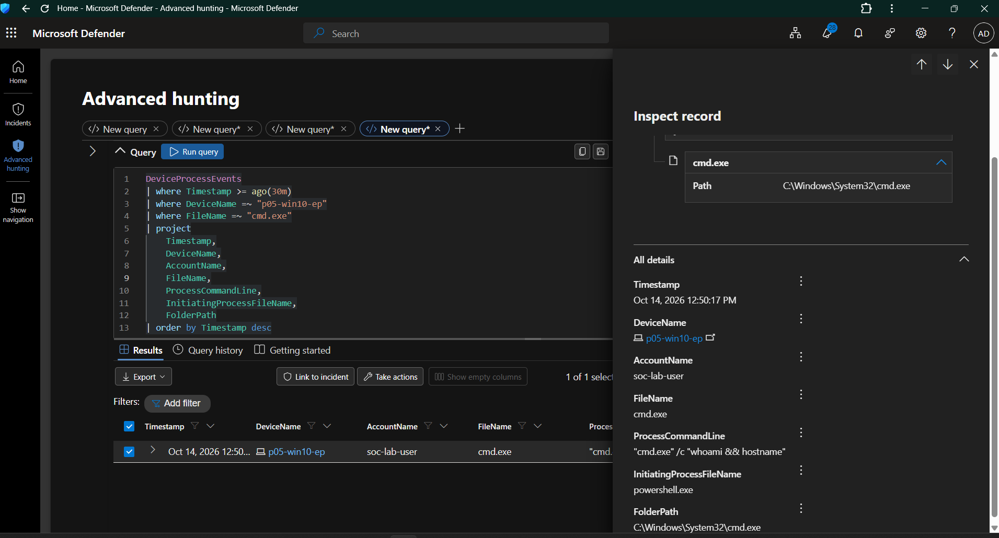

The recorded CMD process event was reviewed in Advanced Hunting.

The investigation used the process command line to identify the controlled discovery command and its parent process.

**Validation result:** The controlled CMD execution was visible in endpoint process telemetry.

### Evidence 11 — CMD Whoami Detection Validation

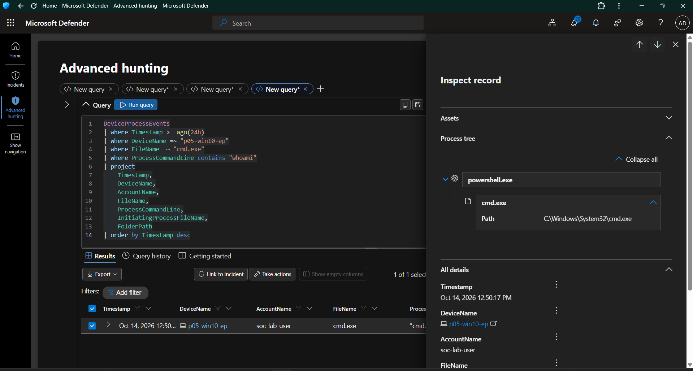

A focused KQL investigation searched process command lines for discovery-related terms, including `whoami`.

**Observed result:** The controlled discovery command was returned by the query.

**SOC relevance:** Filtering process events by command-line indicators allows analysts to investigate specific behaviors without relying exclusively on executable names.

---

## 7. Endpoint Discovery Hunting

The investigation expanded the search to discovery-related commands.

The hunting logic reviewed process command lines for indicators such as:

- `whoami`
- `hostname`
- `ipconfig`
- `systeminfo`
- `net user`
- `net localgroup`

These commands can be legitimate administrative utilities. Their presence is not sufficient evidence of compromise.

### Evidence 12 — Endpoint Discovery Hunt Validation

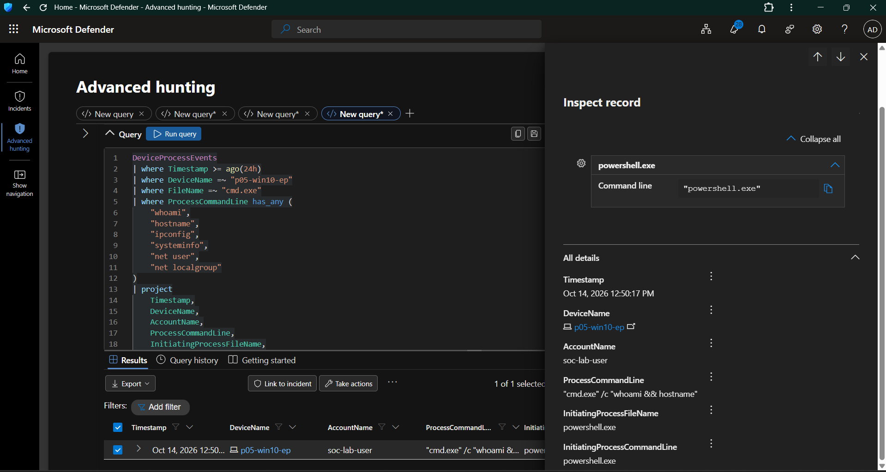

The hunting query filtered process telemetry for selected discovery-related command-line indicators and summarized matching activity.

**Investigation objectives:**
1. Identify process events containing discovery-related terms.
2. Review the associated account and parent process.
3. Examine the execution timestamp and command line.
4. Validate whether the event corresponded to the controlled lab activity.

**SOC relevance:** This workflow demonstrates how a SOC analyst can turn an investigative hypothesis into a repeatable KQL hunting query.

---

## 8. Repeated Discovery Activity Validation

The final investigation focused on identifying repeated discovery-related activity within endpoint process telemetry.

### Evidence 13 — Repeated Discovery Hunt Validation

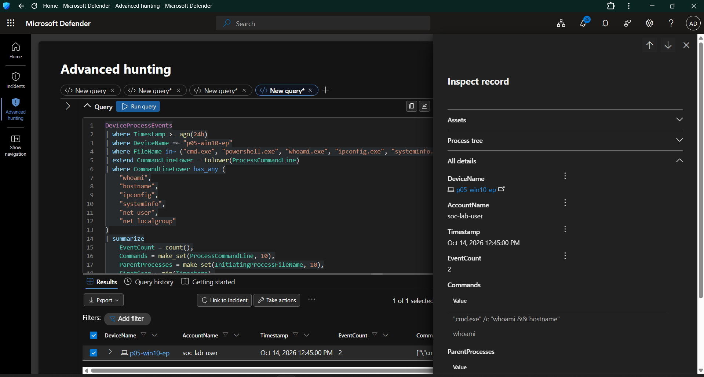

The query grouped matching process activity and examined the observed commands, account, parent process, and event count.

**Validation result:** The controlled `whoami` and `hostname` activity was visible in the endpoint telemetry and could be investigated using KQL.

The purpose of this validation was to confirm that the hunting logic could identify the controlled test behavior. It was not intended to establish that a real attack had occurred.

---

## 9. KQL Investigation Techniques Practiced

The Day 07 investigation applied the following KQL techniques:

| Technique | Purpose |
|---|---|
| Time filtering with `ago()` | Restrict investigation to a relevant time window |
| Filtering with `where` | Narrow events to a device, executable, or command-line indicator |
| Field selection with `project` | Display relevant investigation fields |
| Aggregation with `summarize` | Calculate event counts and group process activity |
| Sorting with `order by` | Prioritize frequent or recent events |
| Command-line matching | Identify selected discovery commands |
| Parent-process investigation | Understand process execution relationships |
| Account-context review | Identify the account associated with execution |

These techniques provide a foundation for endpoint threat hunting and detection engineering.

---

## 10. Quantitative Outcomes

The following outcomes are supported by the recorded lab evidence.

| Metric | Observed outcome |
|---|---:|
| Endpoint investigated | 1 |
| Endpoint process events in the recorded baseline query | 883 |
| Unique process filenames in that baseline query | 105 |
| Unique accounts in that baseline query | 4 |
| `wevtutil.exe` events in the recorded investigation | 48 |
| Controlled discovery command | 1 command containing `whoami` and `hostname` |
| Core endpoint telemetry tables investigated | 2 |
| Evidence screenshots captured | 13 |

**Interpretation:** The lab established a repeatable workflow for investigating process activity, reviewing process relationships, and validating controlled discovery behavior on a monitored Windows endpoint.

*Counts reflect the specific query results captured during the lab. They are not universal endpoint totals, and the results can change as new telemetry arrives.*

---

## 11. MITRE ATT&CK Context

The controlled discovery activity is relevant to the following MITRE ATT&CK technique:

| Technique | ID | Lab relevance |
|---|---|---|
| System Information Discovery | T1082 | Investigating the use of `systeminfo` and related system-information commands |
| System Owner/User Discovery | T1033 | Investigating `whoami` and account-context discovery |
| System Network Configuration Discovery | T1016 | Investigating `ipconfig` and network-configuration discovery |
| Account Discovery | T1087 | Investigating commands such as `net user` and `net localgroup` |

These mappings describe the behaviors targeted by the hunting logic. They should not be interpreted as confirmation that every listed technique was executed during the recorded test.

---

## 12. Day 07 Completion Summary

Day 07 focused on endpoint investigation using Microsoft Defender for Endpoint and KQL.

The work covered process baselining, Windows utility investigation, controlled PowerShell and CMD execution, process-tree inspection, and discovery-command hunting.

The controlled activities were used to validate endpoint telemetry and test the investigation queries against known behavior.

### Skills Demonstrated

- Microsoft Defender Advanced Hunting
- KQL-based endpoint investigation
- Process execution analysis
- Parent-child process investigation
- Command-line analysis
- Endpoint file-activity investigation
- Discovery-behavior hunting
- Evidence collection and technical documentation
- MITRE ATT&CK technique mapping

### Portfolio Value

This exercise demonstrates a practical endpoint-hunting workflow: generate a controlled test event, locate it in endpoint telemetry, investigate its execution context, validate a KQL query, and document the results with supporting evidence.

**Day 07 status: Practical investigation and evidence collection completed; documentation ready for review.**

---

## 13. Evidence Index

All screenshots are stored in `screenshots/Day07/`.

| Evidence | Filename |
|---|---|
| 01 | `Day07-01-Endpoint-Process-Baseline.png` |
| 02 | `Day07-02-Top-Process-Frequency.png` |
| 03 | `Day07-03-Wevtutil-Investigation.png` |
| 04 | `Day07-04-Wevtutil-CommandLine-Analysis.png` |
| 05 | `Day07-05-PowerShell-Harmless-Test-Execution.png` |
| 06 | `Day07-06-PowerShell-Process-Telemetry.png` |
| 07 | `Day07-07-Windows-Test-File-Creation.png` |
| 08 | `Day07-08-PowerShell-Process-Telemetry-After-Test.png` |
| 09 | `Day07-09-CMD-Process-Execution.png` |
| 10 | `Day07-10-CMD-Process-Telemetry-Validation.png` |
| 11 | `Day07-11-CMD-Whoami-Detection-Validation.png` |
| 12 | `Day07-12-Endpoint-Discovery-Hunt-Validation.png` |
| 13 | `Day07-13-Repeated-Discovery-Hunt-Validation.png` |

---

## 14. Next Step

Proceed to Day 08 — Identity and Endpoint Correlation.

The next stage will focus on correlating identity sign-in activity with endpoint process telemetry to build a more complete investigation timeline.