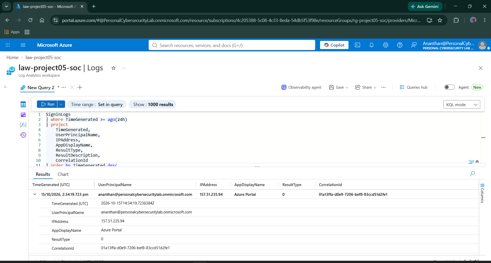
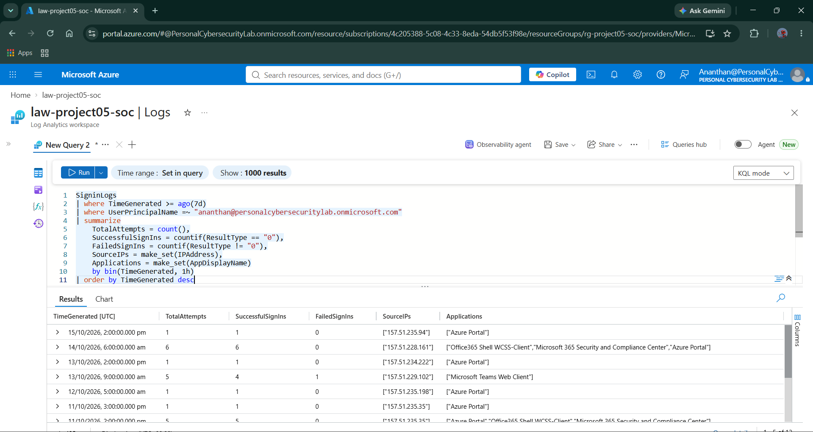
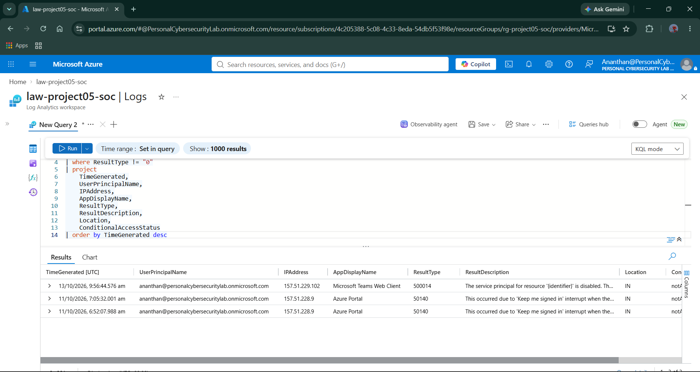
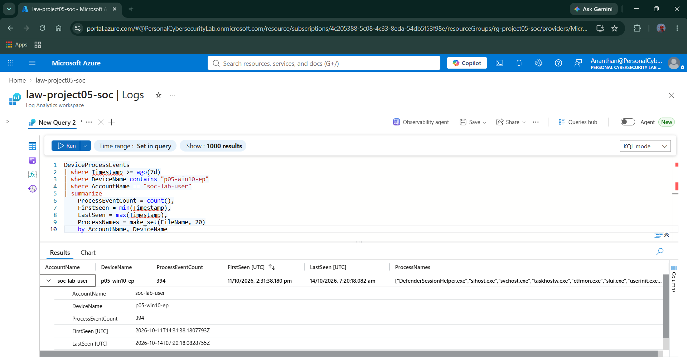
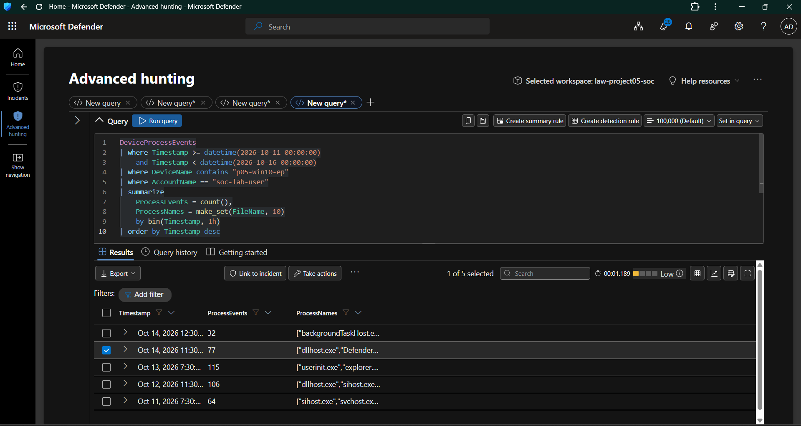
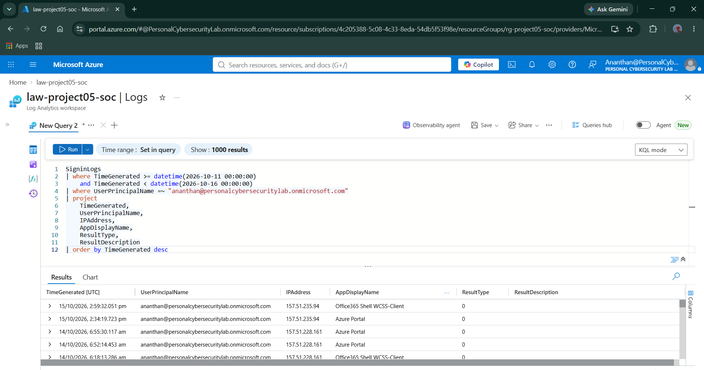
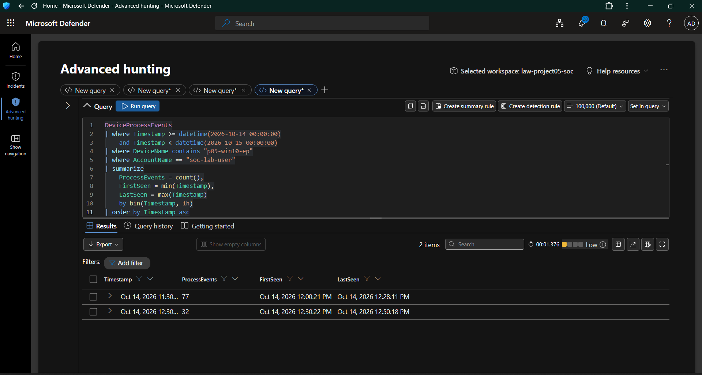
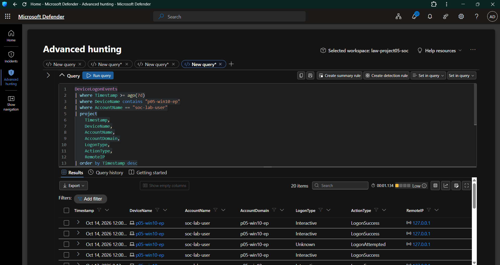

# Day 08 — Identity and Endpoint Correlation Investigation

**Project:** Project 05 — Microsoft Cloud SOC, EDR & Threat Hunting Lab  
**Day:** 08 of 18  
**Focus:** Identity investigation, endpoint telemetry analysis, and cross-source correlation  
**Platforms:** Microsoft Entra ID, Microsoft Defender for Endpoint, Azure Log Analytics  
**Query Language:** Kusto Query Language (KQL)  
**Status:** Investigation completed; direct identity correlation not established

---

## 1. Objective

The objective of Day 08 was to investigate cloud identity authentication events and endpoint activity, compare their timelines, and determine whether the available telemetry supported a reliable relationship between the cloud identity and the local Windows account.

### Investigation objectives

- Investigate Microsoft Entra ID sign-in activity.
- Review successful and failed authentication attempts.
- Analyze endpoint process activity associated with the local Windows account.
- Establish an endpoint activity timeline.
- Investigate local Windows logon events.
- Compare identity and endpoint activity.
- Document findings, limitations, and opportunities for improvement.

---

## 2. Lab Environment

| Component | Configuration |
|---|---|
| Identity platform | Microsoft Entra ID |
| Cloud identity | `ananthan@personalcybersecuritylab.onmicrosoft.com` |
| Endpoint security | Microsoft Defender for Endpoint |
| Endpoint device | `p05-win10-ep` |
| Local Windows account | `soc-lab-user` |
| Log Analytics workspace | `law-project05-soc` |
| Query language | KQL |
| Evidence directory | `screenshots/Day08/` |

### Identity distinction

This investigation involved two identities:

- **Cloud identity:** `ananthan@personalcybersecuritylab.onmicrosoft.com`
- **Local Windows account:** `soc-lab-user`

The local Windows account was not linked to the Entra ID identity as part of this lab configuration.

Therefore, the investigation treats these as separate identities unless supporting evidence establishes a relationship.

---

## 3. Entra ID Sign-In Investigation

### Objective

Investigate cloud authentication activity for the Entra ID account and review the associated timestamps, source IP addresses, applications, and authentication results.

### KQL query

**Data source:** `SigninLogs`  
**Query environment:** Azure Log Analytics

```kusto
SigninLogs
| where TimeGenerated >= ago(24h)
| project
    TimeGenerated,
    UserPrincipalName,
    IPAddress,
    AppDisplayName,
    ResultType,
    ResultDescription,
    CorrelationId
| order by TimeGenerated desc
| take 20
```

### Evidence 01 — Entra ID Sign-In Investigation



### Findings

The query returned sign-in records for the investigated Entra ID account.

The results included:

- Sign-in timestamps
- User principal name
- Source IP address
- Application name
- Authentication result
- Correlation ID

The captured results showed a successful Azure Portal sign-in with `ResultType` equal to `0`.

### SOC analysis

A successful authentication indicates that the sign-in operation succeeded according to the recorded result. It does not independently establish whether the activity was expected or suspicious.

A SOC analyst should assess the application, source IP, location, authentication context, and surrounding events before determining whether an alert or escalation is warranted.

---

## 4. Authentication Pattern Analysis

### Objective

Summarize authentication activity over time and identify the distribution of successful and failed sign-ins.

### KQL query

```kusto
SigninLogs
| where TimeGenerated >= ago(7d)
| where UserPrincipalName =~ "ananthan@personalcybersecuritylab.onmicrosoft.com"
| summarize
    TotalAttempts = count(),
    SuccessfulSignIns = countif(ResultType == "0"),
    FailedSignIns = countif(ResultType != "0"),
    SourceIPs = make_set(IPAddress),
    Applications = make_set(AppDisplayName)
    by bin(TimeGenerated, 1h)
| order by TimeGenerated desc
```

### Evidence 02 — Sign-In Pattern Analysis



### Findings

The query groups authentication events into hourly intervals and summarizes:

- Total authentication attempts
- Successful sign-ins
- Failed sign-ins
- Source IP addresses
- Applications accessed

The captured results showed authentication activity across multiple time intervals, applications, and source IP addresses.

### SOC analysis

Authentication aggregation can help identify unusual spikes, repeated failures, and activity requiring deeper investigation.

However, the presence of failed sign-ins does not automatically indicate a brute-force attack. Analysts must consider failure reasons, event frequency, successful authentication following failures, source reputation, and other relevant context.

---

## 5. Failed Sign-In Investigation

### Objective

Investigate failed authentication events and examine the associated result codes and descriptions.

### KQL query

```kusto
SigninLogs
| where TimeGenerated >= ago(7d)
| where UserPrincipalName =~ "ananthan@personalcybersecuritylab.onmicrosoft.com"
| where ResultType != "0"
| project
    TimeGenerated,
    UserPrincipalName,
    IPAddress,
    AppDisplayName,
    ResultType,
    ResultDescription,
    Location,
    ConditionalAccessStatus
| order by TimeGenerated desc
```

### Evidence 03 — Failed Sign-In Investigation



### Findings

The captured results included failed sign-in events associated with the investigated Entra ID account.

The visible events included different result codes and descriptions.

Examples in the evidence included:

- `500014` — a result description referring to a disabled service principal.
- `50140` — a result description referring to an interruption involving the "Keep me signed in" experience.

These events have different potential causes and should not be treated as equivalent authentication failures.

### SOC analysis

The correct investigation process is to:

1. Review the exact result code and description.
2. Identify the affected application.
3. Review the source IP address and location.
4. Check for successful sign-ins around the same time.
5. Determine whether the failure reflects user behavior, application configuration, or potentially suspicious activity.

The captured failures do not independently establish malicious activity.

---

## 6. Endpoint Account Activity Summary

### Objective

Determine the volume and time range of process events associated with the local Windows account on the lab endpoint.

### KQL query

**Data source:** `DeviceProcessEvents`  
**Query environment:** Microsoft Defender Advanced Hunting

```kusto
DeviceProcessEvents
| where Timestamp >= ago(7d)
| where DeviceName contains "p05-win10-ep"
| where AccountName == "soc-lab-user"
| summarize
    ProcessEventCount = count(),
    FirstSeen = min(Timestamp),
    LastSeen = max(Timestamp),
    ProcessNames = make_set(FileName, 20)
    by AccountName, DeviceName
```

### Evidence 04 — Endpoint Account Activity Summary



### Findings

The captured query returned the following aggregate results:

| Field | Observed value |
|---|---|
| Account name | `soc-lab-user` |
| Device name | `p05-win10-ep` |
| Process event count | 394 |
| First observed event | October 11, 2026, approximately 14:31:38 UTC |
| Last observed event | October 14, 2026, approximately 07:20:18 UTC |

### SOC analysis

The results confirm that Defender recorded process activity associated with `soc-lab-user` on the investigated endpoint during the selected period.

The process event count represents recorded telemetry, not a count of malicious actions.

Process names must be investigated alongside parent processes, command lines, timestamps, account context, and other available evidence before determining whether activity is suspicious.

---

## 7. Endpoint Activity Timeline

### Objective

Group process events into hourly intervals to establish a timeline of activity associated with the local account.

### KQL query

```kusto
DeviceProcessEvents
| where Timestamp >= datetime(2026-10-11 00:00:00)
    and Timestamp < datetime(2026-10-16 00:00:00)
| where DeviceName contains "p05-win10-ep"
| where AccountName == "soc-lab-user"
| summarize
    ProcessEvents = count(),
    ProcessNames = make_set(FileName, 10)
    by bin(Timestamp, 1h)
| order by Timestamp desc
```

### Evidence 05 — Endpoint Activity Timeline



### Findings

The query grouped endpoint process events into hourly time buckets.

This view makes it easier to identify periods with higher event volumes and select time windows for detailed investigation.

### SOC analysis

Timeline aggregation provides an overview of endpoint activity but does not identify malicious behavior on its own.

A higher event count may result from normal operating system activity, user activity, background services, or other processes.

The analyst should investigate individual events when the surrounding context suggests a potential security concern.

---

## 8. Entra ID Sign-In Timeline

### Objective

Review identity authentication events during the investigation period and prepare them for comparison with endpoint activity.

### KQL query

```kusto
SigninLogs
| where TimeGenerated >= datetime(2026-10-11 00:00:00)
    and TimeGenerated < datetime(2026-10-16 00:00:00)
| where UserPrincipalName =~ "ananthan@personalcybersecuritylab.onmicrosoft.com"
| project
    TimeGenerated,
    UserPrincipalName,
    IPAddress,
    AppDisplayName,
    ResultType,
    ResultDescription
| order by TimeGenerated desc
```

### Evidence 06 — Entra ID Sign-In Timeline



### Findings

The captured results showed successful sign-ins associated with the Entra ID account.

Examples visible in the results included:

| Date | Approximate time shown | Application | Source IP | Result |
|---|---|---|---|---|
| October 14, 2026 | 06:52 UTC | Azure Portal | `157.51.228.161` | Success |
| October 14, 2026 | 06:55 UTC | Azure Portal | `157.51.228.161` | Success |

The displayed timestamps are taken from the investigation evidence.

### SOC analysis

The sign-in timeline provides identity-side context for the investigation.

A successful cloud sign-in cannot be assumed to have initiated a specific local Windows process. Establishing that relationship requires supporting identity, device, session, or other reliable correlation evidence.

---

## 9. Endpoint Timeline — October 14, 2026

### Objective

Narrow the endpoint investigation to October 14 and identify the observed process activity intervals.

### KQL query

```kusto
DeviceProcessEvents
| where Timestamp >= datetime(2026-10-14 00:00:00)
    and Timestamp < datetime(2026-10-15 00:00:00)
| where DeviceName contains "p05-win10-ep"
| where AccountName == "soc-lab-user"
| summarize
    ProcessEvents = count(),
    FirstSeen = min(Timestamp),
    LastSeen = max(Timestamp)
    by bin(Timestamp, 1h)
| order by Timestamp asc
```

### Evidence 07 — Endpoint Timeline, October 14



### Findings

The captured results showed two hourly buckets containing endpoint process activity:

| Activity interval shown | First observed event | Last observed event | Event count |
|---|---|---|---:|
| Around 11:30 AM | 12:00:21 PM | 12:28:11 PM | 77 |
| Around 12:30 PM | 12:30:22 PM | 12:50:18 PM | 32 |
| **Total** | | | **109** |

The interface shortened the displayed bucket labels. The first and last event timestamps provide more precise timing information.

### SOC analysis

The evidence shows endpoint process activity during the displayed time intervals.

The specific Entra ID sign-ins highlighted in Section 8 occurred earlier than these endpoint activity intervals.

This evidence does not establish a direct causal relationship between those sign-ins and the later endpoint process events.

The correct conclusion is that the available events were compared, but direct identity correlation was not confirmed.

---

## 10. Endpoint Logon Investigation

### Objective

Investigate logon events associated with the local Windows account and review the recorded logon types, actions, and remote IP values.

### KQL query

**Data source:** `DeviceLogonEvents`  
**Query environment:** Microsoft Defender Advanced Hunting

```kusto
DeviceLogonEvents
| where Timestamp >= ago(7d)
| where DeviceName contains "p05-win10-ep"
| where AccountName == "soc-lab-user"
| project
    Timestamp,
    DeviceName,
    AccountName,
    AccountDomain,
    LogonType,
    ActionType,
    RemoteIP
| order by Timestamp desc
| take 20
```

### Evidence 08 — Endpoint Logon Investigation



### Findings

The captured results displayed 20 logon events for the investigated endpoint and local account.

The visible records included:

| Field | Observed value |
|---|---|
| Device | `p05-win10-ep` |
| Account | `soc-lab-user` |
| Account domain | `p05-win10-ep` |
| Logon type | Mostly `Interactive` |
| Action type | Mostly `LogonSuccess` |
| Remote IP shown in some events | `127.0.0.1` |
| Additional action shown | `LogonAttempted` |

### SOC analysis

The account and domain values are consistent with a local Windows account on the endpoint.

The address `127.0.0.1` is the IPv4 loopback address. It refers to the local system rather than an external public host.

A `LogonAttempted` event should be evaluated alongside its outcome and surrounding events; its presence alone does not establish an unsuccessful or malicious logon.

The captured endpoint logon events provide additional context for local account activity. They do not establish that the local account is the same identity as the Entra ID account.

---

## 11. Cross-Source Correlation Assessment

### Objective

Assess whether the collected identity and endpoint telemetry supports a reliable relationship between cloud sign-in activity and local endpoint activity.

### Identities under investigation

| Identity | Identity context |
|---|---|
| `ananthan@personalcybersecuritylab.onmicrosoft.com` | Microsoft Entra ID cloud account |
| `soc-lab-user` | Local Windows account on `p05-win10-ep` |

### Findings

The investigation established that:

1. Entra ID sign-in telemetry was available.
2. Successful and failed cloud authentication events were reviewed.
3. Defender process telemetry was available for the local Windows account.
4. Endpoint process activity was summarized and placed on a timeline.
5. Endpoint logon events were examined.
6. Identity and endpoint timelines were compared.
7. A direct mapping between the Entra ID account and the local Windows account was not established.

### Correlation limitation

The lab did not have a configured and verified mapping between the two identities during this investigation.

The available evidence did not establish a reliable direct identifier linking the observed Entra ID sign-ins to the local account's endpoint process events.

Therefore, this investigation does not claim that:

- Both accounts represent the same identity.
- The Entra ID sign-ins caused the observed endpoint activity.
- The local Windows account authenticated to Entra ID.
- The investigated activity was malicious.

### Recommended future enhancement

A future lab enhancement could introduce an appropriately configured Entra-joined endpoint or another supported identity architecture.

The resulting telemetry could then be validated to determine which identity and device attributes are available for correlation.

This enhancement was not implemented as part of Day 08, and the existing 18-day project plan remains unchanged.

---

## 12. SOC Investigation Summary

| Investigation area | Outcome |
|---|---|
| Entra ID sign-in investigation | Completed |
| Successful authentication review | Completed |
| Failed authentication investigation | Completed |
| Endpoint process activity analysis | Completed |
| Endpoint activity timeline | Completed |
| Endpoint logon investigation | Completed |
| Cross-source timeline comparison | Completed |
| Direct identity mapping | Not established |
| Direct identity correlation | Not confirmed |
| Malicious activity established by this investigation | Not established |

### Final assessment

Day 08 focused on investigating cloud identity authentication and endpoint activity as separate telemetry sources, then comparing their timelines to assess whether a reliable relationship could be established.

The evidence confirmed that both identity and endpoint telemetry were available for investigation.

However, the Entra ID account and local Windows account were not linked in the current lab configuration. The available evidence did not establish a direct relationship between them.

The investigation therefore documented the available findings and explicitly recorded the correlation limitation rather than presenting an unverified relationship as fact.

This demonstrates an important SOC principle: **correlation must be supported by evidence, not assumed from the presence of events in the same environment.**

---

## 13. Skills Demonstrated

- Microsoft Entra ID sign-in investigation
- Authentication result analysis
- Failed sign-in investigation
- KQL filtering and aggregation
- Microsoft Defender Advanced Hunting
- Endpoint process activity analysis
- Endpoint logon investigation
- Timeline-based investigation
- Cross-source correlation assessment
- Evidence-based technical reporting
- Documentation of telemetry limitations

---

## 14. Day 08 Completion Status

**Status:** Investigation and evidence collection completed. Direct identity correlation remains unconfirmed.

The investigation used the telemetry available in the existing lab. No changes were made to the local account configuration to force a relationship that had not been established.

The original 18-day project plan remains unchanged.

### Next milestone

**Day 09 — Threat Hunting**

The next phase will focus on hypothesis-driven threat hunting using the available Microsoft Defender and Microsoft Sentinel capabilities