# Day 09 — Threat Hunting and Investigation

**Project:** Project 05 — Microsoft Cloud SOC, EDR & Threat Hunting Lab  
**Focus:** Threat Hunting  
**Platforms:** Microsoft Defender XDR and Microsoft Sentinel  
**Query Language:** Kusto Query Language (KQL)  
**Evidence:** `screenshots/Day09/`

---

## 1. Objectives

The objective of Day 09 was to investigate endpoint process activity and identity sign-in telemetry using a hypothesis-driven threat-hunting approach.

The investigation covered:

- Endpoint process telemetry baselining.
- Suspicious process-pattern investigation.
- Process execution and command-line analysis.
- PowerShell investigation.
- Entra ID sign-in analysis.
- Failed authentication investigation.
- Azure Portal authentication analysis.
- Source IP investigation.

The goal was to identify activity requiring further investigation while distinguishing suspicious indicators from legitimate system or user activity.

---

## 2. Tools and Data Sources

| Tool or data source | Purpose |
|---|---|
| Microsoft Defender Advanced Hunting | Investigate endpoint process and logon telemetry. |
| Microsoft Sentinel Logs | Investigate identity sign-in events. |
| KQL | Filter, summarize, and investigate security telemetry. |
| `DeviceProcessEvents` | Examine endpoint process execution events. |
| `DeviceLogonEvents` | Review endpoint logon activity. |
| `SigninLogs` | Analyze Entra ID authentication records. |

**Important:** Defender Advanced Hunting and Sentinel Logs are separate query environments. Queries must be executed where the relevant telemetry is available.

---

## 3. Endpoint Process Investigation

### 3.1 Process Telemetry Baseline

**Evidence file:** `Day09-01-Process-Telemetry-Baseline.png`

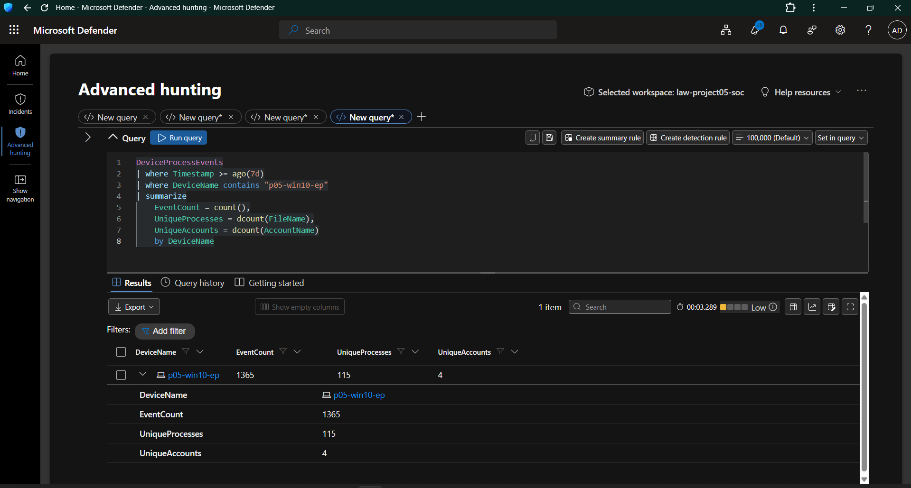

**Objective:** Establish a baseline of available endpoint process activity.

The baseline provides context for subsequent investigation by showing the process telemetry available for analysis.

**Investigation focus:**
- Availability of endpoint process events.
- Observed processes and accounts.
- Device-specific activity.
- Whether additional filtering is required.

**Security relevance:** Establishing a baseline helps analysts distinguish routine activity from patterns that deserve closer inspection.

### 3.2 Suspicious Process-Pattern Hunt

**Evidence file:** `Day09-02-Suspicious-Process-Pattern-Hunt.png`

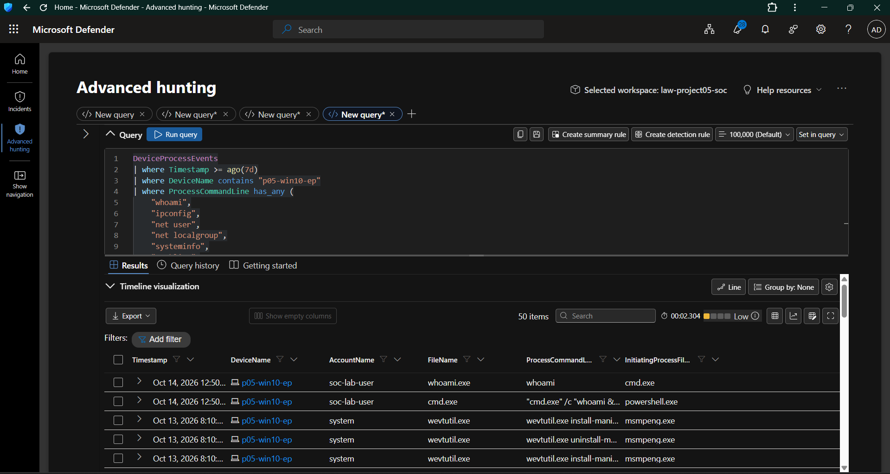

**Objective:** Investigate process patterns that may warrant additional analysis.

Process names alone cannot establish malicious behavior. Analysts should examine the executable, command line, parent process, account context, and surrounding events where available.

**Security relevance:** Process-pattern hunting helps generate investigative leads for further validation.

### 3.3 Process Execution Investigation

**Evidence file:** `Day09-03-Process-Execution-Investigation.png`

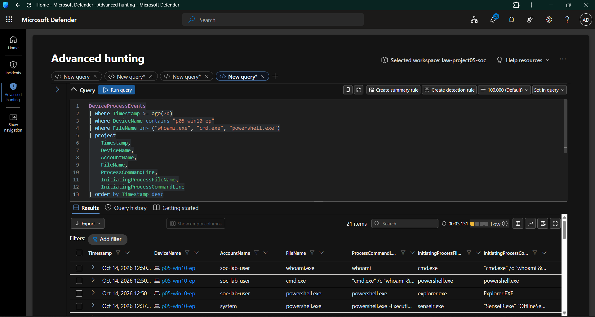

**Objective:** Review process execution records and their available context.

Relevant fields may include:
- Timestamp.
- Device name.
- Process name.
- Executing account.
- Process command line.
- Initiating process information.

**Security relevance:** Process execution details help analysts understand how an application was launched and whether its execution context warrants further investigation.

### 3.4 Defender-Related Process Investigation

**Evidence file:** `Day09-04-Defender-Related-Process-Investigation.png`

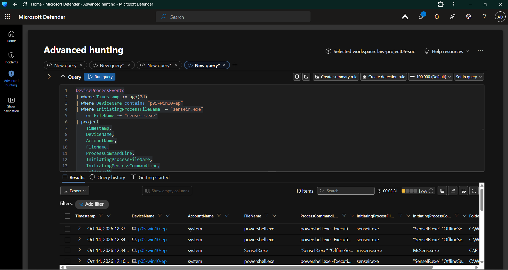

**Objective:** Examine Defender-related process activity.

Security software can generate legitimate background activity. Process events associated with security tools must therefore be interpreted in context.

**Security relevance:** Understanding expected security-tool behavior helps reduce false positives during threat hunting.

### 3.5 Process Command-Line Analysis

**Evidence file:** `Day09-05-Defender-Process-Command-Line-Analysis.png`

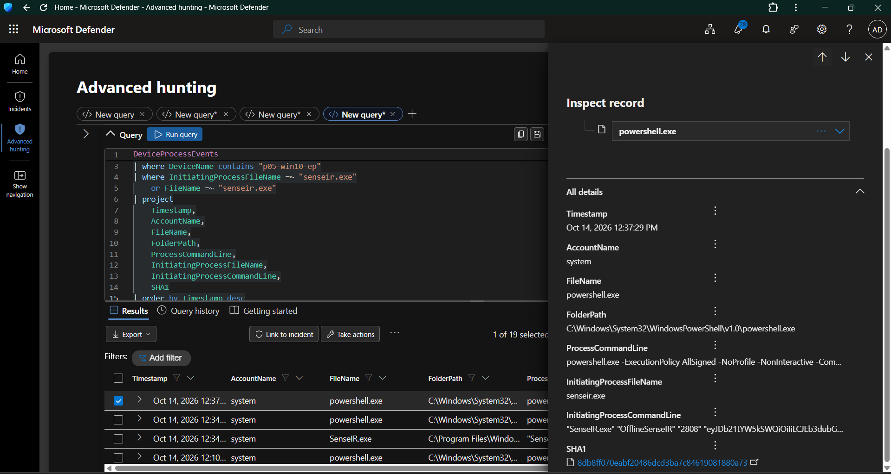

**Objective:** Examine process command-line information for additional execution context.

Command-line information may reveal:
- Execution arguments.
- Script or file paths.
- Administrative actions.
- Unusual execution patterns.

**Security relevance:** Command-line analysis provides more context than a process name alone. Suspicious arguments still require validation before an event can be classified as malicious.

### 3.6 PowerShell Command-Line Investigation

**Evidence file:** `Day09-06-PowerShell-Command-Line-Investigation.png`

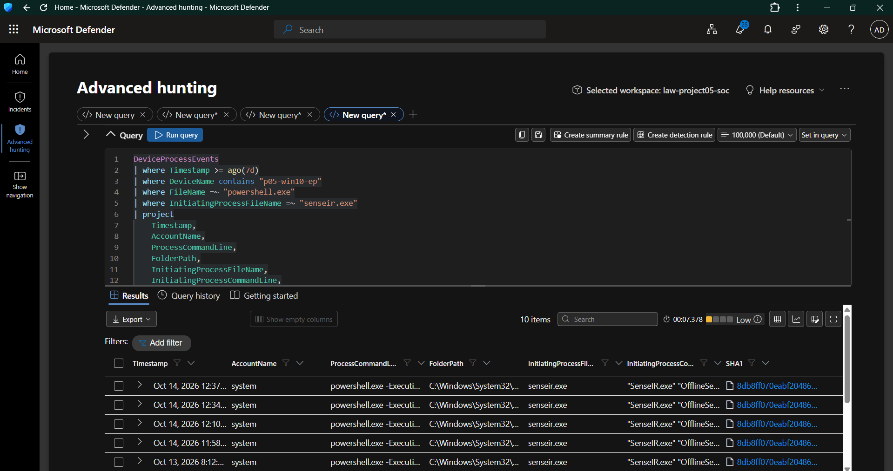

**Objective:** Investigate PowerShell execution using endpoint telemetry.

PowerShell is a legitimate administrative tool, but it can also be abused. Its use should be assessed alongside the command, account, parent process, and execution context.

**Security relevance:** Reviewing PowerShell activity helps analysts investigate potentially suspicious script execution without treating all PowerShell use as malicious.

### 3.7 PowerShell Full Command-Line Review

**Evidence file:** `Day09-07-PowerShell-Full-Command-Line.png`

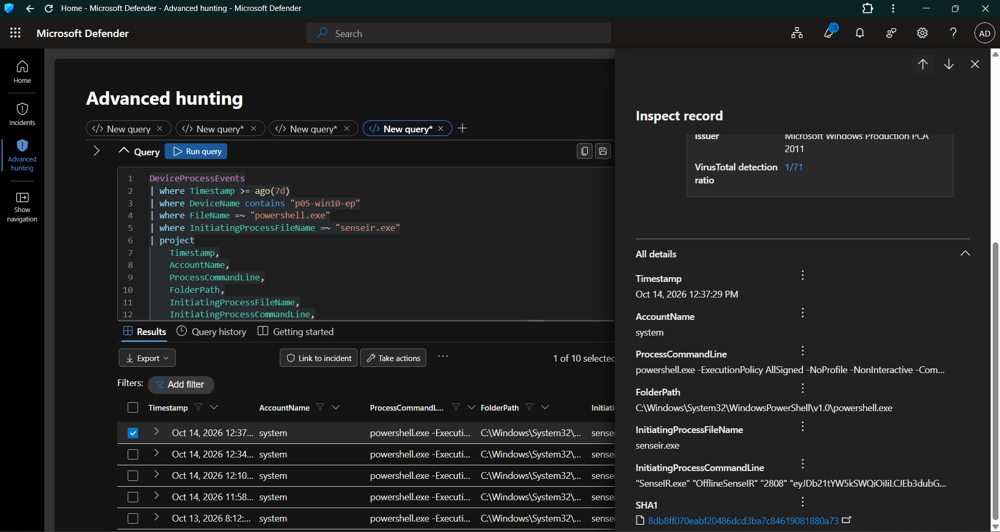

**Objective:** Review the available full command-line details for PowerShell activity.

A full command line can provide information that is not visible from the process name alone.

**Security relevance:** Detailed command-line review supports investigation of suspicious execution patterns and helps analysts determine whether additional evidence is required.

---

## 4. Identity and Authentication Investigation

### 4.1 Sign-In Telemetry Baseline

**Evidence file:** `Day09-08-Signin-Telemetry-Baseline.png`

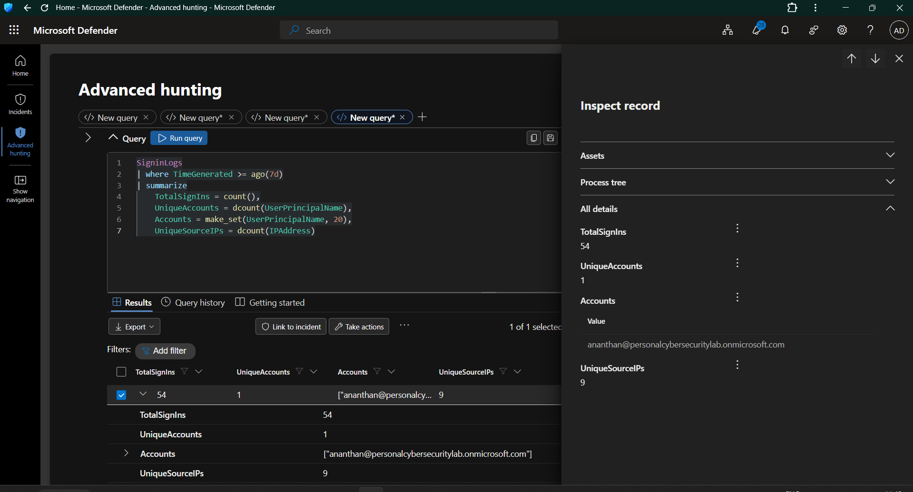

**Data source:** Microsoft Sentinel — `SigninLogs`

**Objective:** Establish a baseline of available Entra ID sign-in activity.

The investigation considered sign-in events, source IP addresses, applications, and authentication results.

**Security relevance:** A baseline provides context for identifying authentication patterns that may require closer inspection.

### 4.2 Unusual Sign-In Activity Summary

**Evidence file:** `Day09-09-Unusual-Signin-Activity-Summary.png`

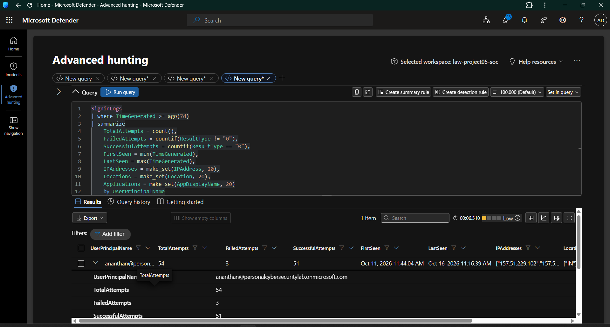

**Data source:** Microsoft Sentinel — `SigninLogs`

**Objective:** Summarize authentication activity to identify patterns for further investigation.

Relevant analysis dimensions include:
- Total sign-in attempts.
- Failed sign-ins.
- Successful sign-ins.
- Source IP addresses.
- Applications.
- Authentication result codes.

**Security relevance:** Aggregated sign-in activity can help prioritize records for investigation. A high failure count alone does not prove an attack.

### 4.3 Failed Sign-In Investigation

**Evidence file:** `Day09-10-Failed-Signin-Investigation.png`

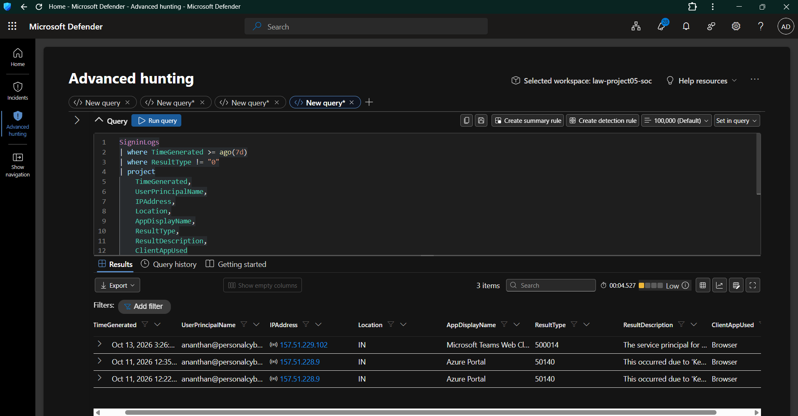

**Data source:** Microsoft Sentinel — `SigninLogs`

**Objective:** Examine unsuccessful authentication records and their available failure details.

The investigation considered the account, timestamp, source IP address, application, result code, and result description where available.

**Security relevance:** Reviewing failure details helps distinguish possible security concerns from expected authentication errors or interrupted sign-in flows.

### 4.4 Azure Portal Failure Analysis

**Evidence file:** `Day09-11-Azure-Portal-Failure-Analysis.png`

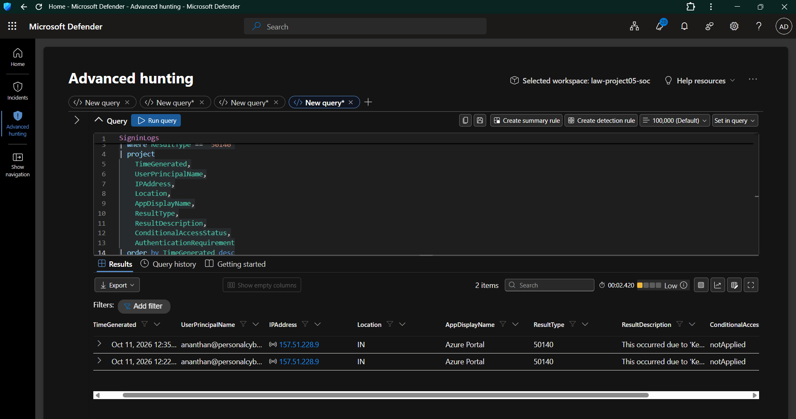

**Data source:** Microsoft Sentinel — `SigninLogs`

**Objective:** Investigate authentication failures associated with Azure Portal activity.

The analysis focused on recorded authentication result codes and descriptions.

**Security relevance:** Authentication failures should be interpreted using their actual recorded details. A failed Azure Portal sign-in does not independently establish an attempted compromise.

### 4.5 Azure Portal Authentication Details

**Evidence file:** `Day09-12-Azure-Portal-Authentication-Details.png`

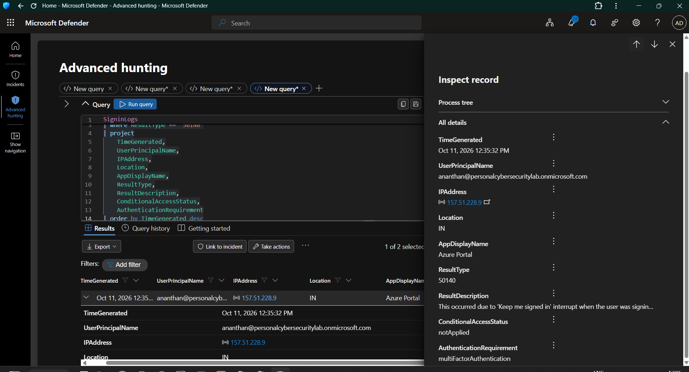

**Objective:** Inspect individual authentication records for additional context.

Relevant fields include:
- `TimeGenerated`
- `UserPrincipalName`
- `IPAddress`
- `Location`
- `AppDisplayName`
- `ResultType`
- `ResultDescription`
- `ConditionalAccessStatus`
- `AuthenticationRequirement`

**Security relevance:** Detailed record inspection helps analysts understand the authentication outcome and determine whether further investigation is appropriate.

### 4.6 Sign-In IP Investigation

**Evidence file:** `Day09-13-SignIn-IP-Investigation.png`

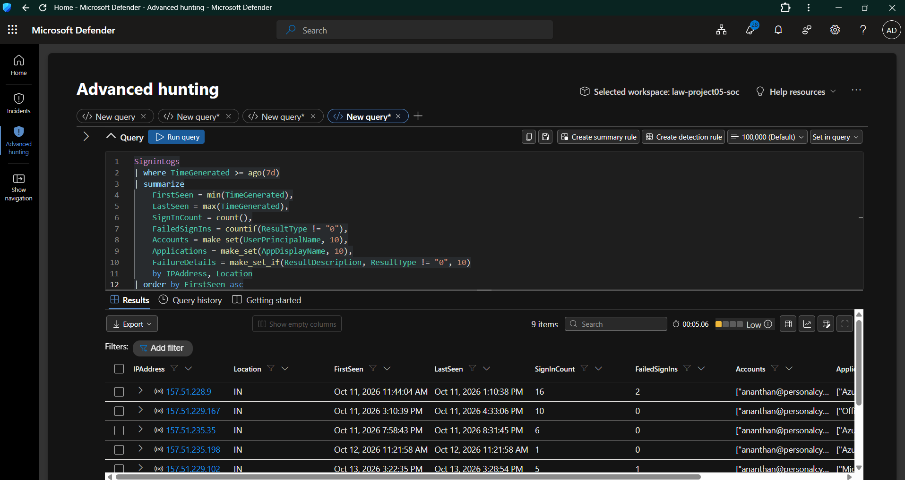

**Data source:** Microsoft Sentinel — `SigninLogs`

**Objective:** Examine authentication activity associated with source IP addresses.

IP-based analysis can help analysts investigate repeated failures, compare activity across applications, and identify records that require additional review.

**Security relevance:** An IP address or reported location alone is not sufficient to establish malicious intent. The findings must be validated against the associated authentication records and other available evidence.

---

## 5. Threat-Hunting Hypotheses

| ID | Hypothesis | Data source | Objective |
|---|---|---|---|
| H-01 | Certain process patterns may warrant investigation. | `DeviceProcessEvents` | Review execution context. |
| H-02 | PowerShell execution may contain unusual command-line activity. | `DeviceProcessEvents` | Inspect command lines and process relationships. |
| H-03 | Identity and endpoint records may provide complementary investigative context. | `SigninLogs`, endpoint telemetry | Review each data source without assuming an identity relationship. |
| H-04 | Repeated authentication failures may warrant further investigation. | `SigninLogs` | Examine accounts, source IPs, applications, and failure reasons. |

These are investigative hypotheses, not confirmed detections.

---

## 6. Identity Correlation Considerations

Entra ID sign-in records and local Windows endpoint events represent different identity and event contexts.

The Entra ID account and the local Windows account `soc-lab-user` must not be assumed to represent the same identity without independent supporting evidence.

The investigation therefore treats these sources separately unless a reliable relationship can be established.

**Correlation principle:** Temporal proximity alone does not prove that an identity event caused an endpoint event.

---

## 7. Investigation Principles

The following principles guided the Day 09 workflow:

1. Establish a baseline before interpreting unusual activity.
2. Use KQL to filter, summarize, and investigate relevant telemetry.
3. Inspect individual records before drawing conclusions.
4. Consider legitimate administrative and security-tool activity.
5. Validate authentication failures using their result codes and descriptions.
6. Avoid classifying an event as malicious based on one indicator.
7. Distinguish observed evidence from investigative hypotheses.
8. Record limitations when available telemetry cannot establish a relationship.

---

## 8. Findings and Limitations

Day 09 focused on developing a structured threat-hunting workflow across endpoint and identity telemetry.

The evidence files document the investigation areas listed above. However, the presence of a query or screenshot alone does not establish that malicious activity was detected.

The following limitations apply:

- An investigation query is not automatically a detection rule.
- Unusual process activity does not independently prove compromise.
- Authentication failures require interpretation using their result codes and descriptions.
- Endpoint and Entra ID identities must not be treated as directly correlated without supporting evidence.
- Final findings must reflect the actual query results and validation performed.

**Assessment:** The investigation workflow provides a foundation for further analysis of endpoint execution and identity authentication patterns. Any claim of a confirmed attack must be supported by validated event evidence.

---

## 9. Evidence Register

The following screenshots are embedded above and stored in `screenshots/Day09/`.

| Evidence ID | Filename | Investigation area |
|---|---|---|
| E-01 | `Day09-01-Process-Telemetry-Baseline.png` | Process telemetry baseline |
| E-02 | `Day09-02-Suspicious-Process-Pattern-Hunt.png` | Suspicious process patterns |
| E-03 | `Day09-03-Process-Execution-Investigation.png` | Process execution |
| E-04 | `Day09-04-Defender-Related-Process-Investigation.png` | Defender-related process activity |
| E-05 | `Day09-05-Defender-Process-Command-Line-Analysis.png` | Process command-line analysis |
| E-06 | `Day09-06-PowerShell-Command-Line-Investigation.png` | PowerShell investigation |
| E-07 | `Day09-07-PowerShell-Full-Command-Line.png` | Full PowerShell command line |
| E-08 | `Day09-08-Signin-Telemetry-Baseline.png` | Sign-in baseline |
| E-09 | `Day09-09-Unusual-Signin-Activity-Summary.png` | Sign-in summary |
| E-10 | `Day09-10-Failed-Signin-Investigation.png` | Failed sign-ins |
| E-11 | `Day09-11-Azure-Portal-Failure-Analysis.png` | Azure Portal failures |
| E-12 | `Day09-12-Azure-Portal-Authentication-Details.png` | Authentication record details |
| E-13 | `Day09-13-SignIn-IP-Investigation.png` | Source IP investigation |

---

## 10. Project Deliverables

| Deliverable | Path |
|---|---|
| Day 09 documentation | `docs/Day09.md` |
| Threat-hunting queries | `hunting/day09-threat-hunting-queries.kql` |
| Hunt 1 report | `hunting/reports/hunt-01-password-spray.md` |
| Hunt 2 report | `hunting/reports/hunt-02-suspicious-powershell.md` |
| Hunt 3 report | `hunting/reports/hunt-03-identity-endpoint-access.md` |
| Hunt 4 report | `hunting/reports/hunt-04-unusual-sign-in-activity.md` |
| Screenshots | `screenshots/Day09/` |

---

## 11. Conclusion

Day 09 developed a hypothesis-driven approach to threat hunting using Microsoft Defender endpoint telemetry and Microsoft Sentinel identity sign-in records.

