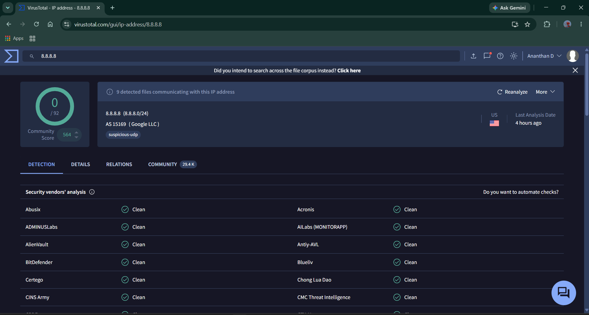
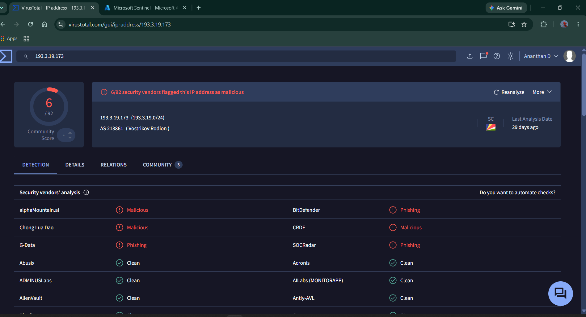
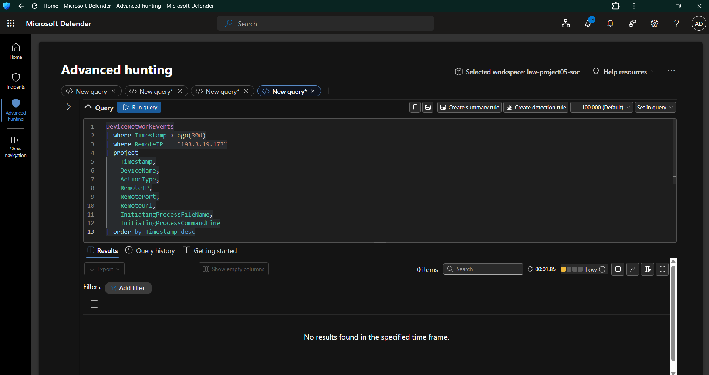
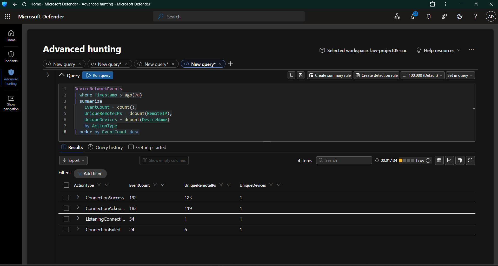
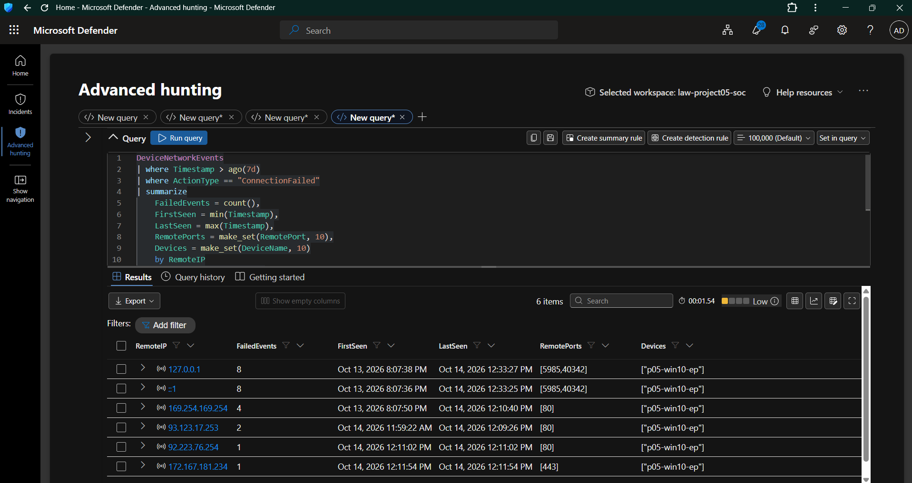
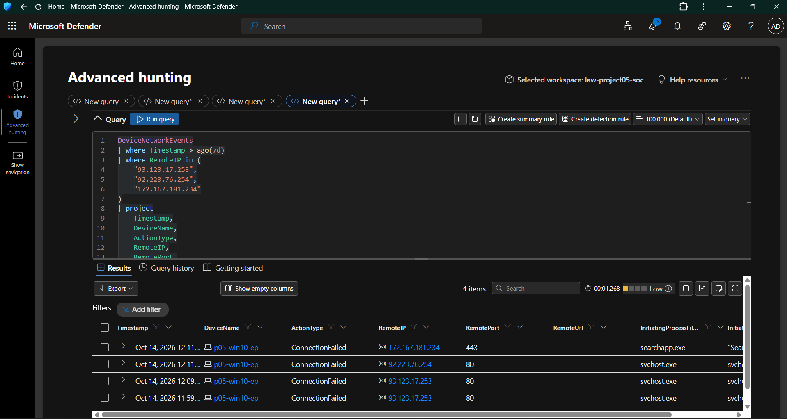
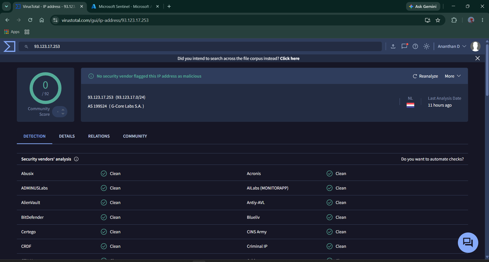
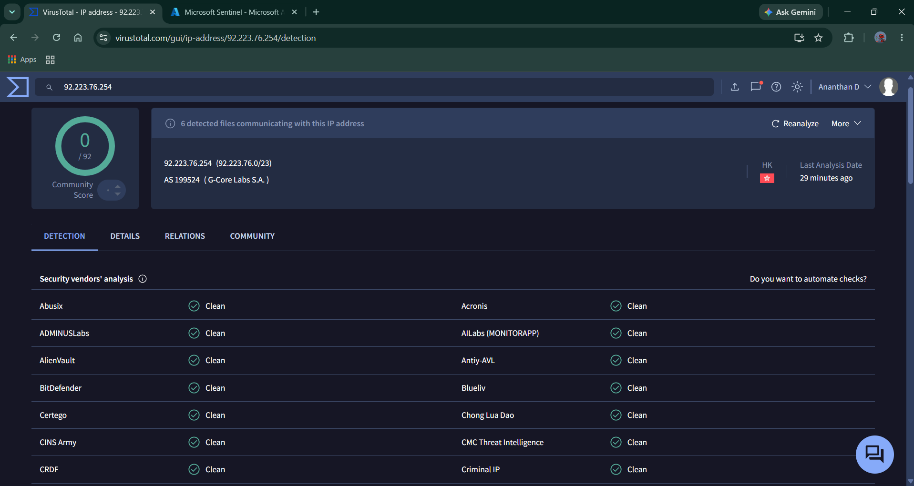
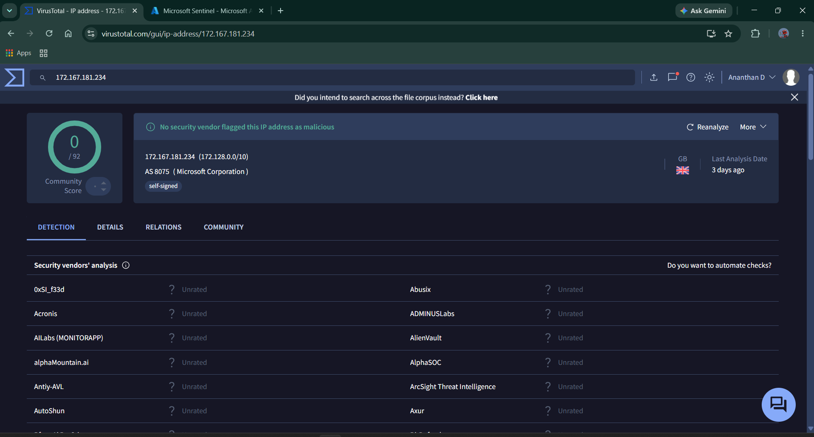

# Day 10 — Threat Intelligence & Advanced Hunting

**Project:** Project 05 — Microsoft Cloud SOC, EDR & Threat Hunting Lab  
**Focus:** Threat Intelligence, IOC Enrichment, Network Telemetry & KQL Hunting  
**Platform:** Microsoft Defender for Endpoint, Microsoft Sentinel, VirusTotal  
**Endpoint:** `p05-win10-ep`   
**Status:** Completed

---

## 1. Executive Summary

Day 10 focused on threat intelligence enrichment and hypothesis-driven investigation of endpoint network activity.

VirusTotal was used to examine IP reputation, while Microsoft Defender Advanced Hunting was used to investigate network connection events on the lab endpoint.

The investigation identified six remote IP addresses associated with failed network connections during the selected seven-day period. Three external IP addresses were selected for additional reputation checks.

The results demonstrated an important SOC investigation principle: external reputation and endpoint telemetry must be assessed together. A suspicious reputation does not automatically establish that an endpoint was compromised, and a failed connection does not establish successful communication with a malicious destination.

### Key findings

- A network telemetry baseline showed 192 `ConnectionSuccess` events and 24 `ConnectionFailed` events.
- Six remote IP addresses appeared in the failed-connection investigation.
- `193.3.19.173` had 6/92 security-vendor detections in the captured VirusTotal report.
- `93.123.17.253`, `92.223.76.254`, and `172.167.181.234` each showed 0/92 security-vendor detections in the captured reports.
- The specific endpoint query for `193.3.19.173` returned zero events over the selected 30-day period.
- The investigated connection failures did not, by themselves, establish successful communication with malicious infrastructure.

These findings are limited to the collected telemetry, query filters, selected time ranges, and reputation information captured during the investigation.

---

## 2. Objectives

The objectives for Day 10 were to:

1. Understand Indicators of Compromise (IOCs) and threat intelligence enrichment.
2. Examine IP addresses using VirusTotal.
3. Establish a baseline of endpoint network activity.
4. Identify and investigate failed network connections.
5. Examine external IP reputation and initiating-process context.
6. Compare external intelligence with endpoint telemetry.
7. Document evidence, confidence, conclusions, and limitations.
8. Build a reusable KQL threat-hunting query collection.

---

## 3. Environment and Tools

| Component | Purpose |
|---|---|
| Microsoft Defender for Endpoint | Endpoint telemetry and investigation |
| Microsoft Defender Advanced Hunting | KQL-based endpoint threat hunting |
| Microsoft Sentinel | SIEM and threat-intelligence exploration |
| VirusTotal | External IP reputation enrichment |
| Windows 10 lab endpoint | Source of network telemetry |
| Visual Studio Code | Documentation and query management |
| Git and GitHub | Version control and portfolio publication |

**Endpoint:** `p05-win10-ep`

**Primary telemetry table:** `DeviceNetworkEvents`

**External enrichment source:** VirusTotal

**Note:** The investigation used the Microsoft Defender Advanced Hunting environment for `DeviceNetworkEvents` queries. Sentinel's Log Analytics environment and Defender Advanced Hunting have different table availability and schemas; queries should be run in the appropriate environment.

---

## 4. Investigation Methodology

The investigation followed this workflow:

1. Establish a baseline of endpoint network activity.
2. Identify failed connections and associated remote IP addresses.
3. Examine the initiating process and destination port where available.
4. Enrich selected IP addresses using VirusTotal.
5. Compare reputation results with endpoint telemetry.
6. Assign a cautious conclusion based on the available evidence.
7. Document unresolved questions and recommended follow-up actions.

### Confidence assessment

| Confidence | Meaning |
|---|---|
| High | Multiple reliable, consistent sources support the conclusion. |
| Moderate | Evidence supports the assessment, but important context remains unresolved. |
| Low | Evidence is limited, ambiguous, or insufficient for a strong conclusion. |

Confidence in an external reputation assessment is separate from confidence that an incident occurred on the endpoint.

---

## 5. Evidence 1 — VirusTotal Baseline IP

### Indicator: `8.8.8.8`

The public DNS resolver `8.8.8.8` was examined as a baseline example to understand how VirusTotal presents IP reputation and contextual information.

The captured report displayed:

- IP address: `8.8.8.8`
- Network: `8.8.8.0/24`
- Network owner: Google LLC
- Country: United States
- Security-vendor detections: `0/92`
- Additional community context, including a historical threat-intelligence reference

The historical reference should not be interpreted as proof that the public DNS resolver is currently malicious. It illustrates why an analyst should review the context and age of a reputation observation rather than relying on a single label.

### Assessment

The captured security-vendor detection count did not show a current malicious verdict. The historical community context requires separate interpretation and does not establish malicious activity by itself.

**Conclusion:** Baseline reputation reviewed; no malicious activity involving this address was established by this exercise.

**Evidence screenshot:**



---

## 6. Evidence 2 — VirusTotal Threat Reputation

### Indicator: `193.3.19.173`

The captured VirusTotal report displayed:

| Attribute | Observation |
|---|---|
| IP address | `193.3.19.173` |
| Network | `193.3.19.0/24` |
| Reported network owner | Vostrikov Rodion |
| Country shown | Seychelles |
| Security-vendor detections | 6/92 |
| Reported classifications | Malicious and phishing classifications from several vendors |
| Last analysis displayed | 29 days before the screenshot |

The vendor detections indicate a suspicious external reputation and justify further investigation. However, the detection ratio alone does not establish that this IP attacked the lab endpoint.

### Endpoint validation

A separate Defender Advanced Hunting query searched `DeviceNetworkEvents` for `193.3.19.173` over the preceding 30 days.

**Observed result:** Zero matching events.

This means the specific query did not return a matching event in the selected time window. It does not prove that the address has never communicated with the endpoint or that no related activity occurred elsewhere.

### Assessment

- **External reputation:** Suspicious.
- **Endpoint association:** Not established by the query.
- **Confidence in suspicious reputation:** Moderate.
- **Confidence in an endpoint incident involving this IP:** Low, because no matching endpoint event was returned by the specific query.

**Conclusion:** Retain the IP as an externally suspicious indicator for contextual review, but do not classify the lab endpoint as compromised based on this evidence alone.

**Evidence screenshot:**



**Endpoint query evidence:**



---

## 7. Evidence 3 — Network Telemetry Baseline

A KQL query against `DeviceNetworkEvents` summarized network activity over the preceding seven days by `ActionType`.

### Query

```kusto
DeviceNetworkEvents
| where Timestamp > ago(7d)
| summarize
    EventCount = count(),
    UniqueRemoteIPs = dcount(RemoteIP),
    UniqueDevices = dcount(DeviceName)
    by ActionType
| order by EventCount desc
```

### Results

| Action type | Event count | Unique remote IPs | Unique devices |
|---|---:|---:|---:|
| `ConnectionSuccess` | 192 | 123 | 1 |
| `ConnectionAcknowledged` | 183 | 119 | 1 |
| `ListeningConnection` | 54 | 1 | 1 |
| `ConnectionFailed` | 24 | 6 | 1 |

### Analysis

The baseline showed multiple types of network activity on the lab endpoint. Successful connections, acknowledged connections, listening events, and failed connections should be interpreted according to their specific context.

The presence of failed connections is not automatically suspicious. Failures can occur because a service is unavailable, a connection is blocked, a destination is unreachable, or an application retries a connection.

**Conclusion:** The baseline provided context for the subsequent failed-connection investigation. It did not independently establish malicious activity.

**Evidence screenshot:**



---

## 8. Evidence 4 — Failed Network Connection Investigation

The next query examined failed connections and summarized their frequency, time range, destination ports, and affected devices.

### Query

```kusto
DeviceNetworkEvents
| where Timestamp > ago(7d)
| where ActionType == "ConnectionFailed"
| summarize
    FailedEvents = count(),
    FirstSeen = min(Timestamp),
    LastSeen = max(Timestamp),
    RemotePorts = make_set(RemotePort, 10),
    Devices = make_set(DeviceName, 10)
    by RemoteIP
| order by FailedEvents desc
```

### Results

Six remote IP addresses were returned.

| Remote IP | Failed events | Remote ports | Initial interpretation |
|---|---:|---|---|
| `127.0.0.1` | 8 | 5985, 40342 | Loopback address; inspect local application context |
| `::1` | 8 | 5985, 40342 | IPv6 loopback; inspect local application context |
| `169.254.169.254` | 4 | 80 | Link-local metadata-service address; interpret according to environment |
| `93.123.17.253` | 2 | 80 | External IP selected for enrichment |
| `92.223.76.254` | 1 | 80 | External IP selected for enrichment |
| `172.167.181.234` | 1 | 443 | External IP selected for enrichment |

The local addresses `127.0.0.1` and `::1` are loopback addresses. They refer to the local system rather than an ordinary external destination.

The address `169.254.169.254` is commonly used by cloud environments for instance metadata services. Its significance depends on the environment, process context, and surrounding events; the address alone is not proof of malicious activity.

The three external addresses were selected for additional reputation enrichment.

### Assessment

The results identified destinations associated with failed connection attempts. The results alone do not establish whether the connections were maliciously initiated, why they failed, or whether successful connections occurred at other times.

**Conclusion:** Three external indicators were selected for enrichment based on the available network-event evidence.

**Evidence screenshot:**



---

## 9. Evidence 5 — External IP and Process Investigation

A follow-up query examined network events for the three selected IP addresses.

### Query

```kusto
DeviceNetworkEvents
| where Timestamp > ago(7d)
| where RemoteIP in (
    "93.123.17.253",
    "92.223.76.254",
    "172.167.181.234"
)
| project
    Timestamp,
    DeviceName,
    ActionType,
    RemoteIP,
    RemotePort,
    RemoteUrl,
    InitiatingProcessFileName,
    InitiatingProcessCommandLine
| order by Timestamp desc
```

### Observations

The query returned four matching failed-connection events in the captured results.

| Remote IP | Failed events observed | Destination port | Initiating process shown |
|---|---:|---:|---|
| `93.123.17.253` | 2 | 80 | `svchost.exe` |
| `92.223.76.254` | 1 | 80 | `svchost.exe` |
| `172.167.181.234` | 1 | 443 | `searchapp.exe` |

### Analysis

The initiating process can help guide the next stage of an investigation, but a process name alone does not determine whether activity is benign or malicious.

For example, `svchost.exe` is a legitimate Windows process that hosts services. The analyst would need additional evidence to determine which service initiated the connection and whether the activity was expected.

Likewise, `searchapp.exe` is not proof of malicious activity simply because it appears in a failed network event. Its path, signature, command line, parent process, and surrounding telemetry would help establish context.

**Conclusion:** The query provided process and destination context for four failed-connection events. The captured evidence did not establish successful communication with malicious infrastructure.

**Evidence screenshot:**



---

## 10. Evidence 6 — VirusTotal Enrichment of Selected IPs

### 10.1 IP: `93.123.17.253`

The captured VirusTotal report showed:

- Network: `93.123.17.0/24`
- Reported network owner: G-Core Labs S.A.
- Country shown: Netherlands
- Security-vendor detections: `0/92`

The report did not show any security vendor flagging this IP as malicious at the time captured.

**Assessment:** No malicious vendor verdict was shown in the captured report. This does not guarantee that the address is harmless or that every connection to it is benign.

**Endpoint context:** Two failed connection events were observed on port 80, initiated by `svchost.exe`.

**Conclusion:** Reputation was not flagged in the captured report, but the process and connection context remain relevant to a complete assessment.

**Evidence screenshot:**



---

### 10.2 IP: `92.223.76.254`

The captured VirusTotal report showed:

- Network: `92.223.76.0/23`
- Reported network owner: G-Core Labs S.A.
- Country shown: Hong Kong
- Security-vendor detections: `0/92`
- Six detected files were reported as communicating with the address

The presence of related files is contextual information; it does not independently establish malicious activity involving the lab endpoint.

**Endpoint context:** One failed connection event was observed on port 80, initiated by `svchost.exe`.

**Assessment:** No malicious vendor verdict was shown in the captured report. The observed failed connection requires context but is insufficient to establish malicious activity.

**Conclusion:** No confirmed malicious activity was established from the available reputation and endpoint evidence.

**Evidence screenshot:**



---

### 10.3 IP: `172.167.181.234`

The captured VirusTotal report showed:

- Network: `172.128.0.0/10`
- Reported network owner: Microsoft Corporation
- Country shown: United Kingdom
- Security-vendor detections: `0/92`
- A `self-signed` tag was displayed

A self-signed tag is contextual information, not proof of malicious activity.

**Endpoint context:** One failed connection event was observed on port 443, initiated by `searchapp.exe`.

**Assessment:** No malicious vendor verdict was shown in the captured report. The report does not establish whether the observed failed connection was expected or suspicious.

**Conclusion:** No confirmed malicious activity was established from the available evidence. Further process and destination context would be required to reach a stronger conclusion.

**Evidence screenshot:**



---

## 11. Consolidated IOC Assessment

| Indicator | Endpoint evidence | VirusTotal evidence | Assessment | Confidence |
|---|---|---|---|---|
| `8.8.8.8` | Used as an external baseline example | 0/92 detections; historical community context present | Baseline reputation reviewed; no incident established | Moderate for the captured reputation; no incident conclusion |
| `193.3.19.173` | No matching event returned by the specific 30-day query | 6/92 detections; malicious/phishing classifications reported | Suspicious external reputation; endpoint association not established | Moderate for suspicious reputation; low for an endpoint incident |
| `93.123.17.253` | Two failed events on port 80 | 0/92 detections | No malicious verdict shown; failures require context | Low |
| `92.223.76.254` | One failed event on port 80 | 0/92 detections | No malicious verdict shown; failures require context | Low |
| `172.167.181.234` | One failed event on port 443 | 0/92 detections; self-signed tag shown | No malicious verdict shown; failures require context | Low |

### Important limitations

- Vendor detection counts can change over time.
- A `0/92` result does not prove that an indicator is safe.
- A positive reputation result does not prove that the lab endpoint was compromised.
- Failed connection events do not prove successful communication.
- The specific query for `193.3.19.173` returned no matching event, but this is limited to the query filters, telemetry, and time range used.
- The initiating-process names do not independently establish intent.
- The investigation did not establish a confirmed security incident from the evidence collected.

---

## 12. Hunting Queries

The following queries were used during the investigation and should be maintained in:

`hunting/day10-threat-intelligence-hunts.kql`

### Query 1 — Network telemetry baseline

```kusto
DeviceNetworkEvents
| where Timestamp > ago(7d)
| summarize
    EventCount = count(),
    UniqueRemoteIPs = dcount(RemoteIP),
    UniqueDevices = dcount(DeviceName)
    by ActionType
| order by EventCount desc
```

**Purpose:** Establish a baseline of endpoint network activity by event type.

### Query 2 — Failed network connections

```kusto
DeviceNetworkEvents
| where Timestamp > ago(7d)
| where ActionType == "ConnectionFailed"
| summarize
    FailedEvents = count(),
    FirstSeen = min(Timestamp),
    LastSeen = max(Timestamp),
    RemotePorts = make_set(RemotePort, 10),
    Devices = make_set(DeviceName, 10)
    by RemoteIP
| order by FailedEvents desc
```

**Purpose:** Identify remote IP addresses associated with failed connections and prioritize indicators for enrichment.

### Query 3 — Investigate selected external IPs

```kusto
DeviceNetworkEvents
| where Timestamp > ago(7d)
| where RemoteIP in (
    "93.123.17.253",
    "92.223.76.254",
    "172.167.181.234"
)
| project
    Timestamp,
    DeviceName,
    ActionType,
    RemoteIP,
    RemotePort,
    RemoteUrl,
    InitiatingProcessFileName,
    InitiatingProcessCommandLine
| order by Timestamp desc
```

**Purpose:** Review event-level evidence and initiating-process context for selected external IPs.

### Query 4 — Search for an externally suspicious IP

```kusto
DeviceNetworkEvents
| where Timestamp > ago(30d)
| where RemoteIP == "193.3.19.173"
| project
    Timestamp,
    DeviceName,
    ActionType,
    RemoteIP,
    RemotePort,
    RemoteUrl,
    InitiatingProcessFileName,
    InitiatingProcessCommandLine
| order by Timestamp desc
```

**Observed result:** Zero events returned in the captured query.

**Purpose:** Check for a specific indicator in the endpoint's available network telemetry.

**Interpretation:** No matching event was returned by this query. Do not interpret this result as proof that the indicator has never communicated with the endpoint.

---

## 13. MITRE ATT&CK Considerations

The observed failed network connections are not sufficient to assign a confirmed adversary technique.

Network connection telemetry may support investigation of command-and-control or other network-related techniques when additional evidence establishes the behavior and context.

For this investigation:

- No confirmed command-and-control activity was established.
- No successful communication with malicious infrastructure was established from the selected failed-connection events.
- No confirmed incident was attributed to the suspicious external IP based on the available evidence.

**MITRE ATT&CK mapping status:** No technique was confirmed from this evidence alone. Additional supporting telemetry would be required before assigning a technique to a confirmed incident.

---

## 14. Recommended Follow-Up Actions

If this were a production SOC investigation, the next steps would include:

1. Review the full event details for any relevant successful connections.
2. Inspect the process path, signature, command line, and parent process for the events of interest.
3. Identify the service hosted by `svchost.exe` when relevant.
4. Check destination URLs, DNS events, and related endpoint telemetry where available.
5. Review the reputation report's timestamps and supporting context.
6. Search other relevant telemetry sources for corroborating activity.
7. Escalate only if the combined evidence supports suspicious or malicious behavior.
8. Document the investigation scope and any missing telemetry.

No containment action is recommended solely on the basis of the captured failed-connection events or the external reputation results.

---

## 15. Final Assessment

Day 10 demonstrated a repeatable threat-intelligence and network-hunting workflow.

The investigation established a network activity baseline, identified six remote IP addresses associated with failed connections, enriched three external IPs with VirusTotal, and compared reputation results with endpoint telemetry.

One IP, `193.3.19.173`, showed a suspicious external reputation with 6/92 security-vendor detections. However, the specific 30-day endpoint query returned zero matching events, so an incident involving this IP was not established.

The other three enriched indicators showed 0/92 security-vendor detections in the captured reports. Their associated failed connections were not sufficient to prove malicious activity.

The investigation therefore produced contextual findings and follow-up opportunities, rather than a confirmed security incident.

### Skills demonstrated

- IOC enrichment and reputation analysis
- Microsoft Defender Advanced Hunting
- KQL network telemetry analysis
- Failed-connection investigation
- Initiating-process context review
- Evidence-based confidence assessment
- Investigation documentation
- Distinguishing suspicious indicators from confirmed incidents

---

## 16. Evidence Inventory

All screenshots are stored in `screenshots/Day10/`.

| Screenshot | Evidence |
|---|---|
| `Day10-01-VirusTotal-Baseline-IP-Report.png` | Baseline IP reputation |
| `Day10-02-VirusTotal-Reported-Threat-IP.png` | Suspicious external IP reputation |
| `Day10-03-IOC-Network-Event-Hunt.png` | Endpoint query for the suspicious IP |
| `Day10-04-Network-Telemetry-Baseline.png` | Seven-day network telemetry summary |
| `Day10-05-Failed-Network-Connection-Investigation.png` | Six remote IPs associated with failed connections |
| `Day10-06-External-IP-Process-Investigation.png` | Selected IPs and initiating-process context |
| `Day10-07-VirusTotal-93-123-17-253.png` | Reputation enrichment for `93.123.17.253` |
| `Day10-08-VirusTotal-92-223-76-254.png` | Reputation enrichment for `92.223.76.254` |
| `Day10-09-VirusTotal-172-167-181-234.png` | Reputation enrichment for `172.167.181.234` |

---

## 17. Completion Checklist

- [x] Reviewed VirusTotal IP reputation reports.
- [x] Established a network telemetry baseline.
- [x] Investigated failed network connections.
- [x] Examined selected IPs and initiating-process context.
- [x] Compared external reputation with endpoint telemetry.
- [x] Documented findings and limitations.
- [x] Listed evidence screenshots.
- [x] Prepared reusable KQL queries.

### Final status

**Day 10 — Threat Intelligence & Advanced Hunting: Completed**

The investigation findings are documented with appropriate limitations. No confirmed malicious incident was established from the evidence collected.

**Next:** Day 11 — Incident Investigation.