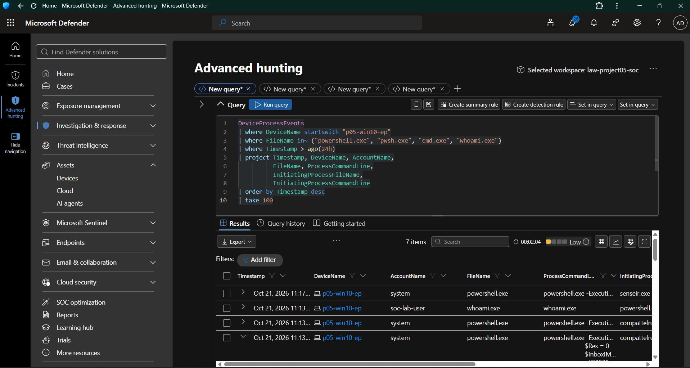
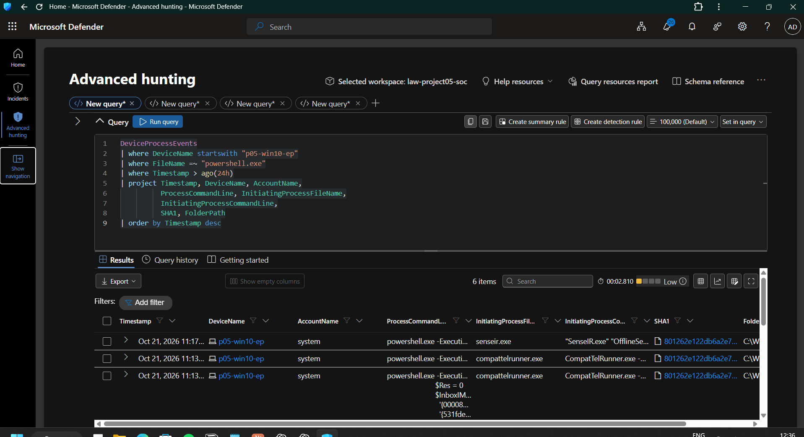
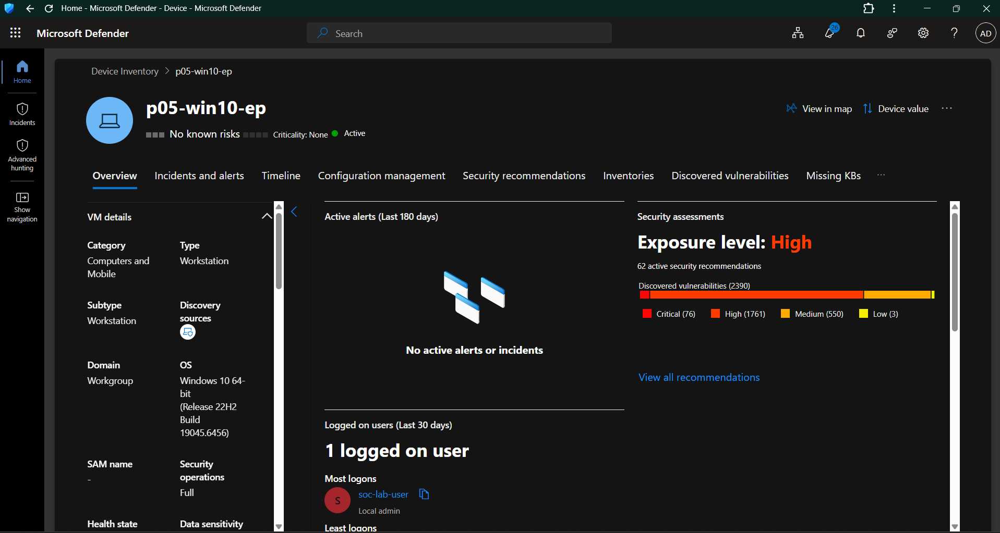
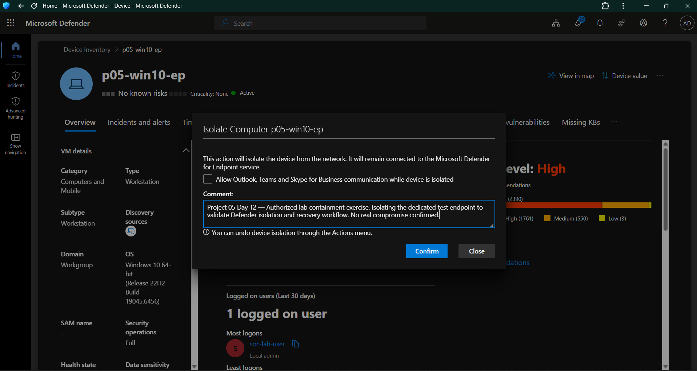

# Day 12 — Endpoint Containment and Response

**Project:** Project 05 — Microsoft Cloud SOC, EDR & Threat Hunting Lab
**Platform:** Microsoft Defender for Endpoint, Microsoft Defender XDR, Windows 10, Microsoft Sentinel
**Endpoint:** `p05-win10-ep`
**Status:** Partially Completed — Containment Outcome Unverified

---

## 1. Objective

The objective of Day 12 was to practice endpoint containment and response in an authorized lab environment.

The exercise followed the incident response workflow:

1. Review endpoint investigation findings.
2. Validate the available process evidence.
3. Review the endpoint's pre-containment state.
4. Submit a device isolation request through Microsoft Defender.
5. Verify the response action and endpoint health.
6. Investigate failures affecting the response workflow.
7. Record findings, limitations, and recommended next steps.

**Important:** This was a controlled lab exercise. No confirmed compromise was established during this activity.

---

## 2. Lab Environment

| Component           | Configuration                           |
| ------------------- | --------------------------------------- |
| Endpoint            | `p05-win10-ep`                          |
| Operating system    | Windows 10 Pro, version 22H2            |
| OS build            | 19045                                   |
| Architecture        | 64-bit                                  |
| Endpoint protection | Microsoft Defender Antivirus            |
| EDR platform        | Microsoft Defender for Endpoint         |
| SIEM                | Microsoft Sentinel                      |
| Virtualization      | VMware Workstation                      |
| Exercise type       | Authorized endpoint response simulation |

The endpoint was a dedicated lab virtual machine with local console access available through VMware.

---

## 3. Endpoint Investigation

Before attempting containment, endpoint process activity and PowerShell-related telemetry were reviewed.

### 3.1 Endpoint Process Investigation

The initial investigation focused on process activity and the available endpoint telemetry.

**Evidence:**

*Figure 1: Endpoint process investigation evidence collected during the lab exercise.*

### 3.2 PowerShell Process Analysis

PowerShell process activity was reviewed to establish context before the containment attempt.

Process evidence must be interpreted using the executable, parent process, user context, command line, and surrounding activity. The presence of PowerShell alone is not sufficient to establish malicious behavior.

**Evidence:**

*Figure 2: PowerShell process analysis performed before the containment workflow.*

### 3.3 Investigation Limitations

The available evidence did not establish a confirmed endpoint compromise.

The exercise therefore proceeded as a controlled response simulation rather than a response to a confirmed real-world incident.

---

## 4. Pre-Containment Assessment

The endpoint state was reviewed before submitting the isolation request.

**Evidence:**

*Figure 3: Endpoint state reviewed before the isolation request.*

The pre-containment assessment provided a reference point for the response workflow.

A successful containment outcome would require separate verification after the isolation request.

---

## 5. Device Isolation Request

A device isolation action was submitted for the dedicated lab endpoint through the Microsoft Defender portal.

The action comment documented the authorized nature of the exercise and its purpose.

**Evidence:**

*Figure 4: Device isolation request submitted through Microsoft Defender.*

### Result

The isolation action was submitted, but successful completion could not be verified during this exercise.

The Defender Action Center showed the action as pending during troubleshooting. The endpoint's subsequent sensor-health issues prevented us from treating the response action as successful.

**Outcome: Submitted — Completion Unverified**

The screenshot demonstrates the submission or confirmation shown in the portal. It must not be interpreted as proof that the endpoint was successfully isolated.

---

## 6. Defender for Endpoint Sensor Troubleshooting

Following the isolation request, the endpoint's Defender for Endpoint sensor health was investigated.

### 6.1 Service Status

The Windows service named `Sense`, which supports Microsoft Defender for Endpoint, was found stopped.

The service configuration indicated:

| Property                  | Observed value |
| ------------------------- | -------------- |
| Service name              | `Sense`        |
| Startup type              | Automatic      |
| Service account           | LocalSystem    |
| Service state             | Stopped        |
| Windows service exit code | `1067`         |

The Windows service exit code indicated that the service process had terminated unexpectedly.

### 6.2 Application Crash Investigation

Windows Application Error events repeatedly recorded crashes involving `MsSense.exe`.

The available crash report contained these details:

| Field                    | Observed value        |
| ------------------------ | --------------------- |
| Application              | `MsSense.exe`         |
| Application version      | `10.8838.26060.15013` |
| Faulting module          | `KERNELBASE.dll`      |
| Faulting module version  | `10.0.19041.3758`     |
| Exception code           | `0xc0000409`          |
| Error reporting category | `BEX64`               |

The faulting module and exception code were recorded as diagnostic evidence. They did not, by themselves, establish the root cause of the crash.

Windows Service Control Manager Event ID `7031` also recorded repeated unexpected service terminations and automatic recovery attempts.

### 6.3 Executable Signature Verification

The digital signature of the installed `MsSense.exe` executable was checked using PowerShell.

The signature verification result was:

`Status: Valid`

The signer was identified as Microsoft Windows Publisher.

This confirmed that Windows successfully verified the executable's digital signature. It did not establish that the executable was functioning correctly.

### 6.4 Windows Integrity Checks

The following Windows integrity checks were performed:

* DISM component store repair completed successfully.
* System File Checker completed without reporting integrity violations.

The `Sense` service continued to fail after these checks.

Consequently, general Windows component integrity issues were not established as the cause of the sensor failure.

---

## 7. Microsoft Defender for Endpoint Client Analyzer

The Microsoft Defender for Endpoint Client Analyzer was downloaded from Microsoft's official documentation and executed on the lab endpoint.

The analyzer generated diagnostic output under:

`MDEClientAnalyzerResult`

### 7.1 Findings

| Diagnostic area                                    | Result                            |
| -------------------------------------------------- | --------------------------------- |
| Defender Antivirus service                         | Running                           |
| Defender Antivirus mode                            | Active                            |
| Defender Antivirus real-time protection            | Enabled                           |
| Defender Antivirus cloud connectivity test         | Successful                        |
| Defender for Endpoint sensor service               | Stopped                           |
| Defender for Endpoint cloud URL checks             | Some checks failed                |
| Defender for Endpoint cloud certificate validation | Successful                        |
| Sensor recovery                                    | Not achieved during this exercise |

The analyzer reported connectivity failures for some Defender for Endpoint cloud service URLs, while the Defender Antivirus cloud connectivity test succeeded.

These results indicated that additional investigation of endpoint connectivity or configuration might be necessary.

However, the available evidence did not establish that the cloud connectivity findings caused the `MsSense.exe` crashes.

### 7.2 Diagnostic Limitations

The Client Analyzer collected diagnostic information, but the available report did not identify a confirmed root cause or demonstrate successful sensor recovery.

The sensor therefore remained unhealthy at the end of the troubleshooting activity.

---

## 8. Incident Response Outcome

The Day 12 workflow was evaluated against its intended response objectives.

| Activity                            | Result                            |
| ----------------------------------- | --------------------------------- |
| Review endpoint process activity    | Completed                         |
| Analyze PowerShell process context  | Completed                         |
| Review pre-containment state        | Completed                         |
| Submit device isolation request     | Completed                         |
| Verify successful isolation         | Unverified                        |
| Investigate sensor health           | Completed — initial investigation |
| Collect Client Analyzer diagnostics | Completed                         |
| Restore sensor health               | Unresolved                        |
| Verify endpoint recovery            | Not completed                     |

### Final Assessment

The lab demonstrated the submission of an endpoint containment action and the investigation of a failure affecting the Defender for Endpoint sensor.

However, successful device isolation and endpoint recovery were not verified.

The exercise therefore remains **partially completed**.

---

## 9. Lessons Learned

### 9.1 Submitting a Response Action Is Not the Same as Successful Containment

A device isolation request must be verified through its final action status and the endpoint's resulting state.

A submitted or pending action is not sufficient evidence of successful containment.

### 9.2 Endpoint Protection and EDR Sensor Health Are Different

Microsoft Defender Antivirus was running while the Defender for Endpoint `Sense` service remained stopped.

This demonstrated the importance of distinguishing antivirus status from EDR sensor health.

### 9.3 Diagnostic Evidence Must Be Interpreted Carefully

A valid digital signature does not guarantee that an executable is healthy.

Similarly, a faulting module in an application crash report does not independently establish the root cause.

### 9.4 Failed Response Actions Require Troubleshooting and Escalation

When a response action cannot be verified, analysts should investigate the endpoint's communication and sensor health, preserve diagnostic evidence, and follow supported troubleshooting procedures.

Unsupported repairs should not be attempted merely to force a successful outcome.

### 9.5 Documentation Must Reflect the Actual Outcome

SOC records must distinguish between actions attempted, actions completed, and actions verified.

This exercise did not establish successful containment, so the final record preserves that limitation.

---

## 10. Outstanding Actions

The following activities remain outstanding:

1. Investigate the Defender for Endpoint sensor failure using Microsoft's supported troubleshooting procedure.
2. Determine whether a supported sensor repair or re-onboarding procedure is appropriate.
3. Verify the outcome of the existing isolation request in the Defender portal.
4. Confirm sensor health and endpoint communication after any repair.
5. Record any successful recovery and containment verification as a separate follow-up.

No additional isolation request was submitted during the troubleshooting process.

---

## 11. Conclusion

Day 12 provided practical experience with endpoint process investigation, PowerShell activity analysis, device isolation submission, Windows service troubleshooting, application crash analysis, and Microsoft Defender for Endpoint diagnostic tooling.

The exercise also demonstrated an important operational lesson: incident response actions must be verified, and unresolved technical issues must be escalated rather than reported as successful outcomes.

**Final status:** Partially completed — containment submitted, outcome unverified; sensor recovery outstanding.
