# Day 13 — Detection Engineering, Incident Management & SOC Automation Validation

**Project:** Project 05 — Microsoft Cloud SOC, EDR & Threat Hunting Lab
**Platform:** Microsoft Sentinel and Microsoft Defender
**Focus:** Analytics rule validation, incident generation, case management, automated task creation, and incident tagging
**Environment:** `law-project05-soc`
**Evidence Directory:** `screenshots/Day13/`
**Status:** Core detection and automation execution validated; final end-to-end validation documented below.

---

## 1. Executive Summary

Day 13 focused on validating the detection-to-incident workflow and implementing automated case-management operations in the Microsoft security environment.

The objective was to demonstrate how authentication-related security detections can generate incidents and how automation rules can streamline subsequent SOC case-management activities.

The work included:

* Reviewing the analytics rule inventory and its configuration.
* Validating analytics rule configuration and query requirements.
* Mapping the detection to MITRE ATT&CK.
* Generating and reviewing incidents associated with repeated invalid credential attempts.
* Configuring automation rules for case tagging and task creation.
* Verifying automation execution through the Microsoft Defender automation run history.
* Inspecting incident and case records to verify applied tags.
* Capturing screenshots to provide reproducible evidence of the implementation.

### Key outcomes

| Capability                            | Outcome                                                                                   |
| ------------------------------------- | ----------------------------------------------------------------------------------------- |
| Analytics rule configuration          | Documented and validated in the available configuration evidence                          |
| Repeated invalid credential detection | Incidents generated successfully                                                          |
| Incident creation                     | Confirmed through incident records                                                        |
| Automated case tagging                | Successful automation executions observed                                                 |
| Case-task automation                  | Task creation rule configured; execution and task completion must be evaluated separately |
| Automation run history                | Successful executions recorded for multiple case IDs                                      |
| Incident tag verification             | `P05-SOC-Lab` visibly present on incident records                                         |
| Evidence collection                   | 19 Day 13 screenshots available                                                           |

> **Validation note:** Successful automation execution confirms that the rule ran without a reported execution failure. The presence of the intended tag provides additional evidence of the resulting case state. Task creation, task completion, and the exact effect of every automation rule must be verified independently before claiming complete end-to-end validation.

---

## 2. Objectives

The objectives for Day 13 were to:

1. Validate the configuration of the authentication-related analytics rule.
2. Verify that the detection produces incidents in the security environment.
3. Configure and inspect Microsoft Defender automation rules.
4. Automate the addition of the `P05-SOC-Lab` tag to eligible cases.
5. Configure a case-review task for repeated invalid credential attempts.
6. Review execution history to identify successful or failed automation runs.
7. Preserve screenshots as auditable evidence.
8. Document the implementation and its limitations for future investigation and portfolio review.

---

## 3. Lab Architecture and Workflow

The implemented workflow follows this sequence:

```text
Entra ID Authentication Activity
              |
              v
Microsoft Sentinel Log Collection
              |
              v
Analytics Rule Evaluation
              |
              v
Repeated Invalid Credential Detection
              |
              v
Security Incident Generation
              |
              v
Microsoft Defender Case Management
              |
              +-----------------------------+
              |                             |
              v                             v
     Case-Tag Automation           Case-Task Automation
              |                             |
              v                             v
       P05-SOC-Lab Tag             Investigation Task
              |                             |
              +--------------+--------------+
                             |
                             v
                   Execution Verification
                             |
                             v
                Evidence and Documentation
```

**Architecture clarification:** The diagram represents the intended logical workflow. Each connection must be supported by the corresponding configuration and execution evidence. The case-task branch is not considered fully validated merely because the task-creation rule exists.

---

## 4. Analytics Rule Configuration and Validation

### 4.1 Analytics Rule Inventory

The analytics rule inventory was reviewed to identify the authentication-related detection used during testing.

**Evidence:**

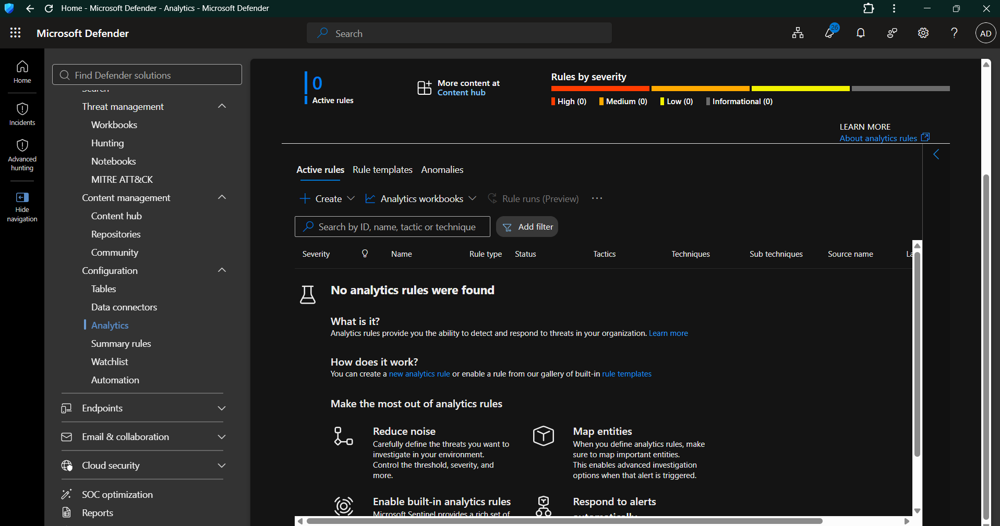

**Screenshot:** `Day13-01-Analytics-Rule-List-Empty.png`

**Purpose:** Records the analytics-rule inventory view captured during configuration and validation.

### 4.2 Validation Error Review

The analytics-rule validation process included examining a configuration error and checking the rule configuration before proceeding.

**Evidence:**

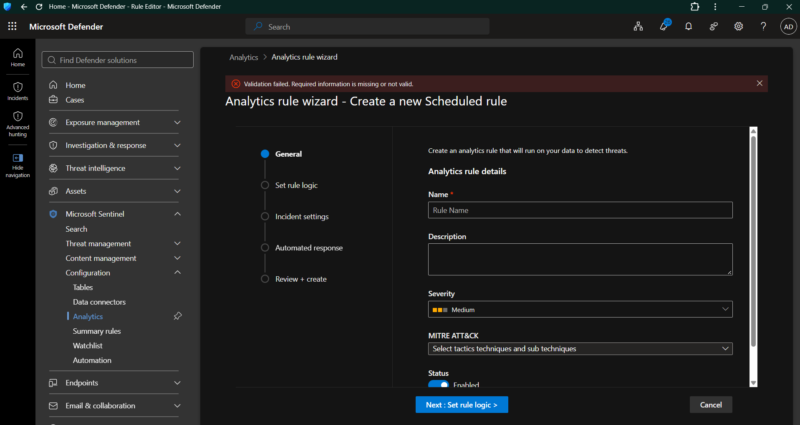

**Screenshot:** `Day13-02-Analytics-Rule-Validation-Error.png`

**Purpose:** Preserves evidence of the validation issue encountered during rule configuration.

A validation error is useful troubleshooting evidence, but it is not proof that the final rule configuration is correct. The subsequent query configuration, successful validation, and generated incidents provide additional evidence.

### 4.3 MITRE ATT&CK Mapping

The authentication detection was mapped to the relevant MITRE ATT&CK credential-access technique.

**Evidence:**

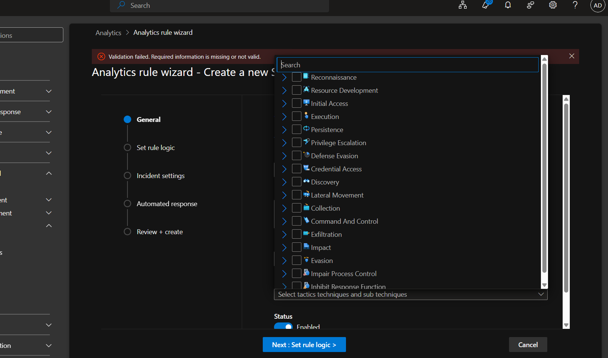

**Screenshot:** `Day13-03-MITRE-ATTACK-Tactic-Selection.png`

**Relevant technique:**

* **Tactic:** Credential Access
* **Technique:** T1110 — Brute Force
* **Relevance:** Repeated invalid authentication attempts can be consistent with password-guessing activity.

**Important:** Failed authentication attempts alone do not establish that a brute-force attack succeeded. Investigation should include attempt volume, affected accounts, source addresses, time distribution, and any subsequent successful authentication.

### 4.4 Analytics Rule Query Configuration

The detection query was reviewed as part of the analytics-rule configuration process.

**Evidence:**

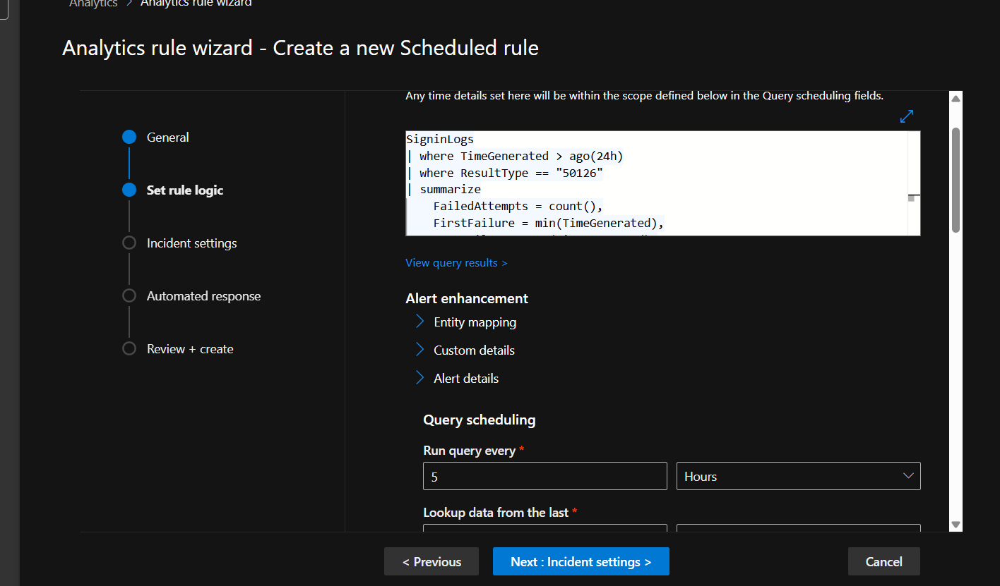

**Screenshot:** `Day13-04-Analytics-Rule-Query-Configuration.png`

The query is intended to identify repeated invalid credential attempts within a defined time window.

### 4.5 Analytics Rule Validation

The available evidence records a passed analytics-rule validation step.

**Evidence:**

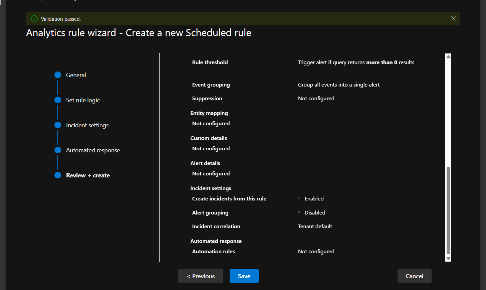

**Screenshot:** `Day13-05-Analytics-Rule-Validation-Passed.png`

A passed configuration validation indicates that the rule passed the checks performed by the platform. It does not, by itself, prove that the rule detects every relevant authentication attack.

---

## 5. Incident Generation and Investigation

### 5.1 Repeated Invalid Credential Incident

The authentication detection generated incidents named:

`P05 - Repeated Invalid Credential Attempts`

The incident description states that the detection identifies two or more failed Entra ID sign-in attempts caused by invalid credentials for a user account within a 24-hour period.

**Evidence:**

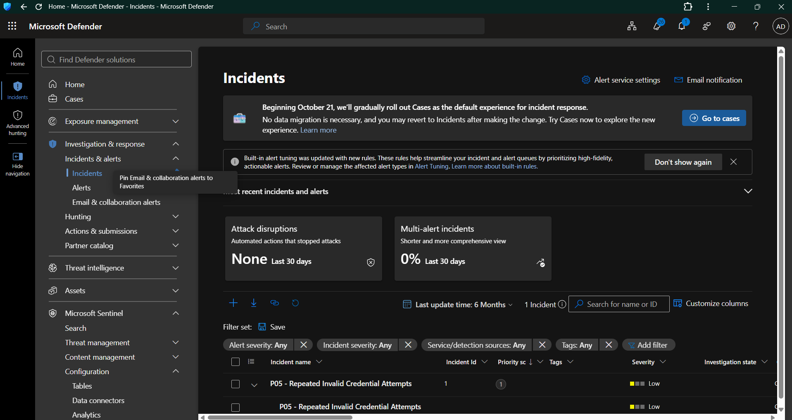

**Screenshot:** `Day13-06-Generated-Invalid-Credentials-Incident.png`

### 5.2 Incident Alert Details

The incident alert details were reviewed to understand the detection source and its associated security context.

**Evidence:**

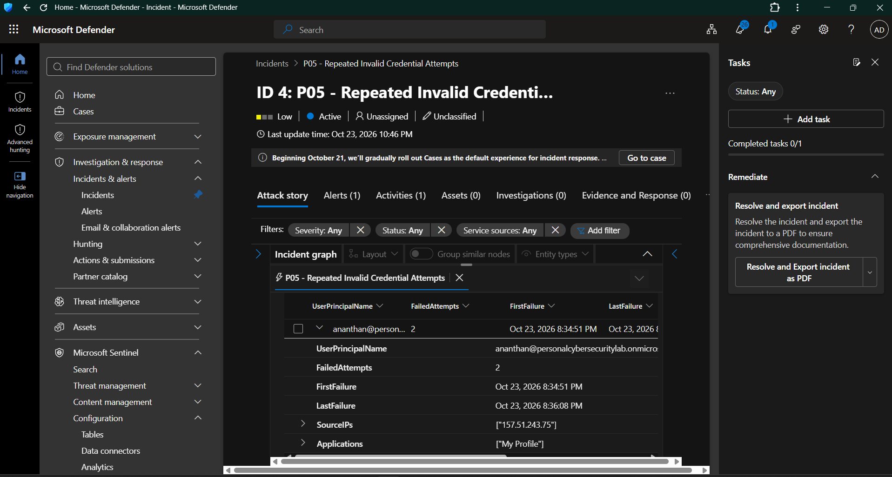

**Screenshot:** `Day13-07-Incident-Alert-Details.png`

The investigation should establish:

1. Which account experienced failed authentication attempts.
2. Whether attempts originated from a single source or multiple sources.
3. Whether a successful sign-in followed the failures.
4. Whether the source address and geographical location were expected.
5. Whether the account exhibited suspicious activity after authentication.
6. Whether containment or escalation is necessary.

The available screenshots demonstrate incident generation and review. They do not independently establish that a real attack succeeded or that an account was compromised.

---

## 6. Microsoft Defender Automation Rules

### 6.1 Automation Rule Baseline

The automation-rule inventory was reviewed to document the configured automation workflow.

**Evidence:**

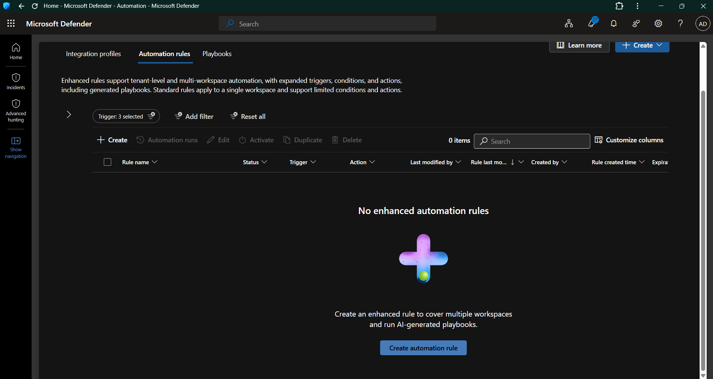

**Screenshot:** `Day13-08-Automation-Rules-Baseline.png`

The lab uses automation rules to support case-management activities following incident creation.

### 6.2 Automation Rule Creation

The rule configuration process included defining the trigger, conditions, and actions for the relevant authentication detection.

**Evidence:**

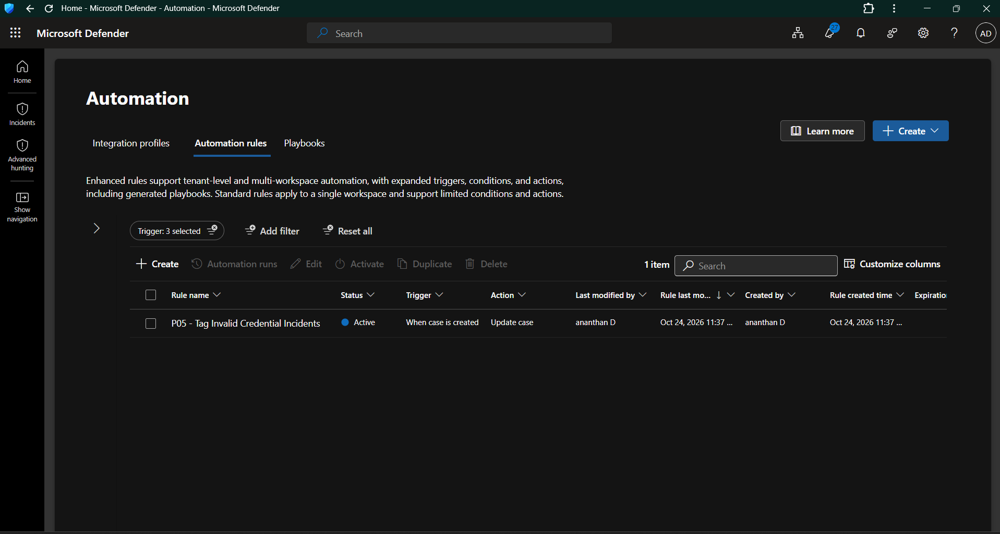

**Screenshot:** `Day13-09-Automation-Rule-Created.png`

The primary tagging workflow uses the following configuration:

| Setting         | Configuration                            |
| --------------- | ---------------------------------------- |
| Rule name       | `P05 - Tag Invalid Credential Incidents` |
| Trigger         | When case is created                     |
| Condition       | Case type equals Incident                |
| Action          | Update case                              |
| Intended result | Apply the `P05-SOC-Lab` tag              |

The rule is designed to identify eligible incident cases and apply a consistent lab tag.

### 6.3 Automation Execution Success

Automation execution history was reviewed to verify whether the configured rule executed successfully.

**Evidence:**

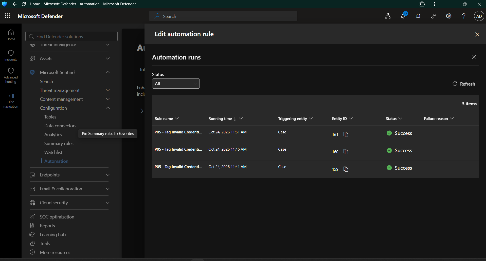

**Screenshot:** `Day13-10-Automation-Execution-Success.png`

The screenshot preserves the execution result recorded by the platform.

### 6.4 Automated Task Configuration

A case-task automation rule was configured to create an investigation task for repeated invalid credential attempts.

**Evidence:**

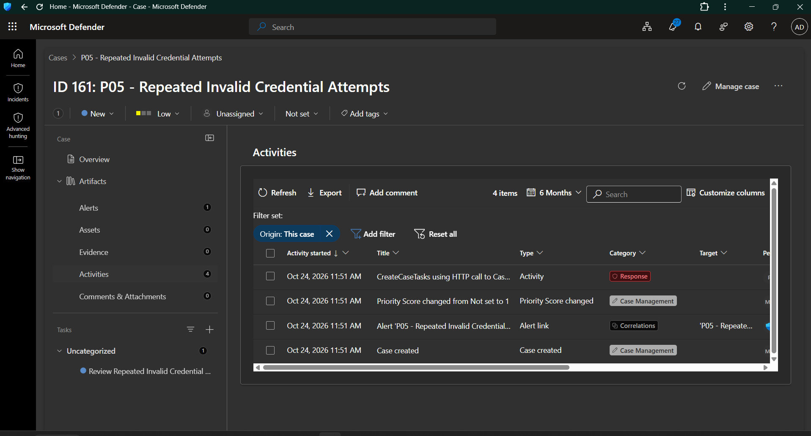

**Screenshot:** `Day13-11-Automated-Task-Verification.png`

The task is intended to guide the analyst through a structured authentication investigation.

**Task name:** `Review Repeated Invalid Credential Attempts`

**Task description:**

Review the affected account and source IP, investigate failed and successful sign-ins, identify suspicious post-authentication activity, and document the investigation findings.

The existence of this task configuration demonstrates workflow design. Actual task creation and task completion should be verified in the corresponding case.

### 6.5 Automation Rules Active

The automation-rule inventory was revisited to confirm the rules' configuration and active status.

**Evidence:**

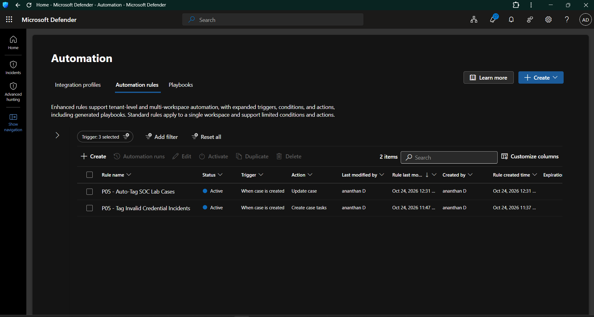

**Screenshot:** `Day13-12-Automation-Rules-Active.png`

The inventory shows the rules used for the case-management workflow.

An active status means the rule is enabled; it does not independently prove that every trigger and condition has been exercised successfully.

### 6.6 Automation Rule Execution Success

The execution history provides evidence of successful automation runs.

**Evidence:**

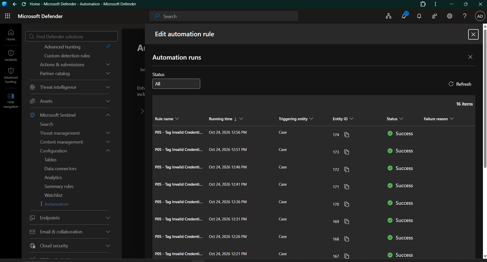

**Screenshot:** `Day13-13-Automation-Rule-Execution-Success.png`

The screenshot records successful execution for the displayed rule and case.

### 6.7 Automated Case-Tag Verification

The case details were reviewed to verify that the `P05-SOC-Lab` tag appeared on the case.

**Evidence:**

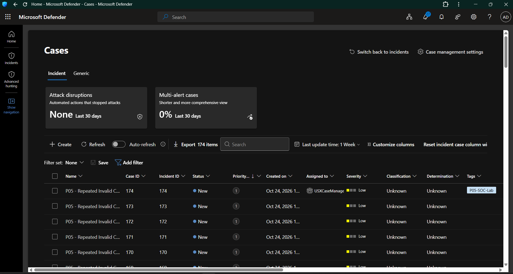

**Screenshot:** `Day13-14-Automated-Case-Tag-Verification.png`

This screenshot supports the presence of the lab tag on the displayed case.

---

## 7. Final Automation Verification

### 7.1 First Automation Rule: Auto-Tag SOC Lab Cases

The rule `P05 - Auto-Tag SOC Lab Cases` was tested through the automation execution history.

**Evidence:**

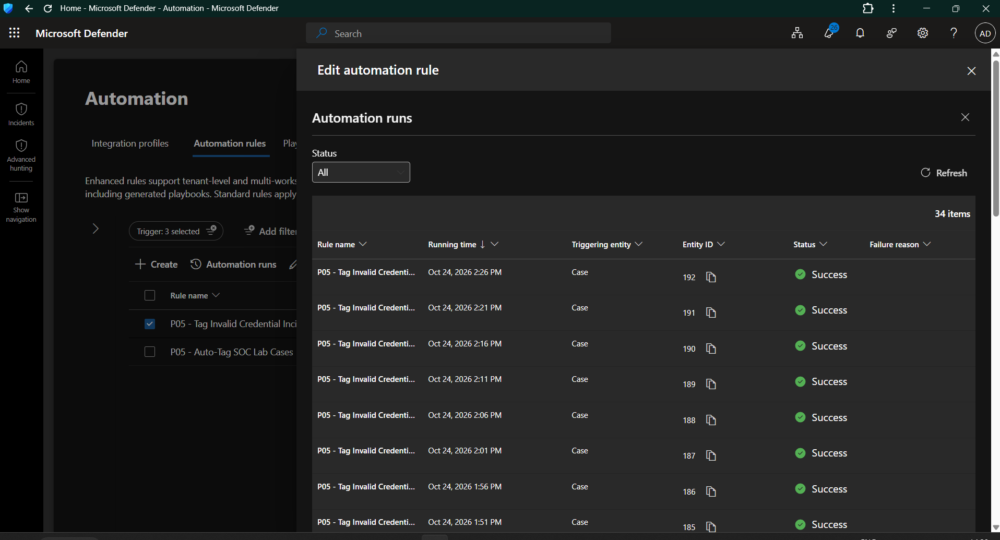

**Screenshot:** `Day13-15-Automation-Execution-New-Cases.png`

The execution history showed a successful run for case ID 196.

### 7.2 Second Automation Rule: Tag Invalid Credential Incidents

The rule `P05 - Tag Invalid Credential Incidents` was tested independently through its execution history.

**Evidence:**

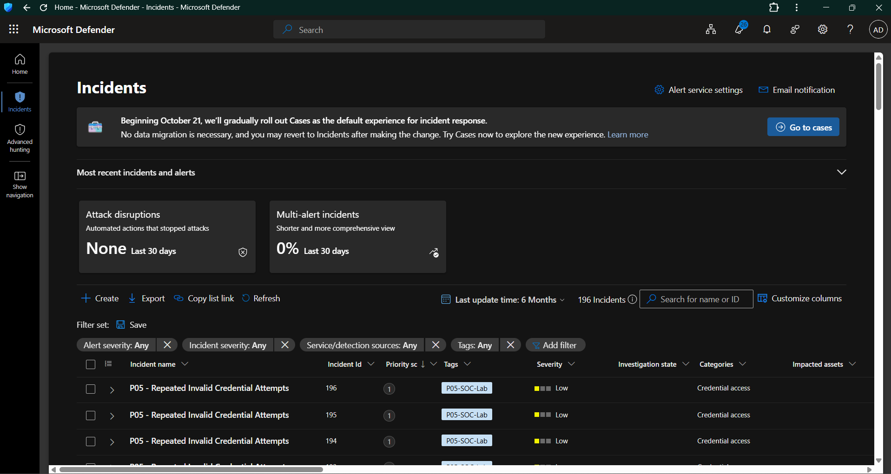

**Screenshot:** `Day13-16-Incident-Tag-Verification.png`

The screenshot captures the incident-tag verification stage.

### 7.3 New Case Tag and Task Verification

The case-management workflow was further examined to document tagging and task-related evidence.

**Evidence:**

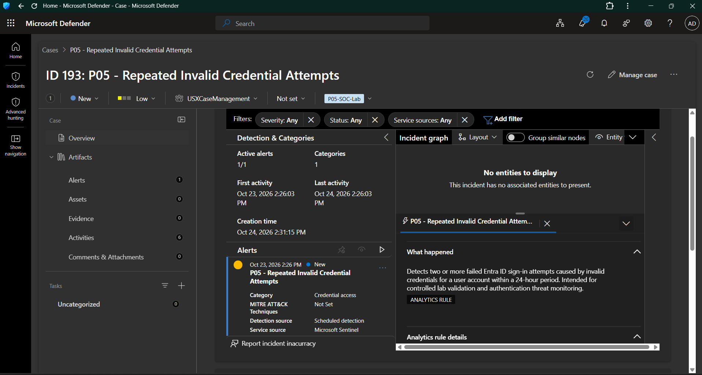

**Screenshot:** `Day13-17-New-Case-Tag-And-Task-Verification.png`

This evidence should be interpreted according to what is actually visible in the screenshot. If a task's creation or completion state is not displayed, it must be verified separately before being marked as complete.

### 7.4 Automation Execution for Additional Cases

The latest automation execution evidence records successful runs for multiple case IDs.

**Evidence:**

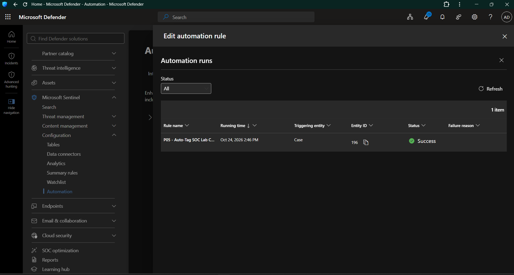

**Screenshot:** `Day13-18-Automation-Execution-Success.png`

### 7.5 Independent Tagging Rule Execution

The execution history for `P05 - Tag Invalid Credential Incidents` showed successful runs for cases including IDs 195, 196, and 197.

**Evidence:**

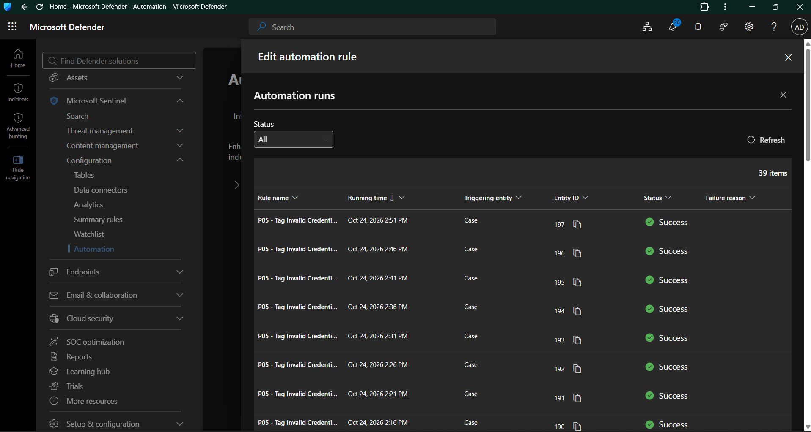

**Screenshot:** `Day13-19-Tag-Automation-Execution-Success.png`

The recorded results support the following observations:

* The tagging rule executed successfully for case 196.
* The tagging rule executed successfully for case 197.
* The tagging rule also showed a successful run for case 195.
* The platform displayed successful execution status for the listed records.

These are observed execution results, not a claim that every case in the environment was processed or that every possible condition was tested.

---

## 8. Validation Matrix

| Test ID | Validation activity                         | Expected result                            | Observed result                                                          | Status                      |
| ------- | ------------------------------------------- | ------------------------------------------ | ------------------------------------------------------------------------ | --------------------------- |
| D13-T01 | Review analytics rule inventory             | Authentication detection is identifiable   | Rule configuration evidence captured                                     | Documented                  |
| D13-T02 | Validate analytics-rule configuration       | Platform validation passes                 | Passed validation screenshot captured                                    | Passed in captured evidence |
| D13-T03 | Generate authentication detection           | Incident is created                        | Repeated invalid credential incidents observed                           | Passed                      |
| D13-T04 | Review incident details                     | Detection context is available             | Incident and alert details captured                                      | Passed                      |
| D13-T05 | Activate automation rules                   | Rules are enabled                          | Active-rule inventory captured                                           | Passed                      |
| D13-T06 | Execute auto-tag rule                       | Execution succeeds for an eligible case    | Successful execution recorded for case 196                               | Passed                      |
| D13-T07 | Execute invalid-credential tagging rule     | Execution succeeds for eligible cases      | Successful runs recorded for cases 195, 196, and 197                     | Passed                      |
| D13-T08 | Verify case tag                             | Intended lab tag appears on the case       | `P05-SOC-Lab` visible on incident records                                | Passed for displayed cases  |
| D13-T09 | Verify investigation task creation          | Investigation task appears on the case     | Task configuration captured; creation requires case-level confirmation   | Pending final confirmation  |
| D13-T10 | Verify task completion                      | Task is completed with documented findings | Completion evidence not established by the current execution screenshots | Not yet validated           |
| D13-T11 | Verify end-to-end behavior across all cases | All eligible cases are processed correctly | Only displayed executions and cases have been verified                   | Partially validated         |

---

## 9. MITRE ATT&CK Mapping

| Detection behavior                             | MITRE ATT&CK technique                     | Technique ID | Relevance                                                                      |
| ---------------------------------------------- | ------------------------------------------ | ------------ | ------------------------------------------------------------------------------ |
| Repeated invalid credential attempts           | Brute Force                                | T1110        | Repeated authentication failures can indicate password guessing                |
| Authentication attempts against cloud accounts | Valid Accounts, when supported by evidence | T1078        | Relevant when an investigation establishes suspicious use of valid credentials |

**Mapping note:** The primary detection maps to T1110. T1078 should be included only when investigation evidence supports suspicious use of valid accounts; failed authentication alone does not establish that behavior.

---

## 10. Troubleshooting Notes

During the lab, automation behavior required additional investigation.

### Issue 1: Automation runs were initially absent

**Observation:** The automation run history initially displayed no execution records.

**Troubleshooting approach:**

* Confirm the rule is active.
* Verify that the trigger is configured as intended.
* Inspect the case type and analytic rule conditions.
* Generate or identify a new eligible case.
* Refresh the execution history.
* Verify the result using the triggering entity and case ID.

**Outcome:** Subsequent screenshots recorded successful execution for multiple cases.

### Issue 2: A visible tag did not initially prove which rule applied it

**Observation:** Cases displayed `P05-SOC-Lab`, but tag presence alone could not identify the rule responsible.

**Troubleshooting approach:**

* Inspect the execution history for each rule independently.
* Match the recorded case ID to the case details.
* Verify the intended tag on the corresponding case.

**Outcome:** Successful execution records were obtained for both automation rules on case 196, while the tag was visibly present on incident records.

### Issue 3: Task configuration and task execution are different validation stages

**Observation:** The task-creation action was configured, but its actual creation and completion were not established solely by the automation inventory.

**Troubleshooting approach:**

* Open a case processed by the task-creation rule.
* Inspect the Tasks section.
* Confirm that the expected investigation task exists.
* Complete the task only after carrying out the investigation.
* Preserve screenshots showing the task and its final status.

**Outcome:** Configuration evidence is available

---

## 11. Security and Operational Considerations

This lab uses controlled authentication testing and synthetic or lab-generated incidents.

The detection is intended to help identify suspicious authentication patterns, but failed logins can also result from legitimate user errors, expired passwords, misconfigured applications, or other benign causes.

A production SOC analyst should correlate the alert with:

* User and account context.
* Source IP address and geographical information.
* Authentication result and error details.
* Successful sign-ins following repeated failures.
* Sign-in frequency and time distribution.
* Relevant endpoint or cloud activity.
* Existing identity protection alerts and risk signals.

Automated tagging improves organization and triage consistency. It should not be treated as proof that an incident is malicious, and it should not automatically replace investigation, classification, escalation, or containment decisions.

---

## 12. Evidence Index

All evidence is stored under `screenshots/Day13/`.

| Evidence                                        | Filename                                              |
| ----------------------------------------------- | ----------------------------------------------------- |
| Analytics rule inventory                        | `Day13-01-Analytics-Rule-List-Empty.png`              |
| Analytics rule validation error                 | `Day13-02-Analytics-Rule-Validation-Error.png`        |
| MITRE ATT&CK tactic selection                   | `Day13-03-MITRE-ATTACK-Tactic-Selection.png`          |
| Analytics rule query configuration              | `Day13-04-Analytics-Rule-Query-Configuration.png`     |
| Analytics rule validation passed                | `Day13-05-Analytics-Rule-Validation-Passed.png`       |
| Generated invalid credential incident           | `Day13-06-Generated-Invalid-Credentials-Incident.png` |
| Incident alert details                          | `Day13-07-Incident-Alert-Details.png`                 |
| Automation rules baseline                       | `Day13-08-Automation-Rules-Baseline.png`              |
| Automation rule created                         | `Day13-09-Automation-Rule-Created.png`                |
| Automation execution success                    | `Day13-10-Automation-Execution-Success.png`           |
| Automated task verification                     | `Day13-11-Automated-Task-Verification.png`            |
| Automation rules active                         | `Day13-12-Automation-Rules-Active.png`                |
| Automation rule execution success               | `Day13-13-Automation-Rule-Execution-Success.png`      |
| Automated case-tag verification                 | `Day13-14-Automated-Case-Tag-Verification.png`        |
| Automation execution for new cases              | `Day13-15-Automation-Execution-New-Cases.png`         |
| Incident tag verification                       | `Day13-16-Incident-Tag-Verification.png`              |
| New case tag and task verification              | `Day13-17-New-Case-Tag-And-Task-Verification.png`     |
| Additional automation execution evidence        | `Day13-18-Automation-Execution-Success.png`           |
| Tagging automation execution for multiple cases | `Day13-19-Tag-Automation-Execution-Success.png`       |

---

## 13. Day 13 Conclusion

Day 13 established and documented an authentication-detection and incident-management workflow using Microsoft Sentinel and Microsoft Defender.

The captured evidence demonstrates incident generation, active automation-rule configuration, successful automation executions, and the presence of the lab tag on displayed cases.

The principal achievement is the successful execution of two case-management automation rules for case 196, with additional successful executions of the invalid-credential tagging rule for cases 195 and 197.

