# Day 15 — End-to-End SOC Investigation and Automation

**Project:** Project 05 — Microsoft Cloud SOC, EDR & Threat Hunting Lab
**Day:** 15
**Status:** Completed
**Focus:** Authentication investigation, incident analysis, KQL-based hunting, case management, and SOC automation
**Platform:** Microsoft Defender, Microsoft Entra ID, Log Analytics
**Environment:** `law-project05-soc`

---

## 1. Executive Summary

Day 15 focused on demonstrating an end-to-end Security Operations Center (SOC) investigation workflow using Microsoft Entra ID authentication telemetry and Microsoft Defender case management.

The investigation covered authentication event analysis, failed and successful sign-in correlation, result-code examination, incident and alert review, automated case tagging, and investigation-task creation.

KQL queries were used to investigate authentication activity associated with a lab account and source IP address. The results were correlated with the associated Defender case, and the case-management automation was verified through execution history and case-state evidence.

The completed lab workflow demonstrates practical skills in authentication investigation, SIEM query development, alert triage, evidence collection, case management, and SOC automation.

### Key Results

| Metric                                                       | Observed Result |
| ------------------------------------------------------------ | --------------: |
| Sign-in events investigated                                  |              20 |
| Successful sign-ins                                          |              11 |
| Invalid-credential failures                                  |               6 |
| Other sign-in events                                         |               3 |
| Defender case reviewed                                       |             513 |
| Associated alerts shown                                      |               1 |
| Lab identification tag verified                              |   `P05-SOC-Lab` |
| Investigation task verified                                  |               1 |
| Automation rules with captured successful execution evidence |               2 |

The authentication figures represent the observed results from the selected account, IP address, and 24-hour query window.

---

## 2. Objectives

The objectives for Day 15 were to:

* Investigate Microsoft Entra ID authentication telemetry using KQL.
* Identify failed and successful sign-in events.
* Analyze authentication result codes and event timestamps.
* Correlate authentication findings with a Defender case and associated alert.
* Review the case's severity, status, and classification.
* Validate automated case tagging.
* Verify investigation-task creation.
* Capture evidence supporting the investigation workflow.
* Document findings in a structured, reproducible format.

**Outcome:** The planned investigation and case-management workflow was demonstrated, and the supporting technical artifacts were documented.

---

## 3. Lab Architecture and Investigation Flow

The investigation used Microsoft Entra ID sign-in logs and Microsoft Defender case-management functionality.

```text
Microsoft Entra ID
       |
       v
   SigninLogs
       |
       v
KQL Authentication Investigation
       |
       +-----------------------------+
       |                             |
       v                             v
Failed Sign-In Analysis       Successful Sign-In Analysis
       |                             |
       +-------------+---------------+
                     |
                     v
          Authentication Findings
                     |
                     v
       Microsoft Defender Case Review
                     |
                     v
                  Case 513
                     |
          +----------+----------+
          |                     |
          v                     v
   Automated Case Tag     Investigation Task
          |                     |
          +----------+----------+
                     |
                     v
          Evidence and Validation
```

The diagram represents the investigation workflow demonstrated in the lab. The KQL investigation and Defender case review were performed as related investigative activities; the diagram does not imply that every queried event was part of the associated alert.

---

## 4. Authentication Investigation

### 4.1 Investigation Scope

The KQL investigation examined sign-in events from the preceding 24 hours for the selected lab account and source IP address.

| Attribute              | Value                                               |
| ---------------------- | --------------------------------------------------- |
| User principal name    | `ananthan@personalcybersecuritylab.onmicrosoft.com` |
| Source IP address      | `157.51.230.238`                                    |
| Location shown in logs | India (`IN`)                                        |
| Applications observed  | Azure Portal; Office365 Shell WCSS-Client           |
| Data table             | `SigninLogs`                                        |
| Query language         | KQL                                                 |

### 4.2 KQL Implementation

The investigation queries are maintained in:

`kql/authentication/day15-end-to-end-investigation.kql`

The query set includes:

1. **Authentication Event Timeline** — retrieves authentication events chronologically.
2. **Authentication Outcome Summary** — summarizes successful, invalid-credential, and other events.
3. **Authentication Result-Code Breakdown** — groups events by result code and description.

These queries support repeatable investigation and provide a structured way to examine authentication behavior.

### 4.3 Authentication Outcome Results

The outcome-summary query returned:

| Authentication metric                                 | Result |
| ----------------------------------------------------- | -----: |
| Total events                                          |     20 |
| Successful sign-ins (`ResultType == "0"`)             |     11 |
| Invalid-credential failures (`ResultType == "50126"`) |      6 |
| Other events                                          |      3 |

The result-code analysis identified the following categories:

| Result code | Meaning                                                     |
| ----------- | ----------------------------------------------------------- |
| `0`         | Successful sign-in                                          |
| `50126`     | Invalid username or password                                |
| `50140`     | Interruption associated with the "Keep me signed in" prompt |

### 4.4 Timeline Analysis

The chronological query showed successful Azure Portal sign-ins, followed by two invalid-credential failures and subsequent successful sign-ins. Successful events associated with Office365 Shell WCSS-Client were also visible.

The two visible `50126` failures occurred approximately 78 seconds apart.

This sequence demonstrates how an analyst can use timestamps, result codes, account information, IP addresses, and application context to investigate authentication behavior.

**Analyst assessment:** The telemetry contains failed and successful sign-ins associated with the same account and IP. The evidence was investigated without treating the observed pattern alone as proof of a confirmed brute-force attack or account compromise.

### Evidence

**Screenshot 01 — Authentication Telemetry Baseline**

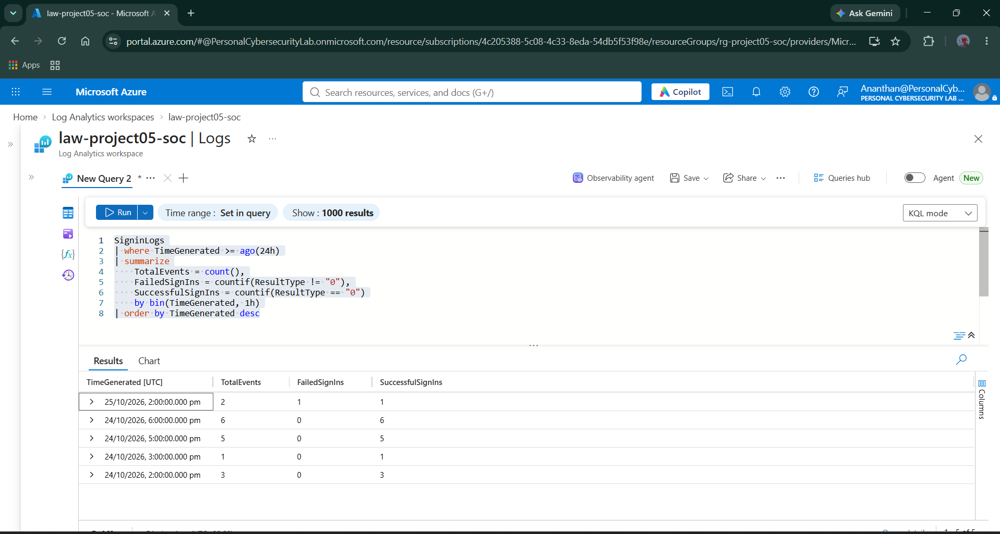

**Screenshot 02 — Failed Sign-In Investigation**

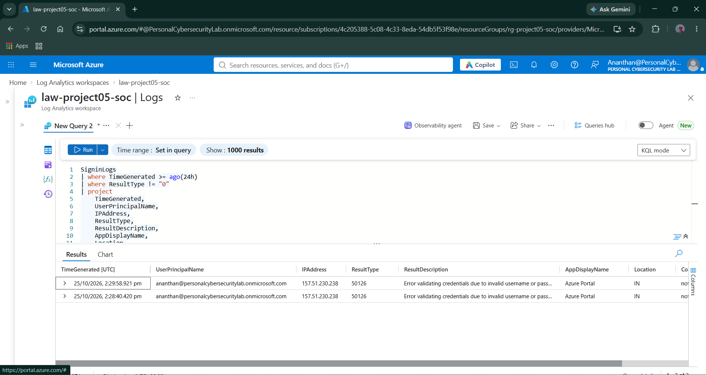

**Screenshot 03 — Failed and Successful Sign-In Correlation**

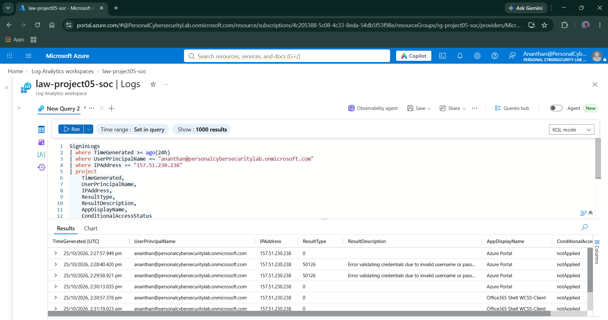

**Screenshot 12 — Authentication Investigation Findings**

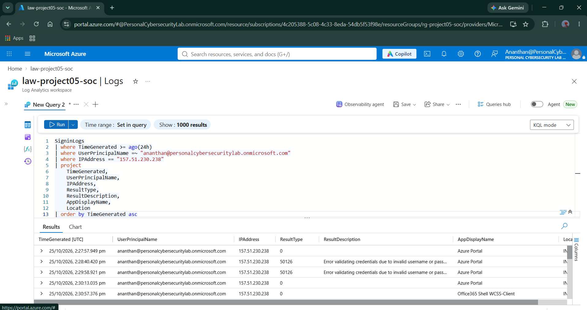

**Screenshot 13 — Authentication Event Summary**

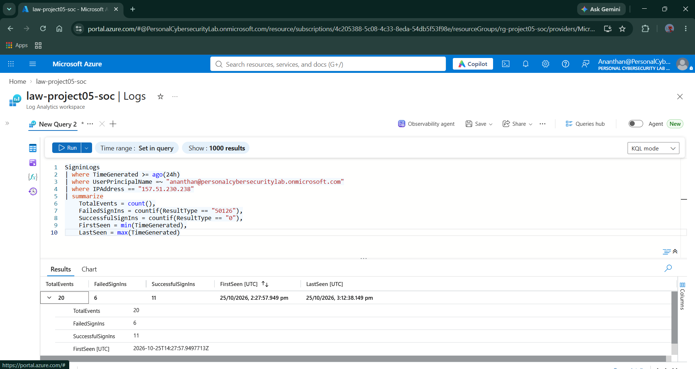

**Screenshot 14 — Authentication Result-Code Analysis**

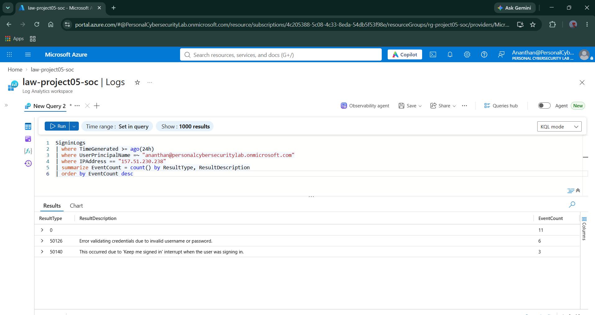

**Screenshot 15 — Authentication Timeline**

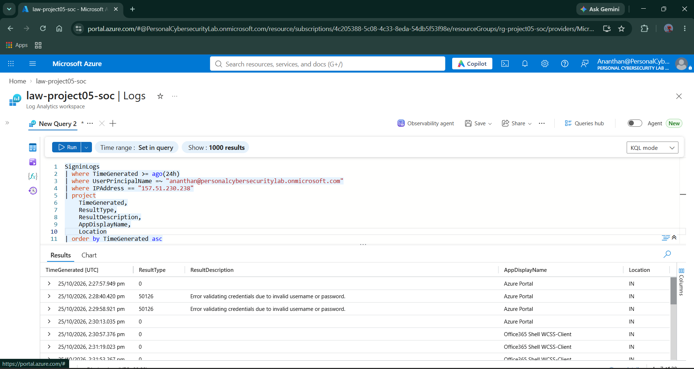

---

## 5. Detection Context

The investigation referenced the existing detection:

| Field                         | Value                                                          |
| ----------------------------- | -------------------------------------------------------------- |
| Detection ID                  | `P05-D06-DET-001`                                              |
| Detection name                | Repeated Authentication Failures                               |
| Data source                   | Microsoft Entra ID                                             |
| Table                         | `SigninLogs`                                                   |
| Detection threshold           | At least 3 failures for the same user and IP within 15 minutes |
| Intended MITRE ATT&CK mapping | `T1110 — Brute Force`                                          |

The detection's logic and validation history are maintained in:

* `detections/day06-repeated-authentication-failures.md`
* `kql/authentication/day06-repeated-authentication-failures.kql`
* `mitre-coverage/day06-authentication-detection-mapping.md`
* `validation/day06-repeated-authentication-failures-validation.md`

The Day 15 investigation's six invalid-credential failures were observed across a 24-hour scope. The aggregate count does not establish that the three-failure threshold was met within an individual 15-minute window.

The `T1110` mapping describes the behavior the detection is designed to identify; it is not a claim that the Day 15 activity was a confirmed brute-force attack.

---

## 6. Microsoft Defender Case Investigation

### 6.1 Case Details

The investigation included a review of the following Defender case.

| Field             | Observed Value                               |
| ----------------- | -------------------------------------------- |
| Case ID           | `513`                                        |
| Case name         | `P05 - Repeated Invalid Credential Attempts` |
| Severity          | Low                                          |
| Status            | Active                                       |
| Classification    | Unclassified                                 |
| Associated alerts | 1                                            |
| Lab tag           | `P05-SOC-Lab`                                |

The case interface showed one associated alert. The incident graph indicated that no entities were available to display.

### 6.2 Investigation Activities

The case review included:

1. Opening the authentication-related case.
2. Reviewing the case's severity and status.
3. Inspecting the associated alert.
4. Verifying the lab identification tag.
5. Opening the Tasks panel.
6. Confirming the investigation task was present.

These activities demonstrate practical incident-review and case-management operations in Microsoft Defender.

### Evidence

**Screenshot 04 — Authentication Incident Inventory**

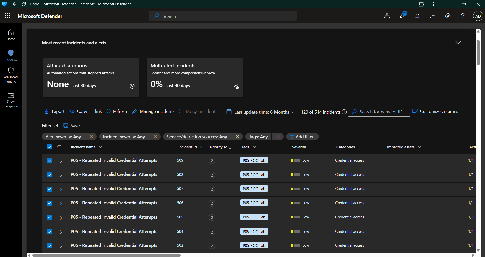

**Screenshot 05 — Incident Details**

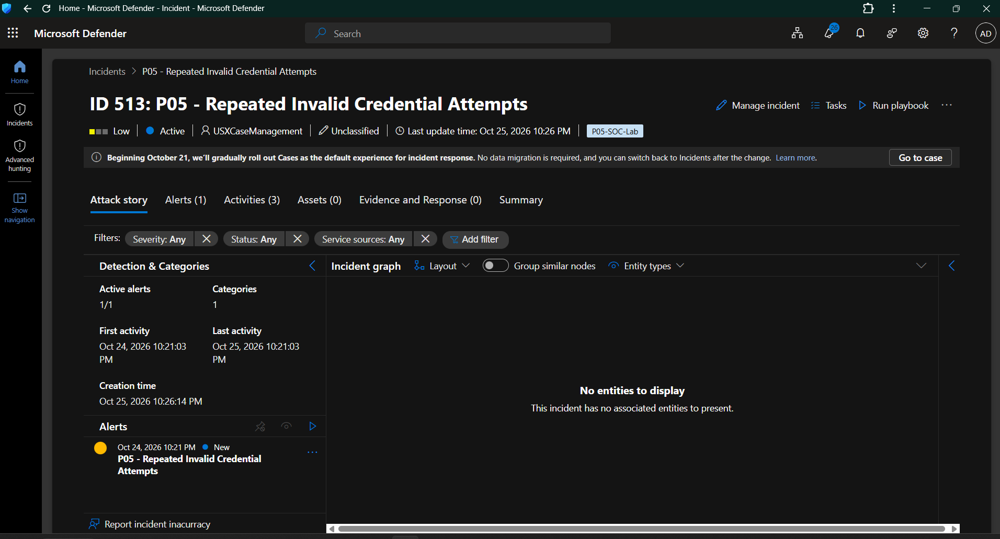

**Screenshot 06 — Associated Alert Details**

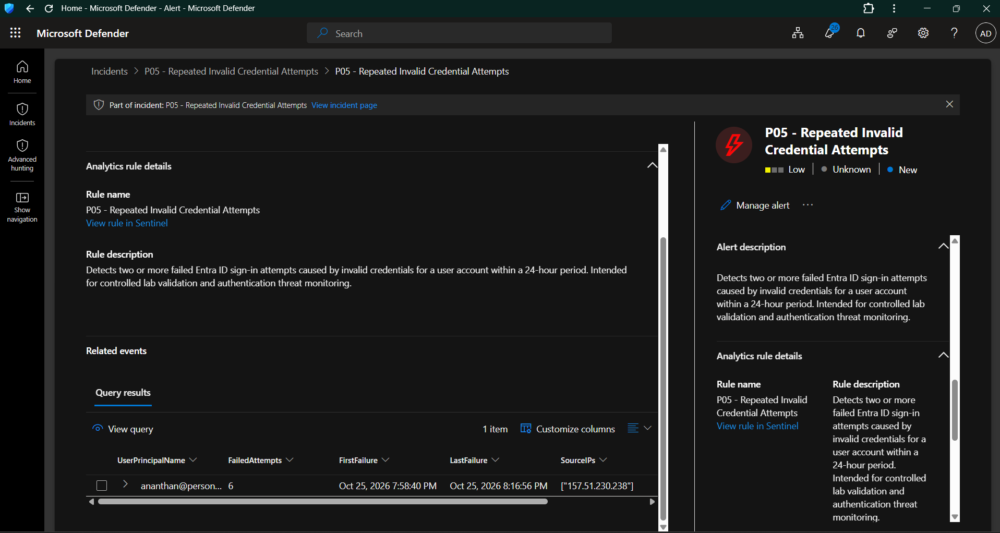

**Screenshot 07 — Case Management Verification**

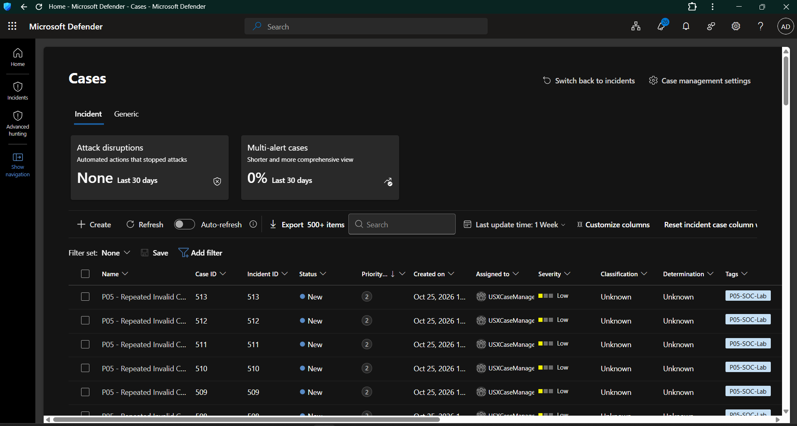

---

## 7. SOC Automation Implementation

Day 15 verified the case-management automation implemented during Day 13.

The existing automation configuration is documented in:

`automation/day13-automation-rules.md`

### 7.1 Rule: P05 - Tag Invalid Credential Incidents

**Purpose:** Apply a consistent lab-identification tag to eligible cases associated with the repeated-invalid-credential detection.

| Setting      | Value                                    |
| ------------ | ---------------------------------------- |
| Rule name    | `P05 - Tag Invalid Credential Incidents` |
| Action       | Update case                              |
| Expected tag | `P05-SOC-Lab`                            |

The captured automation run history showed successful execution records for this rule.

### 7.2 Rule: P05 - Auto-Tag SOC Lab Cases

**Purpose:** Apply the lab-identification tag to eligible SOC lab cases.

| Setting      | Value                          |
| ------------ | ------------------------------ |
| Rule name    | `P05 - Auto-Tag SOC Lab Cases` |
| Action       | Update case                    |
| Expected tag | `P05-SOC-Lab`                  |

The captured automation run history showed successful execution records for this rule.

### 7.3 Automation Verification

The Day 15 workflow verified:

* Successful execution records for the two tagging rules.
* The `P05-SOC-Lab` tag on Case 513.
* The presence of the investigation task in the case.
* The corresponding case-management interface.

The execution records and resulting case state provide evidence that the lab's automation workflow operated as configured for the captured runs.

### Evidence

**Screenshot 08 — Automated Investigation Task**

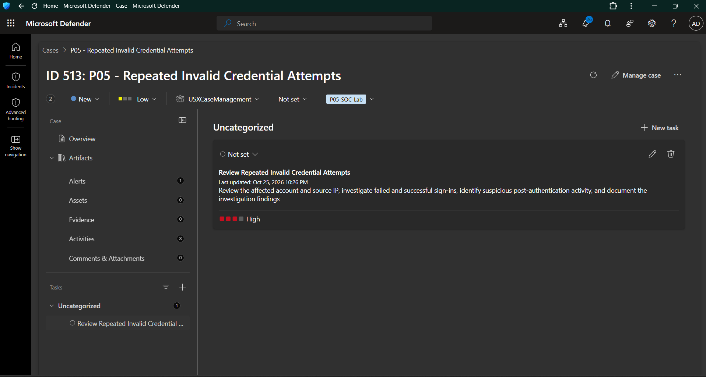

**Screenshot 09 — Tag Automation Execution Success**

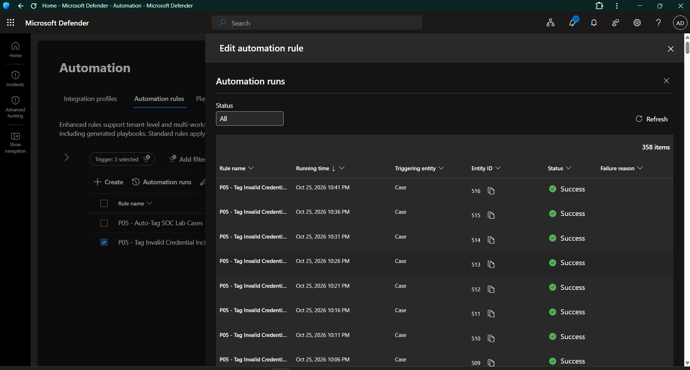

**Screenshot 10 — Task Automation Execution Success**

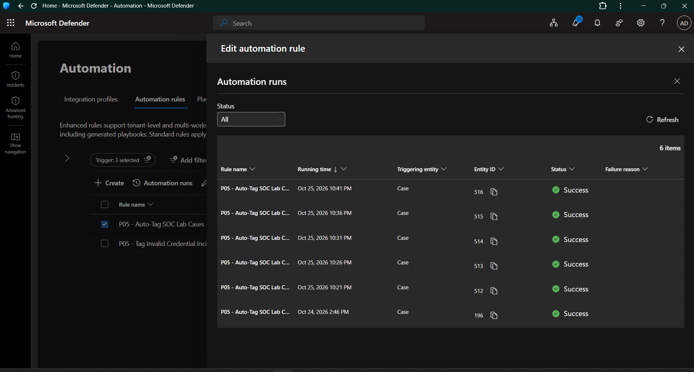

**Screenshot 11 — Case Tag and Task Verification**

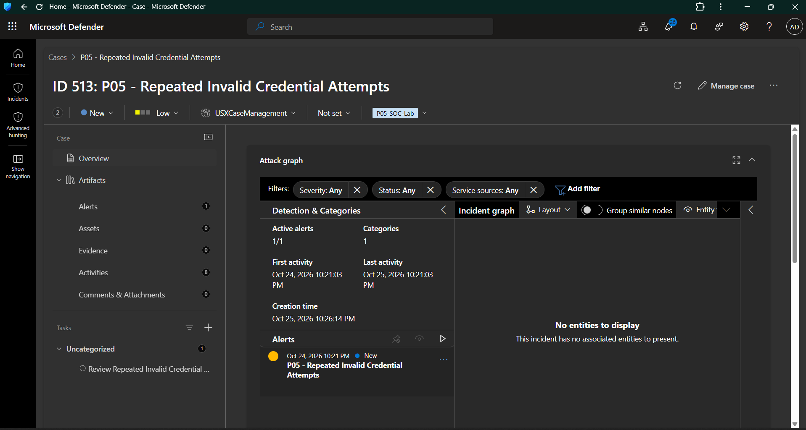

---

## 8. Investigation Task

The following task was present in Case 513:

**Task name:** `Review Repeated Invalid Credential Attempts`

The task description instructs the analyst to review the affected account and source IP, investigate failed and successful sign-ins, identify suspicious post-authentication activity, and document the findings.

| Task attribute | Observed Value |
| -------------- | -------------- |
| Task exists    | Yes            |
| Priority       | High           |
| Status         | Not set        |

The task provides a structured investigation checklist and documents the intended analyst actions for the authentication-related case.

### Evidence

**Screenshot 16 — Final Case Task Verification**

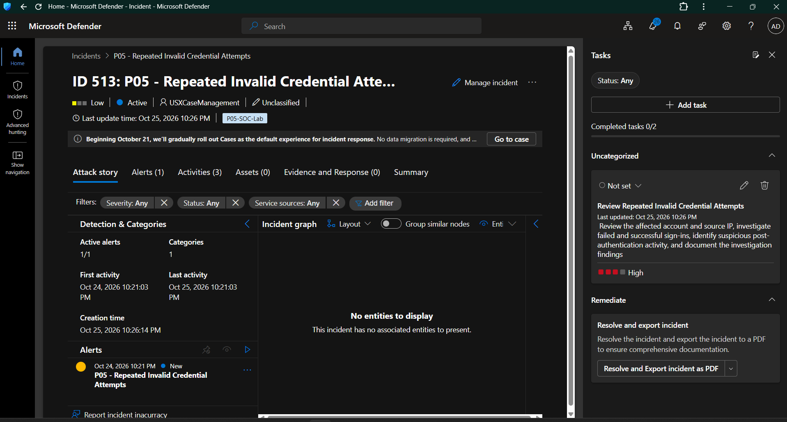

---

## 9. MITRE ATT&CK Context

The related authentication detection is mapped to:

| Field        | Value             |
| ------------ | ----------------- |
| Framework    | MITRE ATT&CK      |
| Tactic       | Credential Access |
| Technique ID | `T1110`           |
| Technique    | Brute Force       |

This mapping reflects the intended behavior of the existing repeated-authentication-failures detection.

The Day 15 investigation demonstrates the analysis of authentication failures and successful sign-ins. It does not independently establish that a brute-force attack occurred.

---

## 10. Technical Artifacts

The Day 15 work is supported by the following repository artifacts.

| Artifact                              | Path                                                              |
| ------------------------------------- | ----------------------------------------------------------------- |
| Authentication investigation KQL      | `kql/authentication/day15-end-to-end-investigation.kql`           |
| Existing authentication detection     | `detections/day06-repeated-authentication-failures.md`            |
| Day 15 detection investigation record | `detections/day15-authentication-investigation.md`                |
| Day 15 investigation report           | `investigations/day15-authentication-incident-investigation.md`   |
| Existing automation configuration     | `automation/day13-automation-rules.md`                            |
| Day 15 automation validation          | `automation/day15-investigation-automation-validation.md`         |
| Existing detection validation         | `validation/day06-repeated-authentication-failures-validation.md` |
| Day 15 end-to-end validation          | `validation/day15-end-to-end-investigation-validation.md`         |
| Existing MITRE mapping                | `mitre-coverage/day06-authentication-detection-mapping.md`        |
| Day 15 evidence screenshots           | `screenshots/Day15/`                                              |

These artifacts separate reusable KQL, detection logic, investigation findings, automation configuration, validation evidence, and screenshot documentation.

---

## 11. Skills Demonstrated

The Day 15 implementation demonstrates practical experience with:

* **KQL:** Filtering, projecting, summarizing, and ordering Microsoft Entra ID sign-in events.
* **Authentication investigation:** Reviewing successful and failed sign-ins, result codes, timestamps, IP addresses, and application context.
* **Alert triage:** Inspecting an authentication-related alert and its associated Defender case.
* **Incident management:** Reviewing case severity, status, classification, tags, and tasks.
* **SOC automation:** Validating automated case-tagging execution and task creation.
* **Evidence collection:** Capturing and organizing investigation screenshots.
* **MITRE ATT&CK:** Referencing the intended technique mapping for a detection.
* **Investigation reporting:** Recording observed results and separating evidence from conclusions.

---

## 12. Day 15 Completion Summary

| Deliverable                            | Status    |
| -------------------------------------- | --------- |
| Authentication investigation KQL       | Completed |
| Authentication event timeline analysis | Completed |
| Authentication result-code analysis    | Completed |
| Detection context reviewed             | Completed |
| Defender case and alert reviewed       | Completed |
| Case-tagging automation verified       | Completed |
| Investigation task verified            | Completed |
| Investigation report created           | Completed |
| Automation validation artifact created | Completed |
| End-to-end validation artifact created | Completed |
| Screenshot evidence organized          | Completed |
| Day 15 documentation                   | Completed |

## Conclusion

Day 15 demonstrated an end-to-end SOC investigation workflow using Microsoft Entra ID authentication telemetry and Microsoft Defender case management.

The work covered KQL-based authentication analysis, result-code review, chronological event investigation, alert and case inspection, automated case tagging, investigation-task creation, and evidence-backed documentation.

The lab recorded 20 sign-in events in the selected investigation scope and verified the case-management automation using captured execution evidence.

**Day 15 Status: COMPLETED**

The investigation workflow and its supporting technical artifacts are documented and organized for portfolio review.
