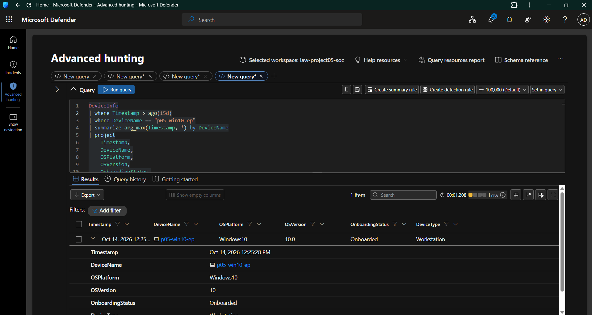
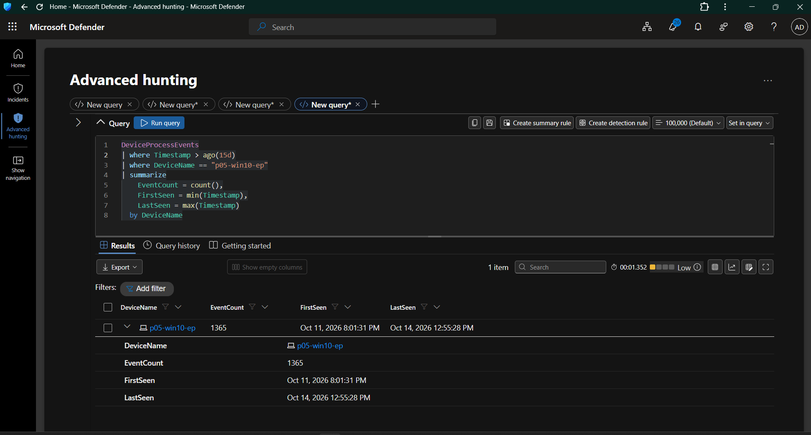
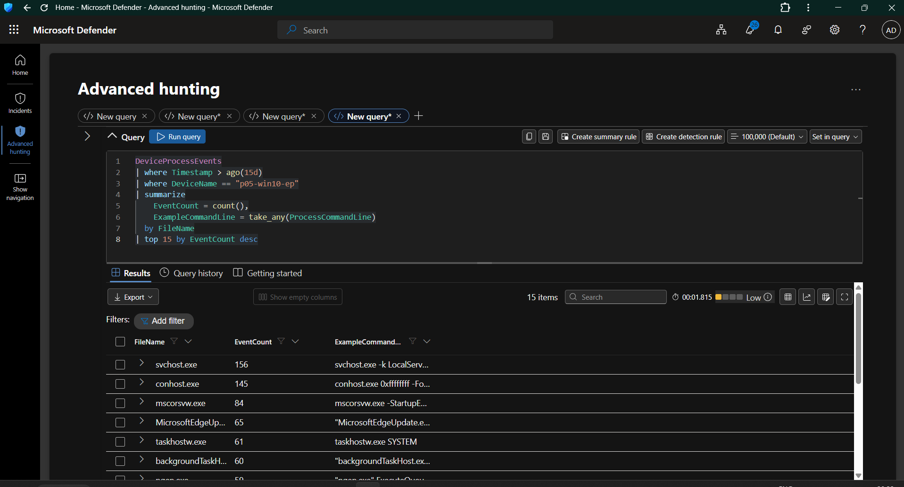
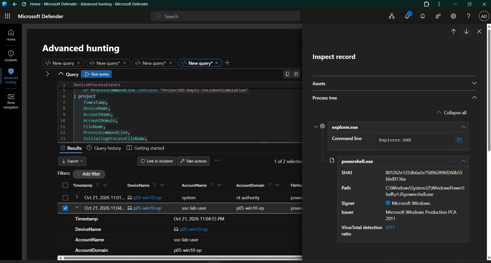
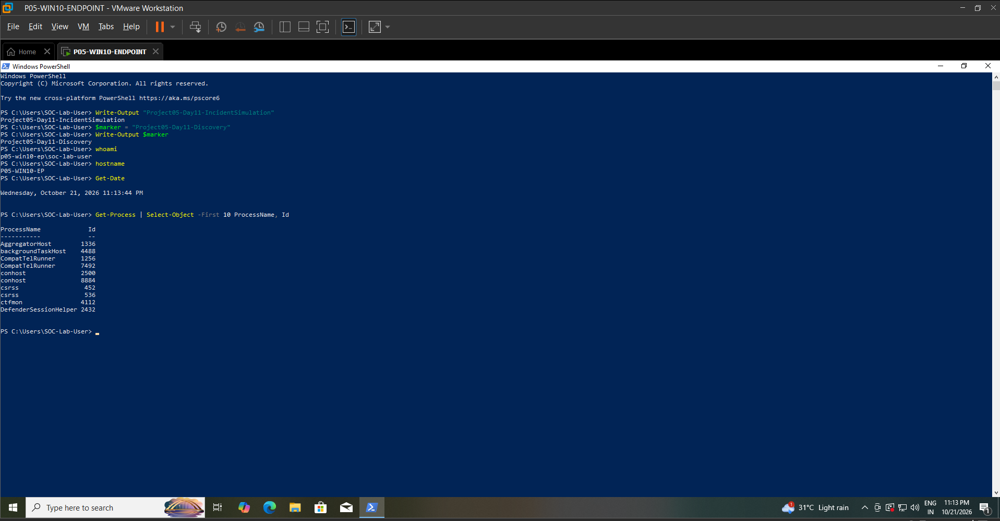
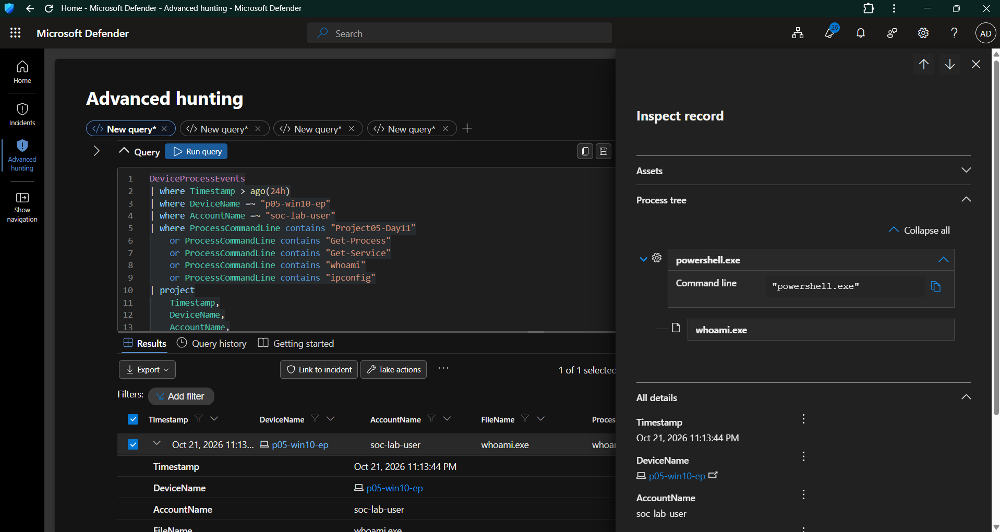

# Day 11 — Endpoint Incident Investigation

## 1. Overview

**Project:** Project 05 — Microsoft Cloud SOC, EDR & Threat Hunting Lab  
**Day:** 11  
**Focus:** Endpoint Incident Investigation  
**Platform:** Microsoft Defender for Endpoint — Advanced Hunting  
**Query Language:** Kusto Query Language (KQL)  
**Endpoint:** `p05-win10-ep`  
**Lab Account:** `soc-lab-user`  
**Investigation Status:** Documented — Controlled Lab Investigation

## 2. Objectives

The objectives of this investigation were to:

- Establish a baseline of endpoint process activity.
- Review endpoint process telemetry collected by Microsoft Defender for Endpoint.
- Investigate PowerShell execution and its initiating process.
- Examine process trees to understand parent-child process relationships.
- Simulate endpoint discovery activity in the lab.
- Review identity and endpoint context associated with the investigation.
- Practice interpreting endpoint evidence without treating every administrative command as malicious.

## 3. Investigation Environment

| Component | Details |
|---|---|
| Endpoint | `p05-win10-ep` |
| Operating system | Windows 10, 64-bit |
| Security platform | Microsoft Defender for Endpoint |
| Investigation interface | Microsoft Defender Advanced Hunting |
| Primary telemetry table | `DeviceProcessEvents` |
| Interactive lab account | `soc-lab-user` |
| Endpoint domain context | Workgroup |
| Query language | KQL |

The endpoint process investigations used the `DeviceProcessEvents` table to examine process execution events, command lines, initiating processes, timestamps, and account context.

## 4. Evidence Collected

### Evidence 01 — Endpoint Baseline



**Purpose:** Establish the endpoint's baseline state and review the environment before examining individual process events.

**Investigation relevance:**
- Provides endpoint context for the investigation.
- Helps establish which device is being examined.
- Supports the distinction between normal endpoint activity and activity requiring additional investigation.

### Evidence 02 — Endpoint Process Telemetry



**Purpose:** Review process execution telemetry collected from the Windows endpoint.

**Investigation relevance:**
- Identifies processes observed by Defender.
- Provides timestamps and account context.
- Supports further investigation of process names, command lines, and initiating processes.

### Evidence 03 — Process Activity Baseline



**Purpose:** Review endpoint process activity and identify relevant events for further analysis.

**Investigation relevance:**
- Establishes a reference point for interpreting process activity.
- Helps identify processes that warrant closer inspection.
- Provides context for subsequent PowerShell and discovery investigations.

### Evidence 04 — PowerShell Incident Execution



**Purpose:** Examine PowerShell process execution and its relationship to the initiating process.

**Investigation observations:**
- A PowerShell process associated with `soc-lab-user` was visible in the process telemetry.
- The process tree showed `explorer.exe` as the parent of the observed interactive PowerShell process.
- The inspected command line was `powershell.exe`.
- The process tree provides useful execution context, but the displayed command line alone does not establish malicious intent.

**Security relevance:**

PowerShell is a legitimate Windows administration tool that can also be abused by attackers. Analysts should investigate the complete command line, parent process, user context, script activity, network connections, and subsequent behavior before classifying an execution as suspicious.

### Evidence 05 — Endpoint Discovery Simulation



**Purpose:** Record the controlled endpoint discovery activity performed in the lab.

**Investigation relevance:**
- Provides evidence of the discovery simulation.
- Supports analysis of commands used to retrieve endpoint or system information.
- Demonstrates how administrative discovery activity can be investigated using endpoint telemetry.

Discovery commands are not inherently malicious. Their significance depends on execution context, the initiating process, the account involved, and whether the activity is consistent with expected administrative behavior.

### Evidence 06 — Identity Context Discovery



**Purpose:** Examine identity-related context associated with the endpoint investigation.

**Investigation relevance:**
- Supports review of the account associated with the observed activity.
- Provides additional context for understanding the endpoint session.
- Demonstrates why analysts should investigate both process behavior and the identity performing the activity.

The available evidence identifies `soc-lab-user` in the endpoint process telemetry. It does not, by itself, establish a direct relationship between this local Windows account and a Microsoft Entra ID identity.

## 5. Investigation Methodology

The investigation followed a structured endpoint analysis workflow.

### Step 1 — Establish endpoint context

The endpoint baseline was reviewed to identify the device and establish the environment under investigation.

### Step 2 — Examine process telemetry

The `DeviceProcessEvents` table was used to review process execution events and relevant fields, including:

- `Timestamp`
- `DeviceName`
- `AccountName`
- `FileName`
- `ProcessCommandLine`
- `InitiatingProcessFileName`
- `InitiatingProcessCommandLine`

### Step 3 — Investigate PowerShell execution

PowerShell events were examined to understand the process command line, account context, and initiating process.

### Step 4 — Review process relationships

The process tree was inspected to understand how the observed PowerShell process was launched.

### Step 5 — Examine discovery activity

Controlled discovery activity was reviewed to understand how commands used to inspect the endpoint can appear in process telemetry.

### Step 6 — Review identity context

The account and endpoint context were examined to support investigation and avoid making unsupported identity-correlation claims.

## 6. KQL Investigation Reference

The following query can be used to review recent PowerShell process events for the lab endpoint.

**Execution environment:** Microsoft Defender Advanced Hunting.

```kusto
DeviceProcessEvents
| where Timestamp > ago(24h)
| where DeviceName =~ "p05-win10-ep"
| where FileName =~ "powershell.exe"
| project
    Timestamp,
    DeviceName,
    AccountName,
    ProcessCommandLine,
    InitiatingProcessFileName,
    InitiatingProcessCommandLine
| order by Timestamp desc
| take 20
```

**Query purpose:** Retrieve recent PowerShell execution events and display the initiating process for investigation.

**Important:** The query returns events available within the selected time range. Its results should be interpreted alongside process-tree evidence and the context of the lab activity.

## 7. Findings

Based on the available screenshots and recorded investigation activity:

1. **Endpoint telemetry was available:** Process execution events were visible for `p05-win10-ep`.
2. **PowerShell execution was observed:** PowerShell process events were present in the endpoint telemetry.
3. **Parent-child process context was available:** The inspected process tree showed `explorer.exe` associated with the interactive PowerShell process.
4. **Controlled discovery activity was performed:** Endpoint discovery and identity-context investigation were documented through the available evidence.
5. **Identity context was reviewed:** The endpoint events included the account `soc-lab-user`.
6. **Malicious activity was not established by these screenshots alone:** The observed commands and process relationships require contextual analysis before a malicious classification can be justified.

## 8. Limitations

This investigation has the following limitations:

- The screenshots represent selected observations rather than a complete export of all endpoint events.
- The available evidence does not establish that the endpoint was compromised.
- The presence of PowerShell or discovery commands is not sufficient evidence of malicious activity.
- The available screenshots do not independently establish persistence, privilege escalation, data exfiltration, or command-and-control activity.
- A direct mapping between the local Windows account and a Microsoft Entra ID identity has not been established.
- No claim of successful containment or remediation is made in this report.

## 9. Conclusion

Day 11 focused on investigating endpoint process activity through Microsoft Defender Advanced Hunting.

The investigation reviewed endpoint telemetry, PowerShell execution, process-tree relationships, controlled discovery activity, and identity context. These activities demonstrate a repeatable workflow for examining endpoint events and gathering evidence during a SOC investigation.

The evidence supports the conclusion that the relevant endpoint telemetry and process relationships were investigated. It does not independently prove that a real compromise occurred.

The next stage of the project will build on this work by documenting investigation findings and practicing appropriate incident response decisions.

## 10. Evidence Index

| Evidence ID | Screenshot | Description |
|---|---|---|
| E-01 | `Day11-01-Endpoint-Baseline.png` | Endpoint baseline |
| E-02 | `Day11-02-Endpoint-Process-Telemetry.png` | Endpoint process telemetry |
| E-03 | `Day11-03-Process-Activity-Baseline.png` | Process activity baseline |
| E-04 | `Day11-04-PowerShell-Incident-Execution.png` | PowerShell execution and process tree |
| E-05 | `Day11-06-Endpoint-Discovery-Simulation.png` | Endpoint discovery simulation |
| E-06 | `Day11-07-Identity-Context-Discovery.png` | Identity-context discovery |

All screenshots are stored in `screenshots/Day11/`.

## 11. Chronological Timeline and Incident Assessment

### 12.1 Timeline of Observed Activity

The following timeline uses timestamps observed in the investigation screenshots. It describes the recorded events without assuming that they represent a real attack.

| Time (October 21, 2026) | Event | Evidence | Assessment |
|---|---|---|---|
| 23:01:38 | PowerShell process event associated with the incident simulation was observed. | Day11-04-PowerShell-Incident-Execution.png | Controlled simulation activity; investigate process context. |
| 23:04:15 | PowerShell execution associated with `soc-lab-user` was observed, with `explorer.exe` as the initiating process. | Day11-04-PowerShell-Incident-Execution.png | Interactive PowerShell execution observed. |
| 23:13:44 | `whoami.exe` was observed running under `soc-lab-user`, with PowerShell as its initiating process. | Day11-07-Identity-Context-Discovery.png | Consistent with the intended identity-discovery simulation. |

**Timeline limitation:** These are selected observations from the available screenshots, not a complete reconstruction of all endpoint activity. The events must not be interpreted as proof of identity compromise.

### 12.2 Identity Assessment

The endpoint telemetry identifies `soc-lab-user` as the account associated with the investigated process activity.

The available evidence does not establish:
- A successful compromise of the account.
- An unauthorized authentication event linked to the endpoint activity.
- A direct relationship between the local Windows account and a Microsoft Entra ID identity.
- Whether an attacker gained access to the account.

**Assessment:** Identity compromise remains unconfirmed.

### 12.3 Endpoint and Scope Assessment

The primary endpoint investigated was `p05-win10-ep`.

The available evidence confirms that process telemetry was reviewed on this device. It does not establish whether other devices or accounts were affected.

**Assessment:** Investigation scope is limited to the available evidence for the examined endpoint. A broader compromise has not been established.

### 12.4 Persistence Assessment

The available evidence does not establish the creation of a scheduled task, registry autorun, service, or another persistence mechanism.

No claim is made that persistence was comprehensively ruled out.

**Assessment:** Persistence is unverified.

### 12.5 Recommended Containment Actions

If similar activity were associated with a confirmed compromise in a production environment, recommended actions would include:

1. Validate the alert and preserve relevant endpoint and identity evidence.
2. Investigate authentication events and determine whether the account was accessed without authorization.
3. If compromise is confirmed, disable or restrict the affected account according to organizational procedures and revoke active sessions where appropriate.
4. Isolate the endpoint through the approved EDR response workflow if evidence indicates an active threat.
5. Investigate persistence, lateral movement, and additional affected assets.
6. Remediate the confirmed cause and verify recovery before returning the endpoint to normal operation.

These are recommendations only. The available lab evidence does not show that containment or remediation was performed.

### 12.6 Final Incident Conclusion

The Day 11 exercise demonstrated endpoint process investigation, PowerShell analysis, process-tree review, and identity-context examination using Microsoft Defender telemetry.

The observed discovery activity was intentionally generated for the lab simulation. The available evidence does not establish a genuine identity compromise or a confirmed malicious incident.

The investigation is therefore documented as a **controlled endpoint investigation with identity compromise, persistence, and broader scope unconfirmed**.